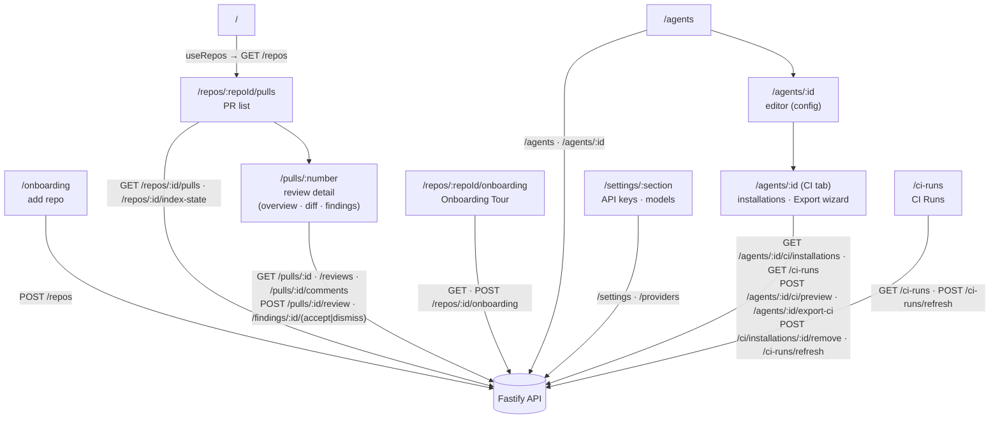

# `@devdigest/web` — the studio (Next.js 15)

The DevDigest UI: import repos, browse pull requests, run and read AI reviews,
and author agents. App Router + React Server/Client components, data via
**TanStack Query** hooks over the Fastify API. (This is the starter surface;
course lessons add the Skills, Memory, Eval, Blast/Brief, multi-agent, CI, and
dashboard screens.)

- **Stack:** Next.js 15 (App Router), React 19, TanStack Query, `next-intl`
  (messages in `messages/<locale>/*.json`), `recharts`, `mermaid`,
  `react-markdown`. UI primitives are vendored under `src/vendor/ui`
  (`@devdigest/ui`) and shared Zod contracts under `src/vendor/shared`
  (`@devdigest/shared`).
- **API base:** `NEXT_PUBLIC_API_BASE` (default `http://localhost:3001`), used by
  `src/lib/api.ts`. Every data hook lives in `src/lib/hooks/*`.
- **Run:** `pnpm dev` (`:3000`). **Test:** `pnpm test` (vitest + jsdom, fetch
  mocked — no API needed). **Typecheck:** `pnpm typecheck`.

## UI route map

Routes (`src/app/**/page.tsx`) and the API surface each leans on (via
`src/lib/hooks/*` → `src/lib/api.ts`):

### Export to CI

Hooks: [`src/lib/hooks/ci.ts`](src/lib/hooks/ci.ts); server routes:
[`../server/src/modules/ci/routes.ts`](../server/src/modules/ci/routes.ts).

| Surface | Code | Hook → API call |
|---|---|---|
| `/ci-runs` page (nav "CI Runs") | [`src/app/ci-runs/_components/CiRunsView`](src/app/ci-runs/_components/CiRunsView/CiRunsView.tsx) | `useCiRuns` → `GET /ci-runs` (filters as query string); `useCiAutoRefresh` → `POST /ci-runs/refresh` |
| Agent editor **CI** tab (`/agents/:id`) | [`CiTab`](src/app/agents/[id]/_components/AgentEditor/_components/CiTab/CiTab.tsx) | `useCiInstallations` → `GET /agents/:id/ci/installations`; `useCiRuns({ agent })` → `GET /ci-runs`; `useCiAutoRefresh(agentId)` → `POST /ci-runs/refresh` with `{ agent_id }` |
| Export wizard (4 steps: Target, Preview, Configure, Install; opened from the CI tab) | [`ExportWizard`](src/app/agents/[id]/_components/AgentEditor/_components/CiTab/_components/ExportWizard/ExportWizard.tsx) | `useCiPreview` → `POST /agents/:id/ci/preview`; `useExportCi` → `POST /agents/:id/export-ci` |
| Remove dialog (from an installation row) | [`RemoveInstallationDialog`](src/app/agents/[id]/_components/AgentEditor/_components/CiTab/_components/RemoveInstallationDialog/RemoveInstallationDialog.tsx) | `useRemoveCiInstallation` → `POST /ci/installations/:id/remove` |

- **Auto-refresh:** `useCiAutoRefresh` posts on mount, on window focus and every
  60 s while the tab is visible, then invalidates the runs and installations
  queries. A GitHub failure is returned as data and shown by
  [`CiRefreshBanner`](src/components/ci-refresh-banner/CiRefreshBanner.tsx)
  with Retry, not as a global toast.
- **Errors:** the preview, export and remove mutations set
  `meta.silentError`; the wizard and dialog render their own inline errors.
- **Cache:** export and remove invalidate all CI installations queries.

Cross-cutting chrome lives in `src/components/app-shell` (nav, breadcrumbs,
`g`-then-key shortcuts). Pages are thin; feature logic sits in colocated
`_components/<Name>/` folders, each with its own `*.test.tsx`.

## Testing

Component/interaction tests (`*.test.tsx`) run under vitest + jsdom with `fetch`
mocked, so they need neither the API nor a browser. The real browser journeys
(client + API + seeded DB) are covered by the deterministic agent-browser suite
in [`../e2e`](../e2e/README.md) and the `e2e-web.yml` workflow. See
[`../TESTING.md`](../TESTING.md).
