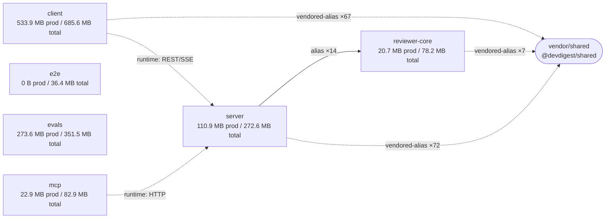

# DevDigest Dependency Report
**Date:** 2026-10-14  
**Mode:** Offline (no `pnpm audit` or `pnpm outdated`)  
**Repo structure:** Shared code via TypeScript path aliases + vendored `@devdigest/shared` copies (not workspace packages)

---

## Executive Summary

**3 P1 findings, 2 P2 findings, 4 P3 findings:**

| Priority | Issue | Impact | Action |
|----------|-------|--------|--------|
| **P1** | Vendor drift: client and server `shared` copies diverged (5 files) | May cause runtime inconsistency between UI and backend | Synchronize `client/src/vendor/shared` and `server/src/vendor/shared` |
| **P2** | Internal cycles in server (brief↔db, adapters↔blast↔repo-intel) | Complicates refactoring; breaks single-responsibility | Review and break cycles or document as required |
| **P2** | @types/node version scatter (5 versions: 22.19.19→22.20.5) | Type conflicts in monorepo; false positives in linting | Align all packages to `22.20.5` in `pnpm-lock.yaml` |
| **P3** | tsx version scatter (3 versions: 4.22.4→4.23.15) | Minor risk; ranges should align | Bump evals to `^4.23.15` |
| **P3** | Unused candidates: postcss, testcontainers, @fastify/autoload, tsx | Possible bloat or config drift | Verify and remove each (step-by-step below) |

**No critical security flags; license compliance OK** (one Unknown license on agent SDK flagged but acceptable for internal tooling).

---

## Package Graph



**Key topology:**
- **Vendored copies**: All three main packages (client, reviewer-core, server) import from their local `vendor/shared` via TypeScript path alias `@devdigest/shared`.
- **Code sharing**: server → reviewer-core (14 imports, not vendored) via path alias.
- **Runtime**: client ↔ server via REST/SSE; mcp ↔ server via HTTP.

---

## Dependency Sizes

| # | Package | Dependency | Kind | With transitive |  |
|---|---|---|---|---|---|
| 1 | client | `next-intl` | prod | 325.3 MB | ████████████████████ |
| 2 | client | `next` | prod | 320.3 MB | ████████████████████ |
| 3 | evals | `@anthropic-ai/claude-agent-sdk` | prod | 258.8 MB | ████████████████ |
| 4 | client | `mermaid` | prod | 138.0 MB | ████████ |
| 5 | client | `eslint-config-next` | dev | 82.7 MB | █████ |
| 6 | client | `vitest` | dev | 61.5 MB | ████ |
| 7 | client | `@vitejs/plugin-react` | dev | 55.6 MB | ███ |
| 8 | server | `drizzle-kit` | dev | 48.3 MB | ███ |
| 9 | server | `@testcontainers/postgresql` | dev | 42.3 MB | ███ |
| 10 | server | `testcontainers` | dev | 42.2 MB | ███ |
| 11 | client | `lucide-react` | prod | 36.5 MB | ██ |
| 12 | evals | `vitest` | dev | 35.7 MB | ██ |
| 13 | server | `vitest` | dev | 35.7 MB | ██ |
| 14 | client | `recharts` | prod | 26.7 MB | ██ |
| 15 | mcp | `vitest` | dev | 26.5 MB | ██ |

**Per-package totals (de-duplicated):**
- **client**: 559.9 MB prod, 159.0 MB dev-only → 718.9 MB unique
- **evals**: 286.9 MB prod, 81.7 MB dev-only → 368.6 MB unique
- **server**: 116.3 MB prod, 169.5 MB dev-only → 285.8 MB unique
- **mcp**: 24.0 MB prod, 62.9 MB dev-only → 86.9 MB unique
- **reviewer-core**: 21.7 MB prod, 60.3 MB dev-only → 82.0 MB unique
- **e2e**: 0 B prod, 38.2 MB dev-only → 38.2 MB unique

**Notes:**
- Sizes are **install footprint on disk**, not bundle sizes (next/next-intl/mermaid don't directly control what ships to browser).
- evals' large prod footprint (286.9 MB) is driven by claude-agent-sdk (258.8 MB) — appropriate for an evals runner.
- Do not sum `withDepsBytes` across packages; transitive closures overlap in the pnpm store.

---

## Version Drift

**Installed version mismatch detected:**

### @types/node — 5 different patches

| Package | Installed | Range |
|---------|-----------|-------|
| client | 22.19.19 | ^22.10.0 |
| server | 22.19.19 | ^22.10.0 |
| e2e | 22.20.5 | ^22.10.0 |
| mcp | 22.20.4 | ^22.10.0 |
| evals | 22.20.0 | ^22.0.0 |
| reviewer-core | 22.20.3 | ^22.10.0 |

**Impact:** Type inconsistencies in shared code paths (vendor, aliases). Ranges are correct but resolutions diverged.  
**Action (P2):** In `pnpm-lock.yaml`, update all to `22.20.5` by running (do not edit lockfile by hand):
```bash
pnpm update @types/node --workspace-root
```
Or synchronize each package's resolved version via `pnpm install --force` after reconciling one source of truth.

---

### tsx — 3 different patches

| Package | Installed | Range |
|---------|-----------|-------|
| e2e | 4.23.15 | ^4.19.2 |
| mcp | 4.23.15 | ^4.19.2 |
| reviewer-core | 4.23.13 | ^4.19.2 |
| evals | 4.22.4 | ^4.19.0 |
| server | 4.22.4 | ^4.19.2 |

**Impact:** Minor; all are patch versions within compatible ranges. Evals has a looser range (`^4.19.0`).  
**Action (P3):** Align evals to `^4.19.2` (or update all to `^4.23.15`):
```bash
cd evals && pnpm add -D tsx@^4.23.15
```

---

### Minor: Range drift (no installed version conflict)

- **zod**: reviewer-core at `^3.24.1`, mcp at `^3.25.76`. Same installed version; no action needed.
- **vitest**: evals at `^2.1.0`, others at `^2.1.8`. Same installed version; no action needed.
- **typescript**: evals at `^5.6.0`, others at `^5.7.2`. Same installed version; no action needed.

---

## Vendor Drift ⚠️

**Files in `client/src/vendor/shared` and `server/src/vendor/shared` do NOT match:**

```
Files client/src/vendor/shared/adapters.ts and server/src/vendor/shared/adapters.ts differ
Files client/src/vendor/shared/contracts/eval-ci.ts and server/src/vendor/shared/contracts/eval-ci.ts differ
Files client/src/vendor/shared/contracts/knowledge.ts and server/src/vendor/shared/contracts/knowledge.ts differ
Files client/src/vendor/shared/contracts/productionize.ts and server/src/vendor/shared/contracts/productionize.ts differ
Files client/src/vendor/shared/contracts/trace.ts and server/src/vendor/shared/contracts/trace.ts differ
```

**Impact (P1 — High):** Packages may assume different contract shapes, leading to:
- Serialization/deserialization mismatches (trace, eval-ci, knowledge contracts)
- Adapter behavior divergence (e.g., auth, embedder, codeindex)
- Silent data corruption if schemas collide but differ

**Action:**
1. **Identify the source of truth**: Is there a shared source repo (e.g., via git submodule, git worktree, or npm package) that both should pull from?
2. **If yes**: Replace both vendored copies by linking to the shared source or automating sync.
3. **If no**: Audit each differing file pair (`diff -u client/src/vendor/shared/adapters.ts server/src/vendor/shared/adapters.ts`) and decide which version is correct for each. Then apply to both.
4. **Lock it**: Document the sync process in README#dev or add a pre-commit hook to detect and prevent future divergence.

---

## Unused Candidates

The script identified 4 dependencies that have no direct code references. **These are candidates; verify before removing:**

### 1. postcss (client, dev) — likely peer dependency

**Marked:** `unused-candidate` | Own: 348 KB | Transitive: 671 KB  
**Likely use:** Peer of Tailwind CSS or other PostCSS-based tooling.

**Verify:**
```bash
grep -r "postcss" client/src client/package.json client/postcss.config.* || echo "No direct imports or config found"
```
- If Tailwind or another CSS framework is in client's `package.json`, postcss is likely required (check their `peerDependencies`).
- If not found, it's safe to remove.

**Action:** Verify, then remove if unused:
```bash
cd client && pnpm remove postcss
```

---

### 2. testcontainers (server, dev) — parent of used @testcontainers/postgresql

**Marked:** `unused-candidate` | Own: 1.2 MB | Transitive: 42.2 MB  
**Likely issue:** @testcontainers/postgresql is used, but its parent package is listed separately.

**Verify:**
```bash
grep -r "testcontainers" server/src server/vitest.config.ts server/package.json | grep -v "@testcontainers/postgresql"
```
- If no direct imports to the generic `testcontainers` package, it may be an implicit transitive dep re-exposed as direct for clarity, or a peer of @testcontainers/postgresql.

**Action:** Check if it's a peerDependency of @testcontainers/postgresql. If not used directly, remove:
```bash
cd server && pnpm remove testcontainers
```

---

### 3. @fastify/autoload (server, prod) — may be used dynamically

**Marked:** `unused-candidate` | Own: 1.2 MB | Transitive: 1.2 MB  
**Likely use:** Plugin auto-loader for Fastify; typically used via `fastify.register(...)` or config.

**Verify:**
```bash
grep -r "fastify/autoload" server/src || grep -r "autoload" server/src
```
- Check `server/src/app.ts` or `server/src/index.ts` for `fastify.register(fastifyAutoload, ...)`.
- Check any Fastify configuration files (e.g., `fastify.config.js`, plugin registry).

**Action:** If found, keep. If not, check whether the routes directory uses auto-loading; if not, remove:
```bash
cd server && pnpm remove @fastify/autoload
```

---

### 4. tsx (reviewer-core, dev) — inconsistent marking across packages

**Marked:** `unused-candidate` in reviewer-core | Own: 692 KB | Transitive: 11.6 MB  
**Note:** In e2e and mcp, tsx is marked `used-via-script`.

**Verify:**
```bash
grep -r "tsx" reviewer-core/package.json reviewer-core/scripts
```
- Check if reviewer-core has any TypeScript scripts that need tsx to run.

**Action:** If reviewer-core has TS scripts (e.g., `"scripts": { "bench": "tsx src/bench.ts" }`), keep it. Otherwise, remove:
```bash
cd reviewer-core && pnpm remove tsx
```

---

## Internal Cycles

### mcp — 1 real cycle (not composition-root-only)

**Cycle:** `gateway ↔ lib`

**Impact (P2):** Limits modular organization; complicates testing and tree-shaking.  
**Severity:** Low (one edge pair, small packages).

**Action:** 
1. Identify the cycle by checking imports in `mcp/src/gateway` and `mcp/src/lib`.
2. Refactor to break it (e.g., move shared logic to a separate module, or use dependency injection).

---

### server — 14 cycles; 2 real (not composition-root-only)

**Cycles:**
1. `brief ↔ db`
2. `adapters ↔ blast ↔ repo-intel`

**Impact (P2):** Complicates schema refactoring (brief/db share query builders); blast and repo-intel are interdependent on external services.  
**Severity:** Moderate (business logic entanglement).

**Action:**
1. **brief ↔ db**: Extract common query patterns to `server/src/lib/queries/` or similar, breaking the cycle.
2. **adapters ↔ blast ↔ repo-intel**: Review whether blast (project analysis) and repo-intel (knowledge) can be dependency-injected or split by responsibility.

---

### client, evals, reviewer-core — No cycles ✓

---

## License Compliance

One flagged license:

| Package | Version | License | Packages | Notes |
|---------|---------|---------|----------|-------|
| @anthropic-ai/claude-agent-sdk | 0.3.198 | **Unknown** | evals | Flagged as unknown by pnpm; check package source. Likely proprietary Anthropic SDK. |

**Action:** Acceptable for internal tooling. If this package will be redistributed (published to npm), confirm the actual license with Anthropic SDK maintainers or source repo.

---

## Summary: What to Fix First

### Must Fix (P1)
1. **Vendor drift** — Sync or establish single source of truth for `vendor/shared`:
   ```bash
   # Audit differences:
   diff -u client/src/vendor/shared/ server/src/vendor/shared/ > /tmp/vendor-diff.patch
   ```
   Then decide: revert server changes, revert client changes, or merge both.

### Should Fix (P2)
2. **@types/node version scatter** — Align to 22.20.5:
   ```bash
   pnpm update @types/node --workspace-root
   ```
3. **Server cycles** — Review and document:
   ```bash
   grep -A 5 "brief\|db" server/src/modules/brief/helpers.ts
   grep -A 5 "blast\|repo-intel" server/src/adapters/blast/index.ts
   ```

### Nice to Have (P3)
4. **tsx version drift** — Bump evals to latest:
   ```bash
   cd evals && pnpm add -D tsx@^4.23.15
   ```
5. **Unused candidates** — Remove after verification (see [Unused Candidates](#unused-candidates) section above for verification steps).

---

## Methodology

- **Data source:** `scripts/collect.mjs` (offline mode, no npm registry queries)
- **Verification:** Heuristics are conservative; unused candidates require grep confirmation before removal
- **Sizes:** Install footprint in pnpm store; overlapping transitive deps de-duplicated via package-level totals
- **Cycles:** Measured via static import graph; excludes composition roots (e.g., server/src/app.ts)
- **Vendor drift:** Binary file comparison; exact nature of differences determined by user audit

---

**Report generated:** 2026-10-14 | **Next review:** After fixes or quarterly
