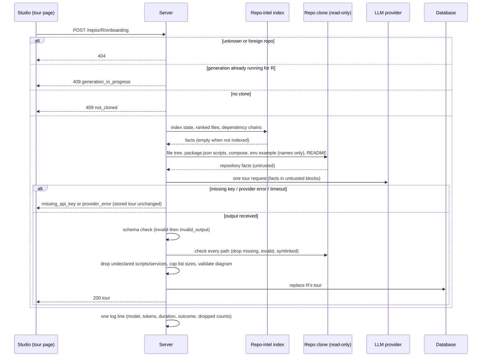
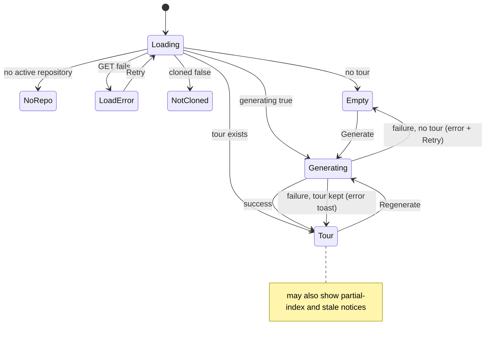

# Spec: Onboarding Generator
Spec ID: SPEC-2026-10-11-onboarding-generator
Status: draft
Supersedes: none

## Problem and user

A developer who joins a project, or opens a repository they have never worked
in, has no quick way to learn its shape. They need to know where requests enter,
which files matter most, how to start it locally, what to read first, and what a
safe first change looks like. Today that knowledge is spread over the README,
`package.json`, compose files and the heads of other team members.

DevDigest already indexes every connected repository (symbols, import graph,
file rank). It can turn that index plus the repository's own config files into a
guided tour.

**User:** the DevDigest studio user. This is a developer new to a connected
repository, or a lead who wants to hand a newcomer a starting point.

**Want:** on a per-repository "Onboarding Tour" page, the user generates a tour
with one click and reads it in five parts:
1. architecture overview;
2. critical paths;
3. how to run locally;
4. guided reading path (recommended file reading order);
5. first tasks.

Every file the tour names is real. The run commands come from the repository's
own config. The tour can be regenerated when the code moves on, and its link can
be shared.

### Current state (as of 2026-10-11, for context only)

- **Pre-staged, unused parts:**
  - A per-repository onboarding store already exists: one row per repository,
    holding a JSON document and a generation time, deleted with its repository.
  - A shared contract `Onboarding` exists: generic sections with a markdown
    body, an optional mermaid diagram and `{label, path}` links. Its shape does
    not match the five parts below.
  - A feature-model entry "Onboarding Tour" exists in Settings → Feature Models.
    Its default is `openrouter` / `deepseek/deepseek-v4-flash`.
  - A system prompt template for the tour exists. Its section list differs from
    the five parts (it mentions `routes_and_apis`).
  - The repo-intel index already offers "top files by rank" and "critical
    dependency chains". Both return nothing when the index is missing or
    disabled.
  - Client message strings for the tour exist. Their copy describes a different
    set of five sections.
- **Missing:** no server endpoint generates or serves a tour. There is no tour
  page and no sidebar item.
- **Route conflict:** the path `/onboarding` is the add-repository screen today.
  The sidebar's active-item rule already maps any path containing `/onboarding`
  to an "onboarding-tour" key, so that screen would highlight a tour item once
  one exists.
- **Index state per repository:** status `full` | `partial` | `degraded` |
  `failed`, files indexed, last indexed commit SHA and update time.
- **Clone:** each connected repository has one local clone on the server host.
  It is a read-only mirror of the default branch as of the last sync.

## Goals / Non-goals

### Goals

- **Page and sidebar:** a per-repository Onboarding Tour page, reached from a
  WORKSPACE sidebar item.
- **One-click generation:** one request per click, which waits for the result.
  Only one generation per repository runs at a time.
- **Five sections, in a fixed order:**
  - architecture overview (prose plus a node diagram);
  - critical paths (file plus description, with "Open");
  - how to run locally (numbered, copyable commands);
  - guided reading path (numbered files with a one-line reason);
  - first tasks (three cards with a complexity level).
- **Grounding:** every path is checked against the clone, and every item that
  fails the check is dropped. Commands are derived only from repository facts.
  No secret value is read or shown.
- **One tour per repository:** Regenerate replaces it. A failed regeneration
  keeps the old tour.
- **Clear states:** no repository, not cloned, loading, generating, failed,
  partial index, stale tour and empty section.
- **Per-user collapse:** the collapse state of each section is saved per user.
- **Share link:** copies the page URL.

### Non-goals

- **No tour history:** there are no versions and no diff between tours.
- **English only:** the tour is always written in English. There is no
  language setting.
- **No editing:** the tour cannot be edited in the UI.
- **No auto-regeneration:** a resync or re-index never regenerates the tour; the
  page only shows the stale notice (AC-20).
- **No MCP tool** for the tour.
- **Not fed into reviews:** the tour is never injected into review prompts.
- **No command execution:** DevDigest never runs any command from the tour.
- **No public sharing or export:** the shared link only works for someone who
  can reach the same studio. There is no markdown or PDF export.
- **No in-app source viewer:** "Open" goes to GitHub.
- **No usage display:** cost, tokens and model are not shown in the UI. They are
  logged only.
- **Plain-text paths:** reading-path and first-task paths are not links, and the
  first-task cards have no action.

## User stories

- **US-1** — As a developer new to a repository, I want to generate a guided
  tour of the active repository with one click and read it as five sections, so
  that I understand its architecture, key files, setup, reading order and a
  first task without asking a colleague.
- **US-2** — As that developer, I want every file path in the tour to exist in
  the repository, so that I never chase a hallucinated file.
- **US-3** — As that developer, I want copyable run commands taken from the
  repository's own config, with no secret values shown, so that I can start the
  project locally safely.
- **US-4** — As a lead, I want to copy a link to a repository's tour, so that I
  can hand it to a newcomer who uses the same studio.
- **US-5** — As a studio user, I want to regenerate the tour when the code has
  moved on, to see when it is stale, and to keep the current tour if
  regeneration fails, so that the tour stays trustworthy and available.
- **US-6** — As a studio user, I want a clear message when no repository is
  selected, the repository is not cloned, the index is incomplete, a section
  has no data or generation fails, so that I know what to do next.
- **US-7** — As a reader, I want to collapse sections and have that remembered,
  and to navigate the page by keyboard and by its section list, so that long
  tours stay easy to use.

## Acceptance criteria (EARS)

> **Size note:** this spec holds more than the usual ~15 ACs, by explicit user
> decision (one cross-module spec, ACs grouped by area). AC-29 to AC-35 were
> added on 2026-10-11, when the open questions were closed and AC-12, AC-19,
> AC-25 and AC-27 were split to one EARS pattern each. They sit in their area
> group, so ids are not in numeric order. Existing ids are unchanged.

### A. Generation and storage

- **AC-1** — WHEN the user requests generation for an active repository that has
  a clone, the server (shall) produce a tour and store it, then return it in the
  response.
  - The tour holds exactly five sections in this order: architecture overview,
    critical paths, how to run locally, guided reading path, first tasks.
  - The model is the one configured for "Onboarding Tour" in Settings → Feature
    Models.
  - All text is in English.
  - The stored tour records its generation time, the commit it describes and the
    indexed file count at generation time (see Contracts).

  Traces: US-1. Verify: integration - with an LLM mock, `POST` returns a tour
  with the five sections in order. A following `GET` returns the same tour.
- **AC-2** — The server (shall) keep at most one tour per repository.
  - A successful generation replaces the previous tour, and no history is kept.
  - Deleting a repository deletes its tour.

  Traces: US-5. Verify: integration - two generations leave one stored tour
  equal to the second; after the repository is deleted, no tour remains for it.
- **AC-3** — WHILE a generation for a repository is running, the server (shall)
  reject any further generation request for that repository with
  `generation_in_progress`, without starting another LLM call.

  Traces: US-5. Verify: integration - two concurrent `POST`s give one 200 and
  one 409 `generation_in_progress`; the LLM mock records one call.
- **AC-4** — IF the repository has no clone, THEN the server (shall) reject a
  generation request with `not_cloned` and make no LLM call.

  Traces: US-6. Verify: integration - a repository without a clone gives 409
  `not_cloned` and zero LLM calls.
- **AC-5** — IF generation fails, THEN the server (shall) leave the stored tour
  unchanged (or absent) and respond with one error code:
  - `missing_api_key`: no API key for the configured provider;
  - `provider_error`: a provider error, or the generation not finishing within
    120 s (the generation is then stopped);
  - `invalid_output`: model output that does not match the tour schema.

  Traces: US-5, US-6. Verify: integration - for each of the three causes
  (the timeout simulated by an LLM mock that never answers, with the timeout
  shortened in the test configuration), the previous tour is byte-identical
  after the failed `POST`, and the code matches.
- **AC-6** — WHERE the repository's index status is not `full` (`partial`,
  `degraded`, `failed`, or never indexed), the server (shall) still generate the
  tour and mark it `partial_index: true`.

  Traces: US-6. Verify: integration - with index status `partial`, generation
  succeeds and the tour has `partial_index: true`; with `full` it is `false`.
- **AC-34** — IF the client that requested a generation disconnects or leaves
  the page before the generation ends, THEN the server (shall) finish the
  generation and store its result, under the same rules as a connected request.

  Traces: US-5. Verify: integration - abort the `POST` request after it
  starts; once the LLM mock responds, a `GET` returns the new tour.

### B. Content rules and grounding

- **AC-7** — WHEN the model output is received, the server (shall) drop every
  critical-path and reading-path item whose path is not an existing regular file
  in the repository's clone.
  - A path that is empty, absolute, or contains a `..` segment is invalid, and
    the item is dropped.
  - A path that resolves outside the clone, or through a symbolic link, is also
    invalid, and the item is dropped.

  Traces: US-2. Verify: unit - the output names `src/real.ts` (exists),
  `src/ghost.ts` (missing), `../etc/passwd` and a symlinked file; only
  `src/real.ts` survives.
- **AC-8** — WHEN the model output is received, the server (shall) keep a
  first-task item only if its path is one of the following, and record that kind
  with the item:
  - an existing file in the clone (`file`);
  - an existing directory in the clone (`directory`);
  - a file that does not exist yet but whose parent directory exists
    (`new_file`).

  Every other first-task item (shall) be dropped, under the same
  invalid-path rules as AC-7.

  Traces: US-2. Verify: unit - `specs/` gives `directory`;
  `src/api/public/health.ts` with an existing `src/api/public/` gives
  `new_file`; `nowhere/x.ts` is dropped.
- **AC-9** — The server (shall) store each list section at no more than its
  maximum, keeping the model's order and dropping items beyond the maximum:
  - critical paths: 3–6 items, maximum 6;
  - reading path: 3–8 items, maximum 8;
  - first tasks: exactly 3 items, maximum 3;
  - run commands: 1–8 items, maximum 8.

  The model is asked for the stated range. A section with fewer surviving items
  than its range is stored and shown with what survives.

  Traces: US-1, US-2. Verify: unit - 9 valid critical paths are stored as the
  first 6; 2 surviving first tasks are stored as 2.
- **AC-10** — The server (shall) derive run commands only from these repository
  facts:
  - `package.json` scripts;
  - docker-compose files;
  - `.env.example` / `.env.sample`;
  - the README.

  It (shall) never read `.env` or any other environment file. From
  `.env.example` / `.env.sample` it (shall) pass only variable names, never
  values, to the model.

  Traces: US-3. Verify: unit - a fixture with `.env` containing `SECRET=abc` and
  `.env.example` containing `STRIPE_KEY=sk_test_x` produces model input that
  contains `STRIPE_KEY`, but neither `abc` nor `sk_test_x`.
- **AC-11** — IF a run command calls a package script that no `package.json` in
  the repository declares, or names a compose service that no docker-compose
  file declares, THEN the server (shall) drop that command.

  Traces: US-3. Verify: unit - `pnpm dev` (declared) is kept; `pnpm start:prod`
  (undeclared) and `docker compose up -d kafka` (undeclared service) are
  dropped.
- **AC-12** — The server (shall) store the architecture diagram as a graph:
  - nodes `{ id, label, kind }`, where `kind` is one of `entry`, `service`,
    `middleware`, `storage`, `external`;
  - edges `{ from, to }`.

  Traces: US-1. Verify: unit - a valid graph of six nodes and five edges is
  stored unchanged.
- **AC-29** — IF the architecture graph is empty, has a node with an unknown
  kind, has duplicate node ids, or has an edge to an unknown node id, THEN the
  server (shall) store `diagram: null` and keep the architecture prose.

  Traces: US-1. Verify: unit - a graph with an edge to `ghost` gives
  `diagram: null` and the prose is kept; an empty graph gives the same result.
- **AC-33** — The server (shall) leave path-like inline code in the
  architecture prose unchecked and unchanged, and count the path-like
  references that do not exist in the clone into the generation log line (NFR
  Observability). The studio (shall) render such inline code as text, never as
  a link.

  Traces: US-2. Verify: unit - prose naming `src/ghost.ts` is stored as is, the
  log line reports `prose_unverified_paths: 1`, and the rendered prose has no
  link for it.

### C. Tour page: navigation and layout

- **AC-13** — The studio (shall) show an "Onboarding Tour" item in the sidebar
  WORKSPACE group, between "Pull Requests" and "Project Context".
  - It opens `/repos/:repoId/onboarding` for the active repository.
  - It is highlighted while that page is shown.
  - It (shall) not be highlighted on the add-repository screen at
    `/onboarding`.

  Traces: US-1. Verify: e2e - clicking the item opens the page and the item is
  active; on `/onboarding` the item is not active.
- **AC-14** — WHEN `/repos/:repoId/onboarding` is opened directly by URL (for
  example from a shared link), the studio (shall) make that repository the
  active one and show its tour.

  Traces: US-4. Verify: e2e - a fresh browser load of the seeded repository's
  tour URL shows "Onboarding for payments-api", not a "no repository" state.
- **AC-15** — WHILE a tour exists for the active repository, the studio (shall)
  show the page as in the screenshots:
  - the header "Onboarding for <repository name>";
  - the subtitle "Generated from index of <N> files · last refreshed <relative
    time>". N is the indexed file count at generation time; the time is the
    tour's generation time;
  - the "Regenerate" and "Share link" buttons;
  - an "ON THIS PAGE" list with the five section names: Architecture overview,
    Critical paths, How to run locally, Guided reading path, First tasks;
  - five collapsible section cards in that order.

  Traces: US-1. Verify: e2e - on seeded data, the header, subtitle, both buttons,
  five anchors and five cards in order are present.
- **AC-16** — The studio (shall) render each section card's content as in the
  screenshots and design:
  - **Architecture overview:** the prose as markdown with inline code, followed
    by the node diagram. Node borders are coloured by kind:
    - `external`: gray;
    - `entry` and `service`: blue;
    - `middleware`: amber;
    - `storage`: green.

    With no diagram, only the prose is shown.
  - **Critical paths:** one row per item: file icon, path, " — " and
    description, and an "Open" button.
  - **How to run locally:** one numbered row per command, with a copy button.
  - **Guided reading path:** a numbered badge, the path and the one-line reason
    on the next line.
  - **First tasks:** cards with a title, a path and a pill:
    - "Low complexity": green;
    - "Medium complexity": amber;
    - "High complexity": the existing critical/red tone.

  Paths in the reading path and first tasks (shall) be plain text, not links.

  Traces: US-1, US-2. Verify: unit - each section renders from a fixture tour; a
  `high` task shows "High complexity"; a tour with `diagram: null` renders prose
  only.
- **AC-17** — WHEN the user activates "Open" on a critical-path row, the studio
  (shall) open the file on GitHub in a new tab. The link is pinned to the tour's
  recorded commit.

  Traces: US-2. Verify: unit - the link is
  `https://github.com/<owner>/<name>/blob/<commit_sha>/<encoded path>` with
  `target="_blank"` and `rel="noopener noreferrer"`.
- **AC-18** — WHEN the user activates a command's copy button, the studio
  (shall) write that command's exact text to the clipboard and show the toast
  "Copied".
  - The text includes any trailing `# comment` exactly as shown.
  - No numbering is added.
  - The toast is the studio's existing toast; no new visual element is added.

  Traces: US-3. Verify: unit - copying row 2 writes
  `cp .env.example .env # add OPENAI + STRIPE keys` exactly and the "Copied"
  toast shows.
- **AC-19** — WHEN the user activates "Share link", the studio (shall) copy the
  page's absolute URL to the clipboard and show the toast "Link copied".

  Traces: US-4. Verify: unit - the clipboard receives
  `<origin>/repos/<repoId>/onboarding` and the toast shows.
- **AC-30** — IF a clipboard write fails (a command copy or "Share link"), THEN
  the studio (shall) show an error toast instead of "Copied" or "Link copied".

  Traces: US-3, US-4. Verify: unit - with a rejected clipboard write, both
  actions show the error toast and no success toast.

### D. Tour page: states

- **AC-20** — WHILE the repository's last indexed commit differs from the
  tour's recorded commit, the studio (shall) show the notice "Index updated
  since this tour was generated" with a Regenerate action.

  Traces: US-5. Verify: unit - the notice renders when `stale: true` and its
  action starts a generation.
- **AC-21** — WHILE a generation for the active repository is running, the
  studio (shall) disable "Regenerate" and the generate button.
  - The labels change to "Regenerating…" / "Generating…".
  - If a tour exists, it stays visible.
  - With no tour, the empty-state body stays visible.
  - The running state is also shown after a reload or in a second tab, as long
    as the generation runs on the server.

  Traces: US-5, US-6. Verify: unit - buttons are disabled and the labels change
  while the request is pending, and when `GET` reports `generating: true`.
- **AC-22** — IF generation fails, THEN the studio (shall) show the failure as
  follows:
  - **A tour exists:** the tour stays unchanged and an error toast appears.
  - **No tour exists:** an error message with a Retry action.
  - **`missing_api_key`:** the message (shall) point to Settings → API Keys with
    a link.

  Traces: US-5, US-6. Verify: unit - each of the three cases renders as stated;
  Retry sends a new generation request.
- **AC-23** — WHILE no tour exists for an active, cloned repository and no
  generation is running, the studio (shall) show the empty state from the
  design:
  - the tour icon;
  - the title "Generate onboarding tour";
  - the body "DevDigest indexes the repo and writes a guided tour:
    architecture, critical paths, how to run, a reading order, and first tasks.
    Takes 30–60s and ~5,000 tokens.";
  - the button "+ Generate onboarding tour".

  There is no "ON THIS PAGE" list in this state.

  Traces: US-1, US-6. Verify: unit - exact copy and the button; clicking it sends
  the generation request.
- **AC-24** — The page (shall) show a distinct state for each situation below,
  all beyond the design:
  - **No active repository:** "Select a repository".
  - **Not cloned:** a hint that the repository is not cloned yet. The generate
    button is absent and "Regenerate" is disabled. An existing tour stays
    readable.
  - **Loading:** a skeleton in the shape of the header and section cards.
  - **Tour load error:** a message with a Retry action that re-requests the
    tour.

  Traces: US-6. Verify: unit - each state renders its content, and Retry
  re-requests.
- **AC-25** — WHERE the tour has `partial_index: true`, the studio (shall) show
  a "partial index" notice under the header.

  Traces: US-6. Verify: unit - the notice renders for a partial tour and is
  absent for a full one.
- **AC-31** — WHERE a section has no items after the content rules, the studio
  (shall) show a message instead of the section's content:
  - critical paths, guided reading path, first tasks: "Not enough index data —
    resync and regenerate";
  - how to run locally: "No run commands found in package.json,
    docker-compose, .env.example or README".

  Traces: US-6. Verify: unit - an empty critical-paths list renders the index
  message; an empty run-locally list renders the run-commands message.

### E. Tour page: collapse, navigation and accessibility

- **AC-26** — WHEN the user activates a section card's chevron, the studio
  (shall) collapse or expand that card and save the new state per viewer:
  - the state is kept in the viewer's browser storage, like the studio's other
    per-viewer preferences (active repository, theme), and is not sent to the
    server;
  - it is keyed by section and shared across all repositories;
  - on the next visit or reload, in any repository, each card opens in its
    saved state;
  - a card with no saved state opens expanded.

  Traces: US-7. Verify: unit - collapse "Critical paths" in repo A, remount the
  page for repo B, and "Critical paths" is collapsed while the other sections
  are expanded; no request carries the collapse state.
- **AC-27** — WHEN the user activates an "ON THIS PAGE" entry, the studio
  (shall) scroll to that section and mark the entry active.

  Traces: US-7. Verify: e2e - clicking "First tasks" scrolls it into view and
  that entry is active.
- **AC-32** — WHEN the user activates an "ON THIS PAGE" entry whose section is
  collapsed, the studio (shall) expand that section, save it as expanded (as in
  AC-26), and scroll to it.

  Traces: US-7. Verify: unit - with "First tasks" collapsed, activating its
  entry expands it, the saved state becomes expanded, and the section is
  scrolled into view.
- **AC-35** — WHILE the user scrolls the page, the studio (shall) mark as
  active the "ON THIS PAGE" entry of the section at the top of the viewport.

  Traces: US-7. Verify: e2e - scrolling to "How to run locally" makes its entry
  active.
- **AC-28** — The page (shall) be operable by keyboard and labelled:
  - "ON THIS PAGE" entries, chevrons, "Open", copy, "Regenerate" and "Share
    link" are reachable by Tab and activate with Enter or Space;
  - each chevron is a button that exposes whether its section is expanded and
    whose accessible name includes the section title;
  - each "Open" button's accessible name includes the file path;
  - each copy button's accessible name includes the command;
  - long paths, commands, titles and diagram labels are shortened with an
    ellipsis, with the full text available as a tooltip and in the accessible
    name.

  Traces: US-7. Verify: unit - accessible names and expanded attributes are
  present; a 200-character path is truncated and has a tooltip with the full
  text.

## Edge cases

- **Second click or second tab during generation (AC-3, AC-21):** the server
  rejects the second request with `generation_in_progress`. The UI stays in the
  generating state and shows no error toast for this code.
- **User leaves the page during generation (AC-21, AC-34):** the generation
  keeps running on the server and its result is stored. Returning to the page
  shows the generating state or the new tour.
- **Generation runs longer than 120 s (AC-5):** it is stopped and reported as
  `provider_error`. The stored tour is unchanged and a new attempt is allowed
  at once.
- **Regeneration fails (AC-5, AC-22):** the previous tour, its subtitle and its
  stale notice stay as they were. An error toast appears.
- **Index never built, partial, degraded or failed (AC-6, AC-25, AC-31):**
  generation runs and the partial-index notice is shown. Ranking-based sections
  (critical paths, reading path) can come back empty and then show "Not enough
  index data — resync and regenerate".
- **Clone deleted after a tour was generated (AC-4, AC-24):** the existing tour
  stays readable, the not-cloned hint is shown and "Regenerate" is disabled.
- **Index moves on after generation (AC-20):** a resync that indexes a newer
  commit triggers the stale notice. The tour is never regenerated automatically.
- **Clone head differs from the indexed commit** (for example, indexing failed
  after a fetch) **(AC-1, AC-7, AC-17):** paths are checked against the clone as
  it is. The tour records the last indexed commit, or the clone's head commit
  when the repository was never indexed. "Open" links pin to that recorded
  commit.
- **File deleted on GitHub after generation (AC-17):** "Open" still points at
  the recorded commit, where the file exists.
- **Model invents paths (AC-7, AC-8):** they are dropped. If every item of a
  section is dropped, the empty-section message is shown (AC-31).
- **First task points at a file to be created (AC-8):** it is kept as
  `new_file` when its parent directory exists, and shown as plain text.
- **Commands that are not script or compose calls (AC-11):** for example `cp
  .env.example .env`. They are kept; only undeclared scripts and services are
  dropped.
- **Repository has no `package.json`, compose file, env example or README
  (AC-10, AC-31):** "How to run locally" may end up empty and shows "No run
  commands found in package.json, docker-compose, .env.example or README".
- **Secret-looking text in `.env.example` values or the README (AC-10):**
  example values are never passed to the model. Text in the README is passed as
  untrusted data, and the model is told never to output secret values.
- **Diagram invalid (AC-16, AC-29):** only the prose is shown, with no error.
- **Very long or many items (AC-9, AC-28):** list sizes are capped at their
  maxima, and long text is shortened with a tooltip.
- **Prose names a path that does not exist (AC-33):** inline code in the
  architecture prose is not checked and is never a link. The log line counts
  such references.
- **Shared link opened in a browser where another repository was active
  (AC-14):** the repository in the URL becomes active.
- **Shared link for a repository unknown to this studio (AC-14, AC-24):** the
  page shows the existing "repository not found" state.
- **Collapsed section targeted from "ON THIS PAGE" (AC-26, AC-32):** it is
  expanded, saved as expanded and scrolled into view.
- **Browser storage unavailable or cleared (AC-26):** for example, private mode
  or cleared site data. Every section opens expanded and the page works
  normally; nothing is saved.
- **Same viewer in another browser or machine (AC-26):** the collapse state is
  per browser, so it is not carried over. This is accepted (decision Q1).
- **Repository deleted while its tour page is open (AC-2):** the next tour load
  returns 404 and the page shows the "repository not found" state.

## Non-functional requirements

All numbers below are user-confirmed (2026-10-11).

- **Performance, generation:** p95 ≤ 60 s from click to rendered tour on the
  default model, for a repository with ≤ 50,000 files. This matches the design
  copy "Takes 30–60s".
- **Generation timeout:** a generation still running after 120 s is stopped
  and reported as `provider_error` (AC-5).
- **Performance, read:** `GET /repos/:repoId/onboarding` p95 ≤ 300 ms on the
  local host.
- **LLM cost:** a generation uses ≤ 8,000 total tokens on the default model for a
  repository with ≤ 50,000 files. The design copy says "~5,000 tokens". This is
  checked from the generation log line.
- **Observability:** each generation attempt writes exactly one log line with:
  - repository id;
  - provider and model;
  - input and output tokens;
  - duration in ms;
  - outcome (`ok` | `missing_api_key` | `provider_error` | `invalid_output`);
  - the number of dropped items per section (paths, commands, overflow);
  - the number of path-like references in the architecture prose that do not
    exist in the clone (`prose_unverified_paths`, AC-33).

  None of these values is shown in the UI.
- **Security, access:** every tour read and generation checks the repository id
  against the caller's workspace and returns 404 otherwise.
- **Security, file reads:** generation reads only the clone of the requested
  repository. It never follows symbolic links out of the clone, and it never
  opens `.env` or any environment file other than `.env.example` /
  `.env.sample`. This is verified by the AC-10 unit test.
- **Security, rendering:** tour prose is rendered as markdown with no raw HTML.
  Links with a target other than http(s) are removed. Diagram labels, paths,
  commands and task titles are rendered as text. This is verified by a unit
  test with `<script>` and `[x](javascript:alert(1))` in the prose.
- **Accessibility:**
  - every interactive control has an accessible name (AC-28);
  - complexity pills and notices are readable as text, not by colour only;
  - focus stays visible on every control.

## Inputs and provenance

### Decisions (user-confirmed, 2026-10-11, relayed by the coordinating agent)

1. Generation is one request per click that waits for the result. A second
   request while one is running is rejected (AC-3).
2. There is one tour per repository. Regenerate replaces it with no history. The
   old tour stays visible during generation. A failed regeneration keeps it and
   shows an error toast (AC-2, AC-5, AC-21, AC-22).
3. A missing clone blocks generation (AC-4). A partial, degraded or failed index
   allows generation with a "partial index" notice. An empty section shows "Not
   enough index data — resync and regenerate" (AC-6, AC-25, AC-31).
4. The tour is in English only (Non-goals).
5. Every path must exist in the clone, otherwise its item is dropped. First-task
   paths may be an existing directory, or a new file whose parent directory
   exists (AC-7, AC-8).
6. Commands come only from repository facts. They are never executed. The real
   `.env` and secret values are never read or shown, only variable names. Copy
   copies the exact text (AC-10, AC-11, AC-18).
7. Counts: 3–6 critical paths, 3–8 reading-path files, exactly 3 first tasks and
   1–8 commands. Complexity is Low / Medium / High, and High uses the existing
   critical/red tone (AC-9, AC-16).
8. The diagram is a structured graph with a kind per node, coloured as in the
   screenshot. An invalid graph means prose only (AC-12, AC-16, AC-29).
9. "Open" goes to GitHub, pinned to the indexed commit, in a new tab.
   Reading-path and first-task paths are plain text (AC-16, AC-17).
10. "Share link" copies the page URL and shows "Link copied". There is no public
    sharing or export (AC-19, AC-30).
11. "N files" is the indexed file count at generation time, and "last refreshed"
    is the generation time. A stale notice appears when the index has moved on
    (AC-15, AC-20).
12. The page is at `/repos/:repoId/onboarding`. The sidebar item sits between
    Pull Requests and Project Context. The add-repository screen stays at
    `/onboarding` and does not highlight the item (AC-13).
13. All the proposed extra states are in scope (AC-21 to AC-25, AC-28, AC-31).
14. Collapse state is saved per user (**differs from the agent's
    recommendation**). Where it is stored was settled by decision Q1 below
    (AC-26).
15. Scope is narrow:
    - the model comes from the "Onboarding Tour" Settings entry;
    - each generation is logged but its usage is not shown in the UI;
    - out of scope: an MCP tool, review-prompt injection, auto-regeneration and
      editing;
    - deleting a repository deletes its tour (Non-goals, AC-2, NFR
      Observability).
16. One cross-module spec in `specs/`, with ACs grouped by area.

### Follow-up decisions (user-confirmed, 2026-10-11, relayed by the coordinating agent: "все open question сделать по Proposed")

All eight open questions were accepted as proposed. The agent-picked NFR
numbers were confirmed.

- **Q1 – Collapse state storage:** kept in the viewer's browser storage, like
  the active repository and theme, and not sent to the server. Any other
  per-viewer preference added by this feature follows the same rule (AC-26).
- **Q2 – Collapse state scope:** keyed by section and shared across all
  repositories (AC-26).
- **Q3 – "ON THIS PAGE" on a collapsed section:** the section is expanded,
  saved as expanded, and scrolled to (AC-32).
- **Q4 – Command copy feedback:** the existing toast with "Copied"; no new
  visual (AC-18).
- **Q5 – Empty "How to run locally":** shows "No run commands found in
  package.json, docker-compose, .env.example or README" (AC-31).
- **Q6 – Path-like inline code in the architecture prose:** not checked and
  never a link. The log counts references that do not exist (AC-33, NFR
  Observability).
- **Q7 – Leaving the page during generation:** the server finishes and stores
  the tour (AC-34).
- **Q8 – Generation timeout:** 120 s, then `provider_error` (AC-5, NFR).
- **NFR numbers confirmed:**
  - `GET` p95 ≤ 300 ms;
  - ≤ 8,000 tokens per generation;
  - 120 s generation timeout;
  - generation p95 ≤ 60 s.

Also folded in, as stated to the user before the answers:
- all tour inputs and the model output are untrusted;
- the output is checked against a schema;
- prose is rendered without raw HTML;
- the design's empty-state copy replaces the outdated pre-staged client copy.

### Design sources

- **User screenshots (source of truth):**
  - the populated page header, "ON THIS PAGE", Architecture overview, Critical
    paths and How to run locally (screenshot 21);
  - How to run locally and Guided reading path (screenshot 22).
- **`design/` fallback** for what the screenshots do not show. Rendered by a
  researcher subagent; the agent checked its screenshots itself:
  - **"Onboarding Tour (N5)", First tasks:** three cards side by side, each with
    a bold title, a mono path and an outlined pill. "Low complexity" is green
    and "Medium complexity" is amber. There is no description, button or
    checkbox, and no footer.
  - **"Onboarding Tour · empty":** the copy used in AC-23.
- **Not in any design:** loading, generating, error, not cloned, partial index,
  stale and empty-section states (AC-21 to AC-25, AC-31), and the High complexity
  colour (decision 7).

### Inputs

| Input | Source | Trust |
|---|---|---|
| Repository id | URL path `/repos/:repoId/onboarding`; the active repository | untrusted id, checked against the workspace |
| Generation request | user click (Generate, Regenerate, Retry) | user action |
| File tree, existence of paths | the repository's local clone | untrusted (repository content) |
| Ranked files, dependency chains, indexed file count, index status, last indexed commit | repo-intel index | server-derived; the paths in it are repository content |
| `package.json` scripts, docker-compose files, `.env.example` / `.env.sample` (variable names only), README | the repository's clone | untrusted |
| Model choice | Settings → Feature Models "Onboarding Tour" | trusted (user configuration) |
| Provider API key | the server's secrets store | secret; never sent to the client and never in the prompt |
| Model output | LLM provider | untrusted; schema-checked and grounded (AC-7 to AC-12, AC-29, AC-33) |
| Collapse state | the user's own toggles; kept in the viewer's browser storage, keyed by section, shared across repositories | per-viewer preference; never sent to the server (AC-26) |

### Contracts

Contract level only; schema names and exact storage are left to the plan.

- `GET /repos/:repoId/onboarding` returns 200 with the body below; 404 for an
  unknown or foreign repository.

  ```
  {
    cloned: boolean,
    generating: boolean,
    index: { status: 'full'|'partial'|'degraded'|'failed'|'none',
             last_indexed_sha: string | null, files_indexed: number },
    stale: boolean,              // tour exists and index.last_indexed_sha !== tour.commit_sha
    tour: OnboardingTour | null
  }
  ```

- `POST /repos/:repoId/onboarding` (generate) returns 200 `{ tour:
  OnboardingTour }`. Errors carry `{ code }`:
  - 404: unknown or foreign repository;
  - 409 `generation_in_progress` (AC-3);
  - 409 `not_cloned` (AC-4);
  - `missing_api_key`, with the status code the server already uses for a
    missing provider key (AC-5);
  - 502 `provider_error`, including a timeout (AC-5);
  - 502 `invalid_output` (AC-5).

- `OnboardingTour`:

  ```
  {
    repo_id: string,
    generated_at: string,          // ISO time; "last refreshed"
    commit_sha: string,            // last indexed commit, else clone HEAD
    files_indexed: number,         // "Generated from index of N files"
    partial_index: boolean,
    architecture: {
      summary: string,             // markdown, no raw HTML
      diagram: { nodes: [{ id, label, kind: 'entry'|'service'|'middleware'|'storage'|'external' }],
                 edges: [{ from, to }] } | null
    },
    critical_paths: [{ path, description }],          // 0..6
    run_locally:    [{ command }],                    // 0..8
    reading_path:   [{ path, reason }],               // 0..8
    first_tasks:    [{ title, path, path_kind: 'file'|'directory'|'new_file',
                       complexity: 'low'|'medium'|'high' }]   // 0..3
  }
  ```

- **GitHub link (client-built, AC-17):**
  `https://github.com/<owner>/<name>/blob/<commit_sha>/<path, URL-encoded per
  segment>`.

### Generation flow



### Page states



### Failure at each boundary

| Boundary | Failure | Behaviour |
|---|---|---|
| UI → API, load | network or 5xx | load error with Retry (AC-24) |
| UI → API, load | 404 repository | "repository not found" state |
| UI → API, generate | 409 `generation_in_progress` | stay in the generating state, no toast (Edge cases) |
| UI → API, generate | 409 `not_cloned` | not-cloned hint (AC-24) |
| UI → API, generate | `missing_api_key` | error pointing to Settings → API Keys (AC-22) |
| UI → API, generate | `provider_error`, `invalid_output`, network | error toast (with a tour) or error with Retry (without one) (AC-22) |
| API → repo-intel | not indexed or degraded | empty facts; `partial_index: true` (AC-6) |
| API → clone | file missing, invalid, symlinked | item dropped (AC-7, AC-8) |
| API → LLM | error or timeout | `provider_error`; stored tour unchanged (AC-5) |
| LLM → API | output not matching the schema | `invalid_output`; stored tour unchanged (AC-5) |
| LLM → API | invalid diagram | `diagram: null`; prose kept (AC-29) |
| UI → clipboard | write rejected | error toast (AC-19) |
| UI → GitHub | file not on GitHub (private repository, no access) | GitHub's own page; out of the studio's control |

### Research sources

- **Repository reading (2026-10-11):**
  - the pre-staged onboarding store (one row per repository, deleted with it);
  - the shared `Onboarding` contract (generic sections plus a mermaid diagram);
  - the "Onboarding Tour" feature-model entry;
  - the tour system prompt template (with a different section list);
  - the repo-intel "top files by rank" and "critical paths" reads (empty when
    the index is off or missing);
  - the index state fields (`status`, `filesIndexed`, `lastIndexedSha`);
  - the client's existing GitHub blob-link pattern pinned to a SHA;
  - the `/onboarding` add-repository route and the sidebar active-key mapping;
  - the pre-staged client tour strings;
  - Conventions "extract" as an existing one-request LLM feature (~50 s).
- **Per-viewer preferences today:** the active repository and the theme are
  kept in browser storage. The server also has a per-user, per-workspace
  key/value settings store. Decision Q1 chose browser storage (AC-26).
- **Design:** a researcher subagent rendered the `design/` artboards "Onboarding
  Tour (N5)" and "Onboarding Tour · empty". The agent checked the rendered
  screenshots itself.
- **INSIGHTS:**
  - root: the two vendored shared-contract copies are hand-synced and have
    drifted;
  - server:
    - vendored contracts are do-not-touch, so module-local contract extensions
      are used;
    - rule violations are 400 and a malformed request shape is 422;
    - new LLM calls need test-side provider mocks, or integration tests reach
      real providers;
  - client:
    - the vendored sidebar nav is edited locally;
    - opening a repository URL directly showed a transient "No repo selected".
      This is relevant to AC-14.

## Untrusted inputs

- **Repository content** (file tree, README, `package.json`, compose files,
  `.env.example` / `.env.sample`, index-derived paths):
  - treated as data, never as instructions;
  - placed in the prompt inside untrusted delimiters, under the global injection
    guard;
  - only variable names are taken from env example files;
  - `.env` and other environment files are never read (AC-10);
  - the content is never executed.
- **Model output** (all tour text, paths, commands, diagram):
  - checked against the tour schema; a mismatch gives `invalid_output` (AC-5);
  - every path is re-checked against the clone (AC-7, AC-8);
  - commands are checked against the declared scripts and services (AC-11);
  - the diagram is structurally validated (AC-12, AC-29);
  - path-like inline code in the prose is never turned into a link (AC-33);
  - prose is rendered without raw HTML and with http(s) links only;
  - everything else is rendered as text;
  - commands are never executed by DevDigest;
  - "Open" links are built by the studio from the repository name, the recorded
    commit and the checked path, never from a URL in the model output (AC-17).
- **Repository id in the URL:** checked against the caller's workspace on every
  read and generation (404 otherwise). A shared link grants no access beyond
  what the opener already has.
- **Secrets:** provider API keys never appear in the prompt, the stored tour,
  the response or logs. The log line holds counts only, not prompt text.

## Open questions

None. Q1 to Q8 were closed on 2026-10-11 with the proposed answers (see Inputs
and provenance → Follow-up decisions). They are reflected in AC-5, AC-18,
AC-26, AC-31 to AC-34, the Edge cases and the NFRs.

### Notes for the implementation planner (not user questions)

- **Vendored contract:** the `Onboarding` shared contract does not match
  `OnboardingTour`, and vendored shared contracts are do-not-touch, with two
  drifted copies. Choose between a module-local contract, as earlier features
  did, and a change at the sync source.
- **Prompt template:** its section list (including `routes_and_apis`) must be
  changed to the five parts, and its mermaid instructions replaced by the graph
  output (AC-12, AC-29).
- **Client copy:** the pre-staged client tour strings describe other sections.
  Replace them with the design copy (AC-23).
- **Sidebar:** the nav is a locally edited vendored file with no "Onboarding
  Tour" item. The current active-key rule matches any path containing
  `/onboarding`, which would highlight the item on the add-repository screen
  (AC-13).
- **e2e:** flows may only assert on read-only seeded data and cannot call an
  LLM. An e2e tour flow needs a seeded tour for `acme/payments-api`.
- **Tests:** integration tests that trigger generation must register a mock for
  the configured provider (default `openrouter`). Otherwise they reach a real
  provider on machines that have keys (server INSIGHTS).
