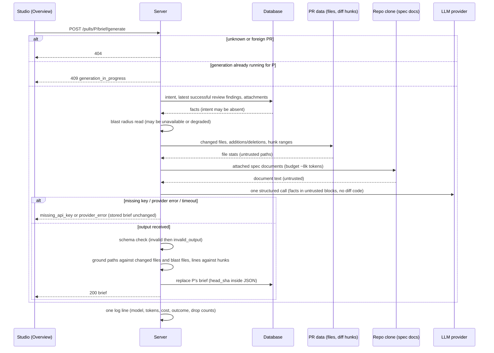
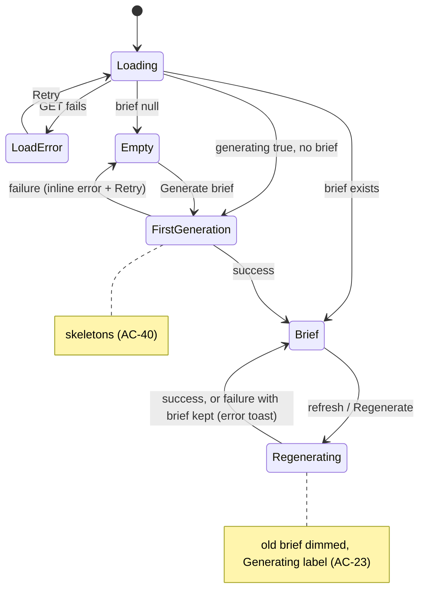
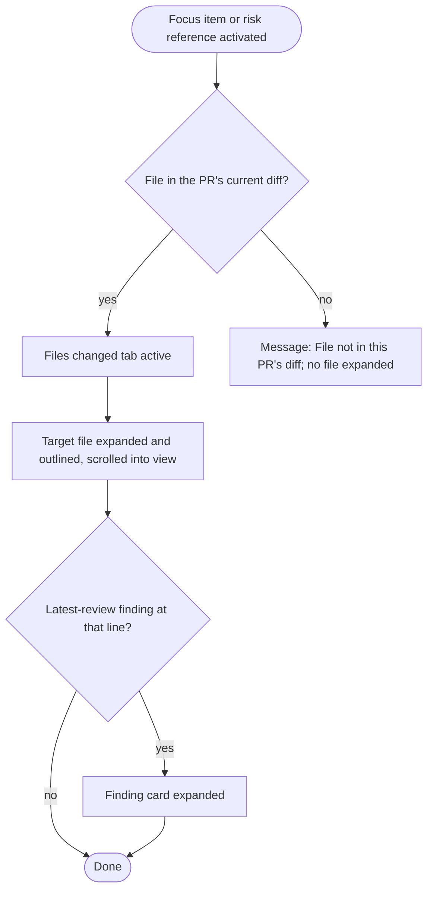

# Spec: PR Brief
Spec ID: SPEC-2026-10-12-pr-brief
Status: draft
Supersedes: none

## Problem and user

A reviewer often opens someone else's pull request "cold". They do not know
why the change exists, what in it is risky, or which file to read first.
DevDigest already answers part of this:
- the Intent layer explains the purpose and scope of the PR;
- Smart Diff orders the changed files by role;
- Blast radius shows what else the change can affect.

These answers are spread over separate cards and tabs. Nothing tells the
reviewer *where the risk is* or *which lines to read first*.

**User:** the DevDigest studio user reviewing a pull request of a connected
repository.

**Want:** one "PR Brief" block on the PR Overview tab. It gathers the existing
facts (intent, blast radius, diff statistics, PR description, attached spec
documents, the latest review's findings) and adds two model-written parts:
- **Risk areas:** concrete risks of this PR, each tied to a file;
- **Review focus:** which `file:line` to read first, and why.

The model is called exactly once per generation. It receives only
pre-computed facts and never the code of the diff. The brief is stored, so a
reload shows it again without a new generation.

### Current state (as of 2026-10-12, for context only)

- **Pre-staged, unused parts:**
  - A per-PR brief store exists: one row per PR, holding a JSON document,
    deleted with its PR. Nothing reads or writes it.
  - The shared contract (both vendored copies) defines `Intent`,
    `BlastRadius`, `Risk { kind, title, explanation, severity: high|medium|low,
    file_refs[] }`, `Risks`, `PrHistory`, `SmartDiff` and the composed
    `PrBrief { intent, blast, risks, history }`. All four fields are
    required. It has no summary and no review focus.
  - A feature-model entry "Risk Brief" (`risk_brief`) exists in Settings →
    Feature Models. Its default is `openai` / `gpt-4.1`, so a model always
    resolves.
  - Client strings for the brief exist: `block.intent` ("Intent"),
    `block.blast` ("Blast radius"), `block.risks` ("Risks"), `noRisks`,
    `unavailable` ("Brief not available yet.") and `unavailableHint` ("Run a
    review or open the PR to compute it."). The hint describes automatic
    computation and does not match a manual Generate button. The screenshot
    label is "Risk areas", not "Risks". An `intent.riskAreas` string ("Risk
    areas") also exists.
- **Existing neighbours:**
  - **Intent:** its own endpoints (`GET /pulls/:id/intent`,
    `POST /pulls/:id/intent/derive`). The stored intent also carries
    `risk_areas` (plain strings) and the head commit it was derived at. The
    Intent card on Overview already shows these strings as "RISK AREAS" chips.
  - **Blast radius:** `GET /pulls/:id/blast` returns changed symbols, callers
    (`file:line`), endpoints, crons, `summary`, and `degraded` / `reason` /
    `ref_sha`. The Blast radius card is already on Overview, together with
    "Prior PRs touching these files" (`GET /pulls/:id/blast/history`).
  - **Diff statistics:** `GET /pulls/:id` returns `files[]` with `additions`
    and `deletions`. `GET /pulls/:id/smart-diff` returns the files grouped by
    role (core, tests, wiring, docs, boilerplate).
  - **Reviews:** each review run stores a verdict, a summary, a score and
    findings (`file`, `line`, `severity`, `title`). The verdict banner
    (verdict, finding/blocker counts, summary, PR score) is shown per run on
    the Agent runs tab. It has no refresh control, no info icon and no
    cost/tokens line.
  - **Project Context:** markdown documents are attached per (agent,
    repository) and per (skill, repository).
  - **Overview today:** the Intent card and Blast radius card side by side,
    then the PR description. There is no "PR BRIEF" heading and no banner.
  - **PR detail tabs** are addressed by `?tab=overview|findings|diff`. No URL
    or UI path opens Files changed at a given file or line.
- **Missing:** no endpoint generates or serves a brief. There is no Generate
  brief button, no review-focus block, no brief-backed risk areas and no
  Overview → Files changed navigation.

## Goals / Non-goals

### Goals

- A "PR BRIEF" block on the Overview tab, laid out as in screenshots 24, 27
  and 28: banner, Intent card with Risk areas, Blast radius card, Review
  focus list.
- One-click generation with exactly one model call over pre-computed facts.
- Two new model-written parts, risk areas and review focus. Every file they
  name is a changed file of the PR or a file of the Blast radius map.
- The brief is stored per PR and shown again after a reload without a new
  generation. A refresh control regenerates it.
- A review-focus item or a risk reference opens the Files changed tab at that
  file (screenshot 29).
- Missing intent or blast radius does not block generation, and the brief
  states in the UI which data was missing.
- Every label of the block comes from the brief message file.

### Non-goals

- **No code to the model:** the diff's code lines are never sent to the model.
- **No auto-generation:** opening a PR, running a review or a new commit never
  generates or refreshes the brief (Q-15).
- **No second model call:** the brief never derives a missing intent itself.
- **No brief history:** a regeneration replaces the stored brief.
- **No editing** of the brief in the UI.
- **English only** (Q-15).
- **No MCP tool and no review-prompt injection** for the brief.
- **No change to the Intent and Blast radius cards' own behaviour.** They
  keep their data, states and actions. The only change is the Risk areas
  swap (AC-13).
- **No change to the Agent runs tab's verdict banner.**

## User stories

- **US-1** — As a reviewer, I want to see a PR Brief block with a "Generate
  brief" button on the Overview tab while the PR has no brief, so that I know
  a brief can be produced.
- **US-2** — As a reviewer, I want to generate the brief and see a short
  summary of what the PR does and why, risk areas and review focus, next to
  the Intent and Blast radius blocks, so that I can start the review with
  context.
- **US-3** — As a reviewer, I want every risk to show a title and the file it
  concerns, and to expand it for the explanation, so that I know where each
  risk lives and why it matters.
- **US-4** — As a reviewer, I want a "file:line — why" review-focus list
  whose items (and risk references) take me to that file on the Files
  changed tab, so that I start reading at the right place.
- **US-5** — As a reviewer, I want to reload the page and see the same brief
  at once, without a new generation, so that I do not wait or pay twice.
- **US-6** — As a reviewer, I want to regenerate the brief with the refresh
  control, so that I can update it after the PR or its facts change.
- **US-7** — As a reviewer, I want every file the brief names to be part of
  this PR or of its blast-radius map, so that I never chase a hallucinated
  path.
- **US-8** — As a reviewer, I want the brief to tell me explicitly when
  intent or blast radius was missing, and to show clear states while it
  generates, when it fails or when it is out of date, so that I know what the
  brief is based on and what to do next.

## Acceptance criteria (EARS)

> **Size note:** this spec holds more than the usual ~15 ACs. It stays one
> cross-module spec with ACs grouped by area, following the precedent of
> SPEC-2026-10-11-onboarding-generator. The user confirmed this (Q-16).
>
> **Status of ACs:** all ACs are user-confirmed (2026-10-12).
> - **Groups A–C** come from the user's task text, the answers A1, B1, C1 and
>   D1–D3, and the user's checklist with screenshots 27–29.
> - **Group D** comes from the agent's recommendations, which the user
>   confirmed in a later answer (Q-1 to Q-22, see Inputs and provenance →
>   Resolved questions). Each group-D AC cites the question that decided it.
>
> Ids are stable, so groups are not in numeric order.

### A. Generation, facts and storage

- **AC-1** — WHEN the user requests a brief for a PR, the server (shall) make
  exactly one structured call to the model configured for "Risk Brief"
  (`risk_brief`) in Settings → Feature Models. The call carries only these
  facts:
  - the stored intent (intent, in scope, out of scope), or an "intent
    unavailable" marker (AC-4);
  - the blast-radius `summary` and its caller files with their lines, or a
    "blast radius unavailable" marker (AC-5);
  - per changed file: path, additions, deletions and Smart Diff role;
  - the PR title and description;
  - the Project Context documents of AC-7;
  - the latest successful review's findings as `file`, `line`, `severity`,
    `title`, with no code;
  - per changed file, the line ranges of its diff hunks on the head side.

  The call (shall) contain no line of the diff's code.

  Traces: US-2, US-7. Verify: integration - with an LLM mock, one generation
  records exactly one call to the `risk_brief` model. The prompt contains the
  fixture's intent, blast summary and caller lines, file stats, finding
  titles and hunk ranges. It does not contain a sentinel string placed only
  in a diff code line.
- **AC-2** — WHEN a generation succeeds, the server (shall) store the brief
  for that PR, replacing any previous brief, and return it. The stored JSON
  holds:
  - the `PrBrief` fields (AC-6);
  - the PR head commit SHA the brief was generated for;
  - the generation time;
  - the provider, model, input/output tokens and cost of the call.

  Traces: US-2, US-6. Verify: integration - two generations leave one stored
  brief equal to the second. Its `head_sha` equals the PR's head SHA at
  generation time.
- **AC-3** — WHEN the brief of a PR is requested and a brief is stored, the
  server (shall) return the stored brief without calling the model.

  Traces: US-5. Verify: integration - after one generation, a `GET` returns
  the same brief and the LLM mock still records one call.
- **AC-4** — IF the PR has no stored intent when a brief is generated, THEN
  the server (shall) still generate the brief, give the model the "intent
  unavailable" marker, store `intent: null`, and not derive an intent.

  Traces: US-8. Verify: integration - with no intent row, generation
  succeeds, the stored brief has `intent: null`, the LLM mock records one
  call (the brief's), and no intent row is created.
- **AC-5** — IF the blast radius cannot be read, or the read reports
  `degraded: true`, THEN the server (shall) still generate the brief, give
  the model the "blast radius unavailable" marker and store `blast: null`.

  Traces: US-8. Verify: integration - with the blast read failing, and
  separately with `degraded: true`, generation succeeds and the stored brief
  has `blast: null`.
- **AC-6** — The shared `PrBrief` contract (shall) be extended identically in
  both vendored copies:
  - `summary: string`: what the PR does and why;
  - `review_focus: [{ file: string, line: integer ≥ 1, reason: string }]`;
  - `intent` becomes `Intent | null`;
  - `blast` becomes `BlastRadius | null`.

  `risks` and `history` keep their current shape.

  Traces: US-2, US-4, US-8. Verify: unit - the two vendored copies are
  byte-identical (`diff` prints nothing). A brief with `intent: null`,
  `blast: null`, a summary and two focus items parses.
- **AC-7** — The server (shall) build the spec-document fact from the
  repository's Project Context, as follows:
  - **Which documents:** every document attached, for the PR's repository, to
    any agent of the workspace, or to any skill enabled both globally and for
    such an agent. This is the same "uses" rule as Project Context's "Used by
    N agents".
  - **Duplicates:** each path is included once.
  - **Budget:** the documents' total size stays within about 8,000 tokens.
    Documents beyond the budget are cut or left out.
  - **Record:** the brief records which document paths were sent.

  Traces: US-2. Verify: integration - in repo A, a document attached to two
  agents is sent once. A document attached only in repo B is not sent. A
  fixture over the budget yields a prompt whose document part is ≤ 8,000
  tokens by the server's own token estimate.
- **AC-8** — WHEN the model output is received, the server (shall) drop every
  review-focus item that meets any of these conditions:
  - its `file` is neither a changed file of the PR nor a caller file of the
    brief's blast-radius map (only changed files count when `blast` is null);
  - its `file` is a changed file and its `line` is not inside a diff hunk of
    that file on the head side;
  - its `file` is a blast-only file and its line fails the rule of AC-36.

  It (shall) keep at most 5 surviving items, in the model's order.

  Traces: US-4, US-7. Verify: unit - focus items for: a changed file inside a
  hunk (kept); a changed file outside any hunk (dropped); a file in neither
  set (dropped); `../etc/passwd` (dropped). With 7 valid items, the first 5
  are stored.
- **AC-37** — WHEN the model output is received, the server (shall) drop
  every risk file reference whose file is neither a changed file of the PR
  nor a caller file of the brief's blast-radius map (only changed files count
  when `blast` is null). It (shall) drop every risk left with no reference.

  Traces: US-3, US-7. Verify: unit - a risk naming only `src/ghost.ts` is
  dropped. A risk naming a blast caller file that is not in the diff is
  kept. With `blast: null`, that same risk is dropped.
- **AC-9** — IF the model output still does not match the brief schema after
  the model adapter's own re-ask, THEN the server (shall) fail the generation
  and leave the stored brief unchanged (or absent).

  Traces: US-8. Verify: integration - with an LLM mock that returns invalid
  JSON, `POST` fails and the previously stored brief is byte-identical
  afterwards.

### B. Overview: PR Brief block and navigation

- **AC-10** — WHILE no brief is stored for the PR and no generation is
  running, the Overview tab (shall) show the "PR BRIEF" block with a
  "Generate brief" button. The Intent and Blast radius cards stay visible
  with their own states.

  Traces: US-1. Verify: unit - with an empty brief response, the block and
  the button render. Activating the button sends one generation request.
- **AC-40** — WHILE the first generation for a PR is running (no brief is
  stored yet), the PR BRIEF block (shall) show skeleton placeholders in place
  of the banner, the Risk areas section and the Review focus card, instead of
  empty space. The block exposes a busy state with an accessible label.

  Traces: US-8, US-2. Verify: unit - with a pending generation request and no
  brief, skeletons render in those three places, the block has
  `aria-busy="true"`, and no Generate button renders.
- **AC-11** — WHILE a brief is stored, the Overview tab (shall) render the
  "PR BRIEF" block as in screenshots 24, 27 and 28, top to bottom:
  - the banner (AC-12);
  - the Intent card (left) with its Risk areas section (AC-13);
  - the Blast radius card (right);
  - the "REVIEW FOCUS — READ THESE FIRST" card with a count badge equal to
    the number of focus items, and one row per item: `file:line`, " — ",
    reason.

  The PR description stays below the block.

  Traces: US-2, US-4. Verify: unit - a fixture brief with 4 focus items
  renders the heading, the banner, both cards, the badge "4" and 4 rows
  reading `src/config.ts:12 — <reason>`.
- **AC-12** — WHILE a brief is stored, the banner (shall) show, as in
  screenshot 27: the brief's `summary`, the refresh control, and the PR's
  latest successful review run's verdict, counts and score:
  - **a successful run exists:** its verdict label ("Request changes" /
    "Approve" / "Comment"), "N findings · M blockers" and the PR score ring;
  - **no successful run:** the summary only, with no verdict label, no counts
    and no score.

  Traces: US-2. Verify: unit - with a review fixture (request_changes, 6
  findings, 2 blockers, score 61), the banner shows all four, the refresh
  control and the brief's summary text. Without reviews it shows only the
  summary and the refresh control.
- **AC-13** — WHILE a brief is stored, the Intent card's "RISK AREAS"
  section (shall) list the brief's risks and hide the intent's own risk-area
  chips. Each risk is a card with a kind icon, its title, its file reference
  and an expand chevron (screenshot 28). WHILE no brief is stored, the
  section (shall) show the intent's chips as today.

  Traces: US-3. Verify: unit - with a brief, 3 risk cards render and no
  intent chip renders. Without a brief, the intent's chips render.
- **AC-34** — WHEN the user activates a risk card's chevron, the studio
  (shall) expand the card to show the risk's explanation, and collapse it on
  the next activation.

  Traces: US-3. Verify: unit - activating the chevron shows the fixture
  explanation and sets the expanded state. Activating it again hides the
  explanation.
- **AC-14** — WHERE the stored brief has no risks, the Risk areas section
  (shall) show the `noRisks` text.

  Traces: US-3. Verify: unit - a brief with `risks: []` renders the `noRisks`
  string.
- **AC-15** — WHERE the stored brief has `intent: null` or `blast: null`, the
  Overview (shall) still render the brief, and (shall) show inside the PR
  BRIEF block an explicit message for each missing fact, stating that the
  brief was generated without intent or without blast radius. The matching
  card keeps its own existing state.

  Traces: US-8. Verify: unit - a brief with `intent: null` renders the
  summary, the risks, the focus list and the "generated without intent"
  message. With both null, both messages render.
- **AC-16** — WHEN the user activates a review-focus item whose file is in
  the PR's current diff, the studio (shall) show the Files changed tab as in
  screenshot 29:
  - the Files changed tab is active;
  - the target file is expanded and outlined as the selected file;
  - the page is scrolled so the file and its target line are in view;
  - the card of the latest review's finding anchored at the target line, if
    there is one, is shown expanded.

  Traces: US-4. Verify: e2e - on the seeded PR, clicking
  `src/api/public/webhooks.ts:61` shows the Files changed tab with that file
  expanded, outlined and in the viewport, line 61 visible, and the blocker
  finding card expanded.
- **AC-21** — WHEN the user activates a risk's file reference, the studio
  (shall) navigate exactly as for a review-focus item (AC-16, AC-27), using
  the reference's first line when it has one.

  Traces: US-3, US-4. Verify: unit - clicking
  `src/middleware/ratelimit.ts:12-18` navigates to Files changed for that
  file, line 12.
- **AC-27** — IF the target file of a review-focus item or risk reference is
  not in the PR's current diff (a blast-only file, or a file gone after new
  commits), THEN the studio (shall) show the short message "File not in this
  PR's diff" and expand no file.

  Traces: US-4, US-8. Verify: unit - activating a focus item for a blast-only
  file shows exactly "File not in this PR's diff", and no file is expanded.
- **AC-17** — WHEN the user activates the banner's refresh control, the
  studio (shall) request a new generation and, on success, render the new
  brief in place of the old one.

  Traces: US-6. Verify: unit - activating refresh sends one generation
  request. The rendered summary changes to the second fixture's summary.
- **AC-41** — The PR BRIEF block (shall) take every label, message, button
  text and accessible name it shows from the brief message file
  (`client/messages/en/brief.json`), never from text written into a
  component. The required strings are listed under Inputs and provenance →
  Client strings. The verdict labels and counts of the reused banner keep
  their existing review strings.

  Traces: US-1, US-2, US-3, US-4, US-8. Verify: unit - rendering the block
  with a test message set whose values are prefixed (for example `X:`) shows
  every brief label with the prefix. A search of the block's components finds
  no English UI literal.

### C. Access

- **AC-18** — IF the PR id does not belong to the caller's workspace, THEN
  the server (shall) answer brief reads and generations with 404 and make no
  model call.

  Traces: US-5, US-2. Verify: integration - a foreign PR id gives 404 on
  `GET` and `POST`, with zero LLM calls.

### D. Decided via resolved questions (user-confirmed 2026-10-12)

- **AC-36** — *(decided, Q-19)* WHEN the model output is received, the
  server (shall) keep a review-focus item on a blast-only file only if its
  `line` equals a caller line listed for that file in the brief's
  blast-radius map.

  Traces: US-4, US-7. Verify: unit - with the blast caller
  `src/api/public/index.ts:23`, a focus item at line 23 is kept and one at
  line 40 is dropped.
- **AC-19** — *(decided, Q-3, Q-4)* WHEN the model output is received,
  the server (shall) apply these rules to the risk references that pass
  AC-37:
  - **Reference format:** `path`, `path:N` or `path:N-M`.
  - **Lines on a changed file outside its head-side hunks:** the reference is
    reduced to `path`.
  - **Lines on a blast-only file that are not one of its caller lines:** the
    reference is reduced to `path`.
  - **Count:** at most 5 risks are stored, in the model's order.

  Traces: US-3, US-7. Verify: unit - `src/a.ts:900` outside the hunks is
  stored as `src/a.ts`. 6 valid risks become 5.
- **AC-20** — *(decided, Q-2)* The server (shall) store each risk's
  `kind` as one of `security | dependency | performance | data |
  api_contract | config | other`, mapping any other value to `other`.

  Traces: US-3. Verify: unit - kind `"auth"` is stored as `other`.
- **AC-38** — *(decided, Q-2)* The studio (shall) show each risk's kind
  icon and, in the expanded card, its severity as text:
  - **Kind icons:** security: shield; dependency: package; performance:
    lightning; any other kind: warning triangle.
  - **Severity labels:** taken from the brief messages (High / Medium / Low).

  Traces: US-3. Verify: unit - an expanded `security` / `high` card shows the
  shield icon and the "High" label.
- **AC-39** — *(decided, Q-6)* WHEN the message of AC-27 is shown, the
  studio (shall) stay on the tab where the click happened and show the
  message as the studio's existing toast. A direct URL to such a file opens
  Files changed at the top with the same toast.

  Traces: US-4. Verify: unit - clicking a blast-only focus item leaves the
  Overview tab active and raises the toast.
- **AC-26** — *(decided, Q-5)* WHEN the studio navigates to a file from
  the brief, the page URL (shall) carry the tab, the file and the line
  (`?tab=diff&file=<path>&line=<n>`). The Files changed tab (shall) also
  do the following:
  - keep the current order (Smart by default);
  - move keyboard focus to the target file's header.

  The same result as AC-16 applies when such a URL is opened directly or
  reached via Back.

  Traces: US-4. Verify: e2e - after clicking a focus item, the URL holds
  `file` and `line`, focus is on the file header, and Back returns to
  Overview.
- **AC-22** — *(decided, Q-9)* WHILE the PR's current head SHA differs
  from the brief's recorded SHA, the studio (shall) show the brief with a
  stale notice and a Regenerate action.

  Traces: US-8, US-6. Verify: unit - with `stale: true`, the notice renders
  and its action sends a generation request.
- **AC-23** — *(decided, Q-11)* WHILE a generation for a PR is running,
  the server (shall) reject another generation request for that PR with 409
  `generation_in_progress` and make no model call. The studio (shall) show
  the following:
  - the generate/refresh controls are disabled and show the "generating"
    label;
  - during a regeneration, the existing brief stays visible, dimmed;
  - the running state (AC-40 for a first generation) is also shown after a
    reload or in a second tab.

  Traces: US-8, US-6. Verify: integration - two concurrent `POST`s give one
  200 and one 409, with one LLM call. Unit - the `GET` flag `generating: true`
  renders the disabled control, and over a stored brief the brief is dimmed.
- **AC-35** — *(decided, Q-11)* IF the client that requested a generation
  disconnects before it ends, THEN the server (shall) finish the generation
  and store its result under the same rules as a connected request.

  Traces: US-5, US-8. Verify: integration - abort the `POST` after it starts;
  once the LLM mock answers, a `GET` returns the new brief.
- **AC-24** — *(decided, Q-11, Q-12)* IF a generation fails, THEN the
  server (shall) leave the stored brief unchanged and answer with one code:
  - `missing_api_key`: no key for the configured provider;
  - `provider_error`: a provider error, or no answer within 60 s, after which
    the call is stopped;
  - `invalid_output`: AC-9.

  The studio (shall) show the failure as follows:
  - **A brief exists:** an error toast; the brief stays.
  - **No brief:** an inline error with Retry.
  - **`missing_api_key`:** the message links to Settings → API Keys.

  Traces: US-8. Verify: integration - each cause gives its code and an
  unchanged stored brief. Unit - each of the three UI cases renders as
  stated.
- **AC-25** — *(decided, Q-1)* WHILE a brief is stored, the banner
  (shall) show, under the PR score as in screenshot 27, the brief
  generation's cost and tokens as "$<cost> <in>→<out>" (for example
  "$0.014 8.2K→1.3K"). The line is omitted when the cost is unknown.

  Traces: US-2. Verify: unit - the fixture cost 0.014, 8,200 in and 1,300
  out renders "$0.014 8.2K→1.3K".
- **AC-42** — *(decided, Q-21)* WHERE the banner shows a verdict from a
  review run, the info icon next to the counts (shall) show, on hover and on
  keyboard focus, which run the verdict comes from (agent name and relative
  time).

  Traces: US-2. Verify: unit - focusing the icon shows "<agent> · <relative
  time>" for the fixture run.
- **AC-28** — *(decided, Q-4)* WHERE the stored brief has no review-focus
  items, the Review focus card (shall) show the empty-focus message and a "0"
  badge.

  Traces: US-4. Verify: unit - `review_focus: []` renders the empty-focus
  string and a "0" badge.
- **AC-29** — *(decided, Q-10)* WHILE no brief is stored and no
  generation is running, the PR BRIEF block (shall) show, above the "Generate
  brief" button of AC-10, a brief icon, an empty-state title and an
  empty-state hint. The existing `unavailableHint` value (which mentions
  automatic computation) (shall) not be shown.

  Traces: US-1. Verify: unit - the icon, the empty-state title, the hint and
  the button render; the old hint text does not.
- **AC-30** — *(decided, Q-8)* IF the PR has more than 200 changed files,
  THEN the server (shall) send only the first 200 in role order (core,
  wiring, tests, docs, boilerplate), plus the total counts, and mark the
  brief `truncated`. The studio (shall) show the truncation note with the
  shown and total counts.

  Traces: US-8. Verify: unit - a 250-file fixture sends 200 file lines and
  the totals for 250. The note renders with 200 and 250.
- **AC-31** — *(decided, Q-7)* The server (shall) store `history: []` in
  every brief and not send prior-PR data to the model. Prior PRs stay in the
  Blast radius card.

  Traces: US-2. Verify: unit - a stored brief has `history: []`, and the
  prompt holds no prior-PR title.
- **AC-32** — *(decided, Q-15)* IF a client sends more than 10 generation
  requests for briefs within one minute, THEN the server (shall) reject the
  extra requests with 429 and make no model call for them.

  Traces: US-6. Verify: integration - the 11th `POST` within a minute gives
  429, and the LLM mock count stays at 10 or fewer.
- **AC-33** — *(decided, Q-14)* The PR Brief block (shall) be operable by
  keyboard and labelled:
  - risk chevrons are buttons that expose their expanded state and whose
    accessible name includes the risk title;
  - focus items and risk file references are links or buttons whose
    accessible name is `file:line — reason` or the reference;
  - severity and verdict are readable as text, not by colour only;
  - long paths and reasons are shortened with an ellipsis, with the full text
    in a tooltip and in the accessible name;
  - Generate, refresh, Retry and Regenerate are reachable by Tab.

  Traces: US-3, US-4. Verify: unit - accessible names and `aria-expanded` are
  present. A 200-character path is truncated and has a tooltip.

## Edge cases

- **No review run yet (AC-1, AC-12, AC-16):** the model receives no findings.
  The banner shows only the summary. Focus lines can still be valid hunk
  lines (AC-8). Navigation opens the file with no finding card.
- **Several agents reviewed the PR (AC-12):** the banner uses only the newest
  successful run. Findings of older runs are not sent (AC-1).
- **Latest review finished after the brief was generated (AC-12):** the
  banner's verdict and score follow the newer review, while the summary stays
  the brief's. The brief is not regenerated automatically (Non-goals).
- **Intent derived after the brief (AC-4, AC-15):** the brief keeps
  `intent: null` and its "generated without intent" message until
  regenerated. The Intent card shows the new intent.
- **Index partial or off (AC-5, AC-15):** the blast radius counts as
  unavailable and the "generated without blast radius" message is shown. Only
  changed files are then valid brief paths (AC-8, AC-37). Partial blast data
  is not passed on (decision Q-13).
- **Risk or focus item on a blast-only file (AC-8, AC-36, AC-37, AC-27):**
  the file is valid, because it is in the blast-radius map. Activating it
  shows "File not in this PR's diff" as a toast on Overview and expands no
  file (AC-39).
- **Model names a deleted file (AC-8, AC-19, AC-27):** a deleted file has no
  head-side lines, so a focus item on it is dropped. A risk keeps the file
  reference without a line. Activating it shows "File not in this PR's diff"
  if the diff view has no entry for the file.
- **Model returns only invalid references (AC-8, AC-37, AC-28, AC-14):** all
  are dropped. The empty-list texts are shown.
- **New commits after generation (AC-22, AC-27):** the stale notice is shown.
  A focus item for a file no longer in the diff shows "File not in this PR's
  diff".
- **First generation vs regeneration (AC-40, AC-23):** a first generation
  shows skeletons in place of the brief parts. A regeneration keeps the old
  brief, dimmed, with the refresh control showing "Generating…".
- **Second click or second tab during generation (AC-23):** 409. The UI stays
  in the generating state with no error toast.
- **Regeneration fails (AC-24, AC-9):** the old brief, its SHA and its stale
  notice stay unchanged.
- **Missing provider key (AC-24):** the error links to Settings → API Keys.
  The "Risk Brief" model always resolves to its default, so a "no model"
  state does not exist.
- **Very large PR (AC-30):** capped at 200 files, with the note shown.
- **Spec documents over budget (AC-7):** cut or left out. The brief records
  which paths were sent.
- **Spec document deleted from the clone (AC-7):** it is skipped silently,
  as Project Context does for missing documents.
- **PR deleted (AC-2):** its brief is deleted with it.
- **Long titles, paths or reasons (AC-33):** shortened, with a tooltip.
- **Missing message key (AC-41):** a missing key is a test failure, not a
  runtime fallback to English text in the component.

## Non-functional requirements

All numbers below are user-confirmed (2026-10-12): the spec-document budget
by D3, the others by Q-15.

- **Performance, generation:** p95 ≤ 30 s from click to rendered brief on the
  default model, for a PR with ≤ 200 changed files.
- **Generation timeout:** 60 s, then `provider_error` (AC-24).
- **LLM input size:** ≤ 12,000 input tokens per generation, of which spec
  documents ≤ 8,000 (AC-7). Checked from the log line.
- **Performance, read:** `GET` brief p95 ≤ 300 ms on the local host.
- **Observability:** each generation attempt writes exactly one log line
  with:
  - the PR id;
  - provider and model;
  - input and output tokens and cost;
  - duration in ms;
  - outcome (`ok` | `missing_api_key` | `provider_error` | `invalid_output`);
  - whether intent and blast were available;
  - the spec-document count;
  - the counts of dropped risks, dropped risk references and dropped focus
    items.

  The log line holds no prompt text.
- **Security, access:** AC-18.
- **Security, rendering:** summary, titles, explanations and reasons are
  rendered as plain text, never as HTML or markdown links. A unit test with
  `<script>` and `[x](javascript:alert(1))` in the summary shows them as
  literal text.
- **Accessibility:** AC-33, AC-40 (busy state). Focus is visible on every
  control.

## Inputs and provenance

### Decisions (user-confirmed, 2026-10-12, relayed by the coordinating agent)

- **A1:** verdict, finding/blocker counts and PR score come from the latest
  successful review. The text under them is the brief's summary. With no
  review, the banner shows only the summary (AC-12).
- **B1:** with a brief, the Intent card's RISK AREAS shows the brief's risks
  and hides the intent chips. Without a brief, the chips stay (AC-13).
- **C1:** the facts include the latest review's findings (file, line,
  severity, title, no code) and the hunk ranges. A focus line on a changed
  file must be inside a hunk. At most 5 focus items (AC-1, AC-8).
  **Widened by checklist item 4 (below):** the allowed files are the changed
  files plus the blast-radius map's files, no longer the changed files only.
- **D1 / D2:** without intent or blast radius, generate with an "unavailable"
  marker. `intent` and `blast` become nullable in both copies of the shared
  brief contract (AC-4, AC-5, AC-6).
- **D3:** spec documents are the union of Project Context documents of all
  workspace agents and their enabled skills in this repository, with no
  duplicates, within a budget of ~8,000 tokens (AC-7).
- **User checklist with screenshots 27–29 (2026-10-12):**
  1. Overview has a PR Brief block; with no brief, "Generate brief" is
     visible (AC-10).
  2. After generation: summary, Risk areas, Review focus; Intent and Blast
     radius beside them when present. When missing, the brief is still
     generated and **states in the UI which data is missing** (AC-11, AC-15).
  3. Each risk has a title and a file; each focus item has `file:line` and a
     reason (AC-11, AC-13).
  4. Every file in Risk areas and Review focus is in this PR **or in the
     Blast radius map** (AC-8, AC-37).
  5. Clicking a focus item opens Files changed at that file, as in
     screenshot 29 (AC-16).
  6. Reload shows the brief at once; the refresh control regenerates it
     (AC-3, AC-17).
  7. The banner on top shows the verdict and PR score from the latest review,
     as in screenshot 27 (AC-12).
  8. A risk expands to show its explanation. Clicking a risk also goes to the
     file on Files changed. A file not in the diff shows exactly "File not in
     this PR's diff" (AC-34, AC-21, AC-27).
  9. While generating, a skeleton is shown instead of empty space (AC-40).
  10. Block labels come from `client/messages/en/brief.json` (AC-41).
- **From the task text:**
  - the user stories 1–6;
  - exactly one model call, which never reads the diff code;
  - the "Risk Brief" feature model;
  - one stored brief per PR, with the commit SHA inside the JSON;
  - `summary` and `review_focus[{file, line, reason}]` added to the shared
    contract in both copies;
  - the existing verdict banner reused on Overview;
  - the existing client strings.

### Resolved questions (user-confirmed 2026-10-12, relayed by the coordinating agent)

The user accepted the recommended answer for every open question. The
earlier "default accepted, not user-confirmed" marks are withdrawn.

- **Q-1 — Cost line in the banner:** the brief generation's own cost and
  tokens, shown under the PR score (AC-25).
- **Q-2 — Risk kinds:** closed set `security | dependency | performance |
  data | api_contract | config | other`, with icons and the severity as text
  in the expanded card (AC-20, AC-38). The chevron shows the explanation
  (AC-34).
- **Q-3 — Risk references:** format `path`, `path:N` or `path:N-M`. Lines
  outside the allowed range are reduced to the path. Clicking navigates like
  a focus item (AC-19, AC-21, AC-37).
- **Q-4 — Limits and empty text:** at most 5 risks and 5 focus items; the
  empty-focus string from Client strings (AC-8, AC-19, AC-28).
- **Q-5 — Navigation URL:** `?tab=diff&file=&line=`, current order kept,
  keyboard focus on the file header, direct URL and Back give the same
  result (AC-26). The visible result follows screenshot 29 (AC-16).
- **Q-6 — "File not in this PR's diff":** shown as the existing toast; the
  user stays on Overview (AC-27, AC-39).
- **Q-7 — History:** `history: []`, not sent to the model (AC-31).
- **Q-8 — Large PRs:** the first 200 files in role order plus totals, with
  the truncation note (AC-30).
- **Q-9 — Stale brief:** a notice with Regenerate when the head SHA moved, and
  no auto-regeneration (AC-22).
- **Q-10 / Q-22 — Empty state and copy:** icon, title and hint above
  "Generate brief". All texts in the Client strings table are approved
  (AC-29, AC-41).
- **Q-11 — Generation rules:**
  - a regeneration keeps the old brief dimmed, and the refresh control shows
    "Generating…";
  - a first generation shows skeletons;
  - one generation runs per PR (409 for another);
  - the running state survives a reload;
  - the server finishes if the client leaves;
  - timeout 60 s.

  (AC-23, AC-24, AC-35, AC-40)
- **Q-12 — Errors:**
  - `missing_api_key` links to Settings → API Keys;
  - `provider_error` / `invalid_output` give a toast when a brief exists, and
    an inline error with Retry when none does;
  - the Generate button is not pre-disabled;
  - a PR-data read failure counts as `provider_error`.

  (AC-24)
- **Q-13 — Degraded blast radius:** treated as unavailable, even with partial
  data. Its files are then not valid brief paths (AC-5, AC-8, AC-37).
- **Q-14 — Accessibility:** AC-33, with accessible names taken from the
  message file (AC-41).
- **Q-15 — Scope and numbers:**
  - English only, and no MCP tool;
  - a review run never triggers the brief;
  - the Description stays below the block;
  - rate limit 10 generations per minute (AC-32);
  - NFR numbers as listed under Non-functional requirements.
- **Q-16 — One spec:** one cross-module spec with grouped ACs (this file).
- **Q-17 — Secret-looking values:** the recommended option. The studio does
  no masking; the model is instructed not to repeat secret values (Untrusted
  inputs).
- **Q-18 — PR title:** part of the facts (AC-1).
- **Q-19 — Focus line on a blast-only file:** only a caller line listed for
  that file in the blast map (AC-36).
- **Q-20:** merged into Q-11.
- **Q-21 — Info icon in the banner:** a tooltip naming the review run the
  verdict comes from, with the agent and relative time (AC-42).

### Design sources

- **Screenshot 24 (source of truth):** populated Overview of PR #482 — the
  "PR BRIEF" heading; the banner with verdict, counts, info icon, summary,
  refresh icon, PR SCORE and cost line; the Intent card with quote, IN SCOPE /
  OUT OF SCOPE and RISK AREAS cards (icon, title, `file:lines`, chevron); the
  Blast radius card; "REVIEW FOCUS — READ THESE FIRST" with a count badge and
  `file:line — reason` rows.
- **Screenshot 25 (source of truth):** Files changed in Smart order (Core
  logic / Wiring / Boilerplate). Files expand to diff lines with
  blocker/warning/suggestion markers.
- **Screenshot 27 (source of truth):** the whole banner marked as part of the
  PR BRIEF block: verdict, "6 findings · 2 blockers", info icon, summary,
  refresh icon, PR SCORE 61, "$0.014 8.2K→1.3K" under the score.
- **Screenshot 28 (source of truth):** RISK AREAS inside the Intent card and
  REVIEW FOCUS — READ THESE FIRST with the badge "4" marked as the brief's
  new parts.
- **Screenshot 29 (source of truth):** Files changed after clicking
  `src/api/public/webhooks.ts:61`. The tab is active, the file is expanded
  and outlined in the accent colour, the page is scrolled to it, line 61 is
  visible with its blocker marker, and that finding's card is expanded.
- **`design/`:** no artboard for the brief's empty, generating, error, stale
  or truncated states was found. The skeleton (AC-40) follows the studio's
  existing skeleton placeholders. The empty-state layout and all copy not
  shown in a screenshot were approved by the user (Q-10, Q-22).

### Inputs

| Input | Source | Trust |
|---|---|---|
| PR id | URL / Overview tab | untrusted id, checked against the workspace (AC-18) |
| Generate / refresh / Retry | user click | user action |
| Intent (intent, in/out scope) | stored intent of the PR | LLM-derived earlier: untrusted |
| Blast summary, caller files and lines | blast-radius read | server-derived; paths and symbol names are repository content |
| Changed files, additions, deletions | PR detail (`files[]`) | GitHub data: untrusted paths |
| Smart Diff role per file | Smart Diff read | server-derived |
| Hunk ranges (head side) | the PR diff's hunk headers | server-derived from GitHub data |
| PR title and description | PR detail | untrusted (author text) |
| Spec documents | Project Context attachments, read from the repository clone | untrusted (repository content) |
| Latest review findings (file, line, severity, title) | latest successful review run | LLM output of an earlier run: untrusted |
| Verdict, counts, score for the banner | latest successful review run | server-stored; rendered as text |
| Model choice | Settings → Feature Models "Risk Brief" | trusted configuration |
| Provider API key | server secrets store | secret; never in the prompt, response, stored brief or logs |
| Model output | LLM provider | untrusted; schema-checked and grounded (AC-8, AC-9, AC-19, AC-20, AC-36, AC-37) |
| UI strings | brief message file | trusted (repository-authored) |

### Contracts

Contract level only. Schema placement, names and storage details are left to
the plan.

- **Shared `PrBrief`** (both vendored copies, identical; AC-6):

  ```
  PrBrief {
    intent: Intent | null,
    blast: BlastRadius | null,
    risks: { risks: Risk[] },          // file_refs ⊆ changed files ∪ blast caller files (AC-37)
    history: { history: PrHistoryItem[] },   // [] per AC-31
    summary: string,
    review_focus: [{ file: string, line: int >= 1, reason: string }]   // 0..5; file ⊆ changed ∪ blast files
  }
  ```

- **Stored brief JSON** (one per PR; the store has only `pr_id` and `json`):
  the `PrBrief` fields plus metadata —
  `head_sha`, `generated_at`, `provider`, `model`, `tokens_in`, `tokens_out`,
  `cost_usd`, `spec_docs` (paths sent), `truncated` (AC-30),
  `files_total`.
- **`GET /pulls/:id/brief`:** 200
  `{ brief: StoredBrief | null, stale: boolean, generating: boolean }`. 404
  for an unknown or foreign PR. `stale` drives AC-22; `generating` drives
  AC-23 and AC-40, including after a reload.
- **`POST /pulls/:id/brief/generate`:** 200 `{ brief: StoredBrief }`. Errors
  carry `{ code }`:
  - 404: unknown or foreign PR;
  - 409 `generation_in_progress` (AC-23);
  - `missing_api_key`, with the status the server already uses for a missing
    provider key;
  - 502 `provider_error`;
  - 502 `invalid_output`;
  - 429 when rate-limited (AC-32).
- **Navigation:** the visible result is AC-16 / AC-27 / AC-39. The URL form
  is `?tab=diff&file=<url-encoded path>&line=<n>` (AC-26).
- **Client strings** (brief message file; AC-41). These are requirements on
  *what* text must exist; key names are for the plan. Every value below is
  approved by the user (Q-10, Q-22) or taken from a screenshot.

  | Purpose | Shown text | Status |
  |---|---|---|
  | block heading | "PR brief" (rendered upper-case as "PR BRIEF") | screenshot |
  | Intent / Blast card titles | existing `block.intent`, `block.blast` | existing |
  | Risk areas heading | "Risk areas" (the current `block.risks` value "Risks" does not match the screenshot) | screenshot |
  | Review focus heading | "Review focus — read these first" | screenshot |
  | Generate button | "Generate brief" | confirmed |
  | generating label (button) | "Generating…" | confirmed |
  | skeleton busy label (accessible) | "Generating brief" | confirmed |
  | refresh control accessible name | "Regenerate brief" | confirmed |
  | missing intent message | "Generated without intent — no intent was derived for this PR." | confirmed |
  | missing blast message | "Generated without blast radius — the index is unavailable for this PR." | confirmed |
  | file not in diff | "File not in this PR's diff" | confirmed (exact) |
  | no risks | existing `noRisks` "No notable risks flagged." | existing |
  | no focus items | "No specific starting point — start with Core logic in Files changed." | confirmed |
  | empty-state title / hint | "No brief yet" / "Generate a brief to see a summary, risk areas and where to start reviewing." | confirmed |
  | stale notice / action | "PR changed since this brief was generated" / "Regenerate" | confirmed |
  | truncation note | "Based on the first {shown} of {total} files" | confirmed |
  | errors | generic failure, missing-key text with a "Settings → API Keys" link, "Retry" | confirmed |
  | risk chevron accessible names | "Show details: {title}" / "Hide details: {title}" | confirmed |
  | severity labels | "High" / "Medium" / "Low" | confirmed |
  | cost line accessible name | "Brief cost {cost}, {in} input and {out} output tokens" | confirmed |
  | verdict-source tooltip | "{agent} · {relativeTime}" | confirmed (Q-21) |

### Generation flow



### Overview brief states



### Navigation from the brief



### Failure at each boundary

| Boundary | Failure | Behaviour |
|---|---|---|
| UI → API, read | network or 5xx | brief block shows an error with Retry; Intent and Blast cards unaffected |
| UI → API, read / generate | 404 | the PR page's existing not-found handling |
| UI → API, generate | 409 `generation_in_progress` | stay in the generating state, no toast (AC-23) |
| UI → API, generate | `missing_api_key` | error linking to Settings → API Keys (AC-24) |
| UI → API, generate | `provider_error`, `invalid_output`, network | toast with a brief, inline error + Retry without one (AC-24) |
| API → intent store | no intent | `intent: null`, "unavailable" marker, UI message (AC-4, AC-15) |
| API → blast radius | error or degraded | `blast: null`, "unavailable" marker, UI message; only changed files valid (AC-5, AC-15, AC-37) |
| API → reviews | no successful run | no findings fact; banner shows summary only (AC-12) |
| API → PR data | files or hunks unavailable | generation fails with `provider_error`; stored brief unchanged (Q-12) |
| API → clone (spec docs) | document missing or unreadable | skipped (AC-7) |
| API → LLM | error or timeout | `provider_error` (AC-24) |
| LLM → API | schema mismatch after re-ask | `invalid_output` (AC-9) |
| LLM → API | paths outside changed ∪ blast files, lines outside hunks | items or references dropped or reduced (AC-8, AC-19, AC-36, AC-37) |
| Overview → Files changed | file not in the current diff | "File not in this PR's diff", no file expanded (AC-27) |

### Research sources

- **Repository reading (2026-10-12):**
  - the per-PR brief store (PR id + JSON, cascade delete);
  - the shared brief contract (`PrBrief` with four required fields);
  - the `risk_brief` feature-model entry and its resolver, default
    `openai/gpt-4.1`;
  - the intent endpoints, the stored intent's `risk_areas` and head commit,
    and the Intent card's RISK AREAS chips;
  - the blast endpoints and their degradation fields;
  - the Smart Diff endpoint and its deterministic roles;
  - the verdict banner (no refresh, info icon or cost) and its use on Agent
    runs;
  - the client brief strings (`block.risks` = "Risks");
  - the PR detail tab URL parameter (no file/line deep-link);
  - the onboarding feature's error codes and statuses, used as precedent.
- **Correction to the task text:** intent is served by its own module and
  endpoints. There is no intent read in the reviews repository.
- **INSIGHTS:**
  - root: there is no sync script for the two vendored contract copies, so
    edit both identically and check with `diff` (Smart Diff precedent). The
    implementer guard blocks Edit on vendored paths even when a plan
    sanctions it.
  - server: module-local schema extensions are the usual way around the
    vendored contract. New LLM calls need a test-side mock for their
    provider (`openai` here), or integration tests reach real providers.
    The blast radius can report `degraded: false` for a partial index.
  - client: the client's hand-mirrored feature-model list must stay in step
    with the vendored one (unchanged by this feature).
- **Design:** screenshots 24, 25, 27, 28 and 29. A text search of the
  `design/` bundle found no brief artboard.

## Untrusted inputs

- **PR title and description, spec documents, intent text, earlier review
  findings' titles, blast symbol names and all file paths:**
  - treated as data, never as instructions;
  - placed in the prompt inside untrusted delimiters, under the global
    injection guard;
  - never executed;
  - spec documents are read only from the PR repository's clone, under the
    Project Context path rules (no symbolic links, no paths outside the
    clone).
- **Model output** (summary, risks, review focus):
  - checked against the brief schema; a mismatch gives `invalid_output`
    (AC-9);
  - every focus item and risk reference is re-checked against the PR's
    changed files and the blast-radius map's files, and lines against the
    head-side hunks (AC-8, AC-19, AC-36, AC-37);
  - risk kinds are normalised (AC-20);
  - all text is rendered as plain text (NFR Security, rendering);
  - navigation targets are built by the studio from validated paths and
    lines, never from a URL in the model output.
- **Secrets:** provider keys never appear in the prompt, the stored brief,
  the response or logs. A secret-looking string quoted in a PR description or
  finding title (for example `sk_live_…` in screenshot 24) is shown exactly
  as the model returned it. The model is instructed not to repeat secret
  values (decision Q-17).
- **PR id:** checked against the caller's workspace on every read and
  generation (AC-18).

## Open questions

None. Q-1 to Q-22 were closed on 2026-10-12 with the recommended answers
(see Inputs and provenance → Resolved questions, which links each answer to
its ACs).

### Notes for the implementation planner (not user questions)

- **Vendored contract:** the `PrBrief` change (`summary`, `review_focus`,
  nullable `intent` / `blast`) must be applied identically to both vendored
  copies and checked with `diff`. Since both are do-not-touch and the
  implementer guard blocks Edit there, the plan must sanction this edit
  explicitly and name how it is made. The stored-brief metadata (SHA, usage,
  `spec_docs`, `truncated`) can live in a module-local extension.
- **Response serialisation:** a response schema built from the vendored
  `PrBrief` strips fields it does not declare. Make sure the metadata the UI
  needs (`stale`, cost, `truncated`, `generating`) is in the response schema.
- **Verdict banner:** it has no refresh control, info icon or cost line
  today. All three are needed on Overview (screenshot 27) without changing
  the Agent runs tab.
- **Message file:** `block.risks` is "Risks" today, but the screenshots show
  "Risk areas". Decide whether to change the value or use another key; the
  shown text must be "Risk areas".
- **Files changed:** today it has no selected-file outline and no way to open
  a given file or finding from outside (AC-16).
- **Tests:** register an LLM mock for `openai` (the `risk_brief` default) in
  integration suites, or they reach a real provider on machines with keys.
- **e2e:** flows cannot call an LLM. The AC-16 / AC-26 flows need a seeded
  brief for the seeded PR.
