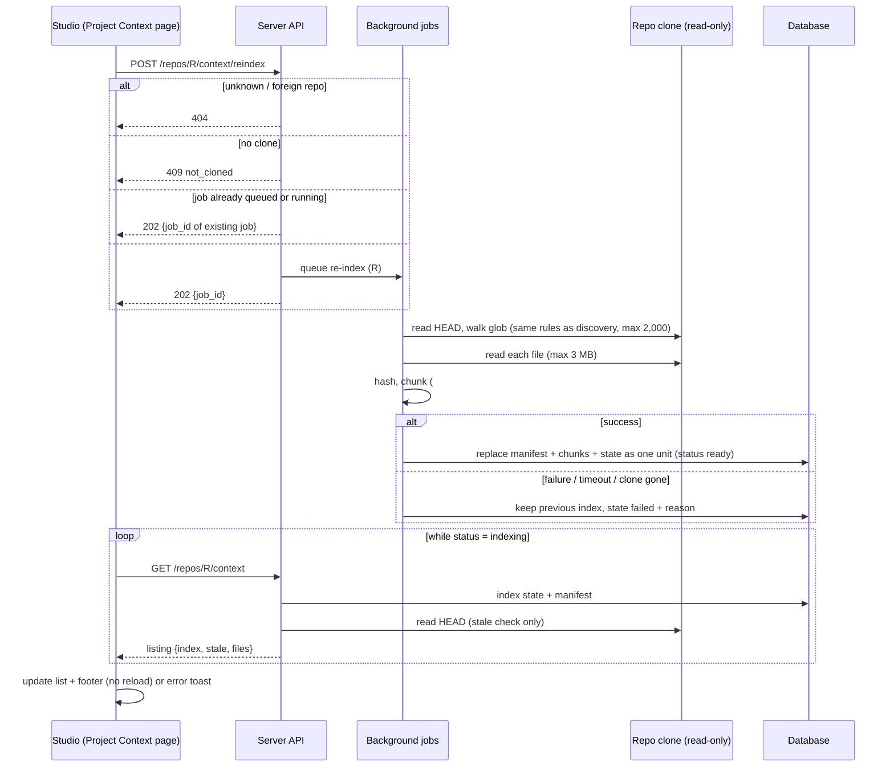
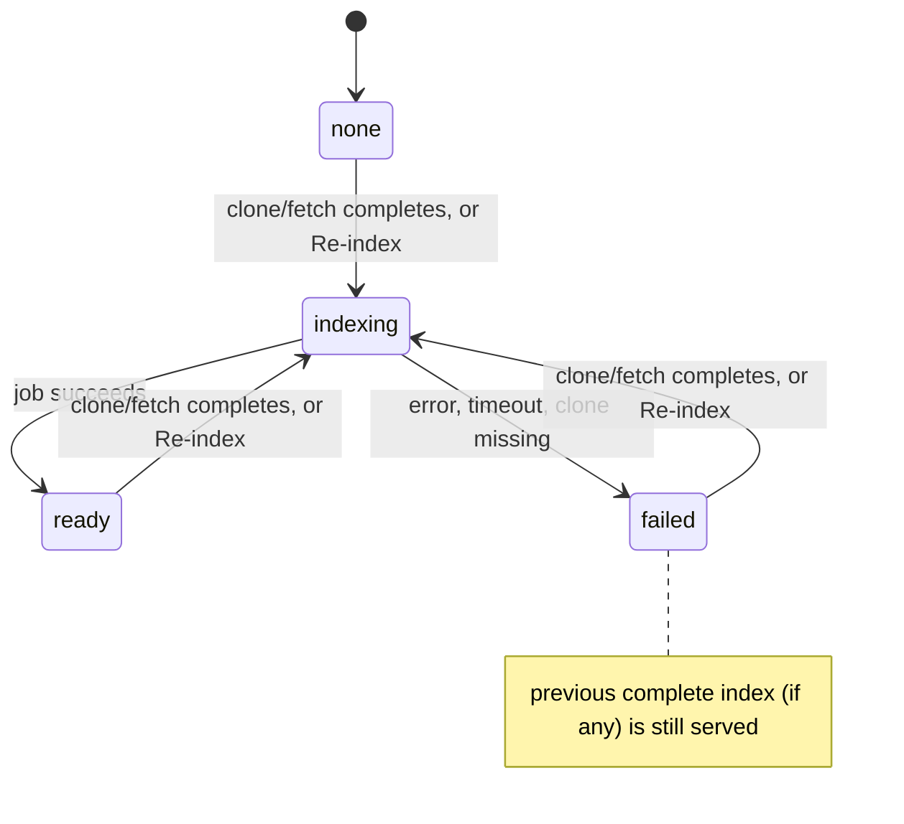

# Spec: Project Context index (file manifest + chunks)
Spec ID: SPEC-2026-10-13-project-context-index
Status: draft
Supersedes: [SPEC-2026-10-11-project-context](2026-10-11-project-context.md) (partially: the "No chunking" non-goal, the left-panel header action and footer of its AC-7, its AC-10, the state list of its AC-11, where its AC-36 cap applies, the `GET /repos/:repoId/context` contract and the discovery performance NFR; everything else stays in force)

> **Reading guide.** In this spec, `AC-n` refers to an AC of this spec. A
> criterion of the earlier spec is written as **old AC-n** (= SPEC-2026-10-11-project-context AC-n).

## Problem and user

The Project Context page (SPEC-2026-10-11-project-context) lists the markdown
documents of a repository by walking its local clone on every request. Nothing
is persisted. The footer "Indexed: N files · last scanned <time>" reports the
time of that request, not a real index. There is no stable, persisted view of
which documents exist, at which commit, and how they split into retrievable
pieces. A later feature (level C: embeddings and retrieval) needs exactly that
view, and needs it in a form that lets it skip unchanged pieces.

**User:** the DevDigest studio user who browses and attaches project documents
for a connected repository (same user as the earlier spec).

**Want:** the server keeps, per repository, a persisted index of the project
documents: a file manifest plus heading-based chunks, built from the clone and
stamped with the commit it was built from. The user can rebuild it with the
Re-index button in the Project Context left panel and sees "Indexed: N files ·
M chunks · last <relative time>" update without a page reload. The page tells the
user when the index is out of date with the clone.

### Current state (as of 2026-10-13, for context only)

- `GET /repos/:repoId/context` walks the clone on every call, reads each matched
  file to estimate tokens, and returns `scanned_at` = the request time. Nothing
  about documents is stored except the attachment lists.
- The left-panel header has a "refresh" icon button that only re-requests the
  listing (old AC-10). The footer reads "Indexed: N files · last scanned <rel>".
- Review runs and PR Brief read attached documents from the clone on disk at
  run time; they do not depend on the listing.
- repo-intel uses a background-job pattern: `POST /repos/:id/resync` answers 202
  and the client treats the job as finished when the index state's update time
  advances (120 s cap). After a clone or `POST /repos/:id/refresh`, repo-intel
  indexing is queued automatically and its failure never fails the clone.
- Background jobs run in-process with a 120 s per-job timeout; there is no
  de-duplication of jobs and no job-status endpoint.

## Goals / Non-goals

### Goals

- **Persisted index per repository:**
  - a file manifest: one entry per indexed document;
  - heading-based chunks per document;
  - an index state: status, indexed time, indexed commit, file and chunk counts.
- **Re-index:** `POST /repos/:repoId/context/reindex` rebuilds the index from the
  clone as a background job (202). The left-panel Re-index button calls it.
- **Automatic re-index** after every successful clone or fetch of the repository.
- **Listing from the index:** the Project Context listing is served from the
  index, with a `stale` flag when the clone or the glob no longer matches it.
- **Footer:** "Indexed: N files · M chunks · last <relative time>", updated after
  a re-index without a full page reload.
- **Embedding-ready hashes:** every chunk carries a content hash, so a later
  embedder can skip chunks whose text did not change.

### Non-goals

- **No embeddings, vector search or retrieval** (level C, a later feature). No
  LLM call of any kind is made while indexing.
- **No change to what runs read.** Review runs and PR Brief keep reading attached
  documents from the clone on disk, exactly as in old AC-24 to AC-29. The index
  is not consulted at run time, and old AC-25 and old AC-28 are unchanged.
- **No change to the document preview.** `GET /repos/:repoId/context/file` keeps
  reading from the clone (old AC-8, AC-11, AC-18).
- **No chunk browsing.** No endpoint or UI lists, shows or searches chunks; only
  the chunk count is visible.
- **No COVERAGE ring or score.** The earlier drop of the "78 COVERAGE" ring stays.
- **No document editing or file management.** The design's left-panel header
  also shows "New file", "New folder" and "Upload" (arrow-up) icon buttons. Their
  behaviour (creating or uploading files) is out of scope, consistent with the
  earlier view-only decision, and they are not shown at all (AC-19,
  user decision OQ6 = b, a deliberate deviation from screenshot 41). There is no
  "Download" button in the design and none is added.
- **No change to the Agent and Skill Context tabs.** They keep their current
  behaviour; whatever document list they show comes from the listing contract
  (AC-13).
- **No incremental-index contract.** A re-index must produce the same result as a
  full rebuild. Whether unchanged files are internally reused is a planning
  decision.
- **No backfill on deploy.** Repositories cloned before this feature show "Not
  indexed yet" until their next clone or fetch, or a manual Re-index.

### Amendments to SPEC-2026-10-11-project-context

| Old item | Change |
|---|---|
| Non-goal "No chunking" | Replaced. Heading-based chunking and the "chunks" count are in scope (AC-5, AC-14). The embedding part of that non-goal still holds. |
| old AC-7 (header, footer) | Header action "refresh" becomes the Re-index button (AC-15, AC-19). Footer becomes the two-line layout of AC-14. The rest of old AC-7 (title, repository name, rows, area badges, first document selected, no add-file, add-folder or upload actions) is unchanged; AC-19 confirms the last point (OQ6 = b). |
| old AC-10 (refresh) | Superseded by AC-15 to AC-18. |
| old AC-11 (page states) | Extended with "Not indexed yet", "Re-indexing" and "index out of date" (AC-14, AC-16). The "Not cloned yet" state still takes precedence over every index state. |
| old AC-36 (2,000 cap) | The cap now applies when the index is built (AC-4). The listing returns the indexed entries, and `truncated`/`total` come from the index. The "showing first 2,000" notice is unchanged. |
| Contract `GET /repos/:repoId/context` | `scanned_at` is replaced by the `index` object and `stale` flag (AC-13). |
| NFR "Performance, discovery" | Replaced by the listing and re-index NFRs of this spec. |

Old AC-1 to AC-5 (glob, exclusions, symlink rule, type, token rule, 3 MB limit)
remain the rules for which documents are indexed and how their fields are derived.

## User stories

- **US-1** — As a studio user, I want to rebuild a repository's project-context
  index on demand, so that the listing reflects the current clone.
- **US-2** — As a studio user, I want the index rebuilt automatically after the
  repository is cloned or fetched, so that I do not have to remember to re-index.
- **US-3** — As a studio user, I want the left-panel footer to show how many
  files and chunks are indexed and when, and to tell me when the index is out of
  date, so that I know how fresh the document list is.
- **US-4** — As the author of the later embeddings feature, I want each document
  persisted as deterministic heading-based chunks with content hashes, so that
  embeddings can be computed only for chunks whose text changed.
- **US-5** — As a studio user, I want a failed or concurrent re-index never to
  lose or corrupt the existing index, so that the page keeps working.
- **US-6** — As a studio user, I want reviews to behave exactly as before
  whatever the index state is, so that indexing cannot break a review.

## Acceptance criteria (EARS)

> **Size note:** 19 ACs, above the usual ~15. It is one feature (index build +
> its single UI surface); the server-side index and the footer/button share one
> contract, so it is kept as one cross-module spec rather than split.

### A. Building the index

- **AC-1** — WHEN `POST /repos/:repoId/context/reindex` is received for a cloned
  repository of the caller's workspace and no re-index of that repository is
  queued or running, the server (shall) queue one re-index job, answer
  `202 { status: "accepted", job_id }`, and report `index.status = "indexing"` in
  the listing (AC-13) until the job ends.

  Traces: US-1. Verify: integration - POST returns 202 with a job id; an
  immediate GET shows `index.status: "indexing"`; after the job ends GET shows
  `"ready"` with a later `indexed_at`.
- **AC-2** — IF the re-index request names an unknown repository, a repository
  outside the caller's workspace, or a repository without a clone, or the job
  cannot be queued, THEN the server (shall) answer 404 (unknown or foreign),
  `409 { code: "not_cloned" }` (no clone) or 503 (job cannot be queued), queue no
  job, and leave the stored index and its state unchanged.

  Traces: US-1, US-5. Verify: integration - foreign repo → 404, uncloned repo →
  409 `not_cloned`, a job queue that rejects the job → 503; the index state is
  identical before and after each.
- **AC-3** — WHILE a re-index of a repository is queued or running, whatever
  started it (button, clone, fetch), the server (shall) answer a further
  re-index request for that repository with 202 and the job id of the existing
  job, and (shall) not queue a second job.

  Traces: US-1, US-5. Verify: integration - two POSTs in a row return the same
  `job_id`, and exactly one job of this kind exists for the repository.
- **AC-4** — WHEN a re-index job runs, the server (shall) build the manifest from
  exactly the documents that discovery selects under old AC-1 to AC-5 and old
  AC-36: the configured glob, the excluded directories, the symlink and
  inside-clone rule, at most 2,000 entries sorted by path. It (shall) record, per
  entry, `path`, `type`, `size`, `tokens` (old AC-5 rule), `content_hash`
  (AC-6) and the flags of AC-7. It (shall) record in the index state:
  - `indexed_at` (time the job finished);
  - `indexed_sha` (the clone's HEAD commit when the job read the clone);
  - `glob` used;
  - `files` (manifest entry count) and `chunks` (total chunk count);
  - `truncated` and `total` (old AC-36 semantics).

  Traces: US-1, US-3. Verify: integration - the fixture clone of old AC-1 yields
  manifest paths exactly a, b, c; a 2,001-file fixture yields 2,000 entries,
  `truncated: true`, `total: 2001`; `indexed_sha` equals the clone HEAD.
- **AC-5** — The server (shall) split each indexable document (UTF-8, ≤ 3 MB,
  not whitespace-only) into ordered chunks by these rules:
  1. a chunk starts at every ATX heading of level 1, 2 or 3 (`#`, `##`, `###`)
     that is not inside a fenced code block; deeper headings do not start a
     chunk;
  2. non-empty text before the first such heading is its own chunk (preamble);
  3. a section whose tokens exceed 800 is split further at blank-line
     boundaries, and any piece still above 800 tokens is hard-split into pieces
     of at most 800 tokens;
  4. tokens are `ceil(characters / 4)`, the studio-wide rule;
  5. each chunk records its ordinal, its heading breadcrumb (the chain of
     enclosing level 1–3 heading texts), its start and end character offsets in
     the document, its tokens, its exact text and its `content_hash` (AC-6).

  Concatenating a document's chunk texts in order (shall) reproduce the document
  text exactly.

  Traces: US-4. Verify: unit - a fixture with a preamble, `#`/`##`/`###`/`####`
  headings, a `## x` line inside a fenced code block, and a 3,500-token section
  without blank lines yields the expected chunk list (no chunk above 800 tokens,
  fenced heading not split, `####` not split); concatenation equals the input.
- **AC-6** — The server (shall) set each chunk's `content_hash` to the lowercase
  hex SHA-256 of the chunk's exact UTF-8 text (no normalisation) and each
  manifest entry's `content_hash` to the SHA-256 of the file's raw bytes, and
  (shall) chunk deterministically: re-indexing an unchanged file yields the same
  chunk texts, offsets, breadcrumbs, ordinals and hashes. Chunk identifiers may
  change between re-indexes.

  Traces: US-4. Verify: unit - chunking the same input twice gives identical
  output; integration - two re-indexes of an unchanged clone give identical
  (path, ordinal, content_hash) sets, and editing one section changes only that
  section's chunk hashes.
- **AC-7** — IF a matched document is over 3 MB, not valid UTF-8 or unreadable,
  or whitespace-only, THEN the server (shall) still record its manifest entry
  with the flag `too_large`, `unreadable` or `empty` respectively and with zero
  chunks, counted in `files` and contributing nothing to `chunks`.

  Traces: US-4, US-5. Verify: integration - a fixture with one file of each kind
  plus one normal file gives `files: 4`, chunks only for the normal file, and
  the three flags set.
- **AC-8** — The server (shall) replace a repository's manifest, chunks and
  index-state counts as one unit, so that a reader at any moment sees either the
  complete previous index or the complete new one.

  Traces: US-5. Verify: integration - listings requested repeatedly during a
  build never mix entries or counts of two builds.
- **AC-9** — IF a re-index job fails, loses its clone, or exceeds the job
  timeout, THEN the server (shall) keep the previous index unchanged and set
  `index.status = "failed"` with `failed_at` and `failure_reason`
  (`timeout` | `clone_missing` | `internal_error`).

  Traces: US-5. Verify: integration - a job made to fail mid-build leaves the
  previous `files`, `chunks`, `indexed_at`, `indexed_sha` and chunk rows intact,
  with `status: "failed"` and a reason.
- **AC-10** — WHEN the clone job of a repository (initial clone, or the fetch
  started by `POST /repos/:id/refresh`) completes successfully, the server
  (shall) queue a re-index of that repository under the AC-3 rule, without
  letting a failure to queue or to build the index change the outcome of the
  clone or the refresh.

  Traces: US-2. Verify: integration - after adding a repository and the clone
  job finishing, the listing reaches `status: "ready"` with no POST; with a
  failing index job the repository's clone path is still recorded and the
  refresh request still answers as before.
- **AC-11** — WHEN a repository is deleted, the server (shall) remove its
  manifest, chunks and index state.

  Traces: US-5. Verify: integration - after deleting repo A, no manifest, chunk
  or state row for A remains, and repo B's index is intact.
- **AC-12** — The server (shall) assemble review-run and PR Brief project context
  from the clone on disk under old AC-24 to AC-29, regardless of whether the
  repository's index is missing, indexing, failed or stale.

  Traces: US-6. Verify: integration - with no index, and again with a stale
  index whose manifest lacks the attached path, a run includes the attached
  document read from disk and the trace equals the pre-feature trace.

### B. Listing

- **AC-13** — WHEN `GET /repos/:repoId/context` is requested for a cloned
  repository, the server (shall) answer from the index, without walking or
  reading document files of the clone, with:
  - `files`: the manifest entries of the last complete index (old shape:
    `path`, `type`, `size`, `tokens`, `too_large`, `used_by`, with `used_by`
    computed at request time per old AC-9), or `[]` when the repository was
    never indexed;
  - `index: { status: "none" | "indexing" | "ready" | "failed", indexed_at,
    indexed_sha, files, chunks, failed_at?, failure_reason? }`, carrying the last
    complete index's values while indexing or after a failure;
  - `stale: true` when an index exists and the clone's current HEAD differs from
    `indexed_sha`, or the clone's HEAD cannot be read, or the configured glob
    differs from the glob the index was built with; otherwise `stale: false`.

  Traces: US-3. Verify: integration - after a re-index, GET returns the
  manifest; after a new commit lands in the clone, GET returns `stale: true` and
  the old entries; with the clone directory removed but its path still
  recorded, GET returns `stale: true`; a never-indexed repository returns
  `files: []`, `status: "none"`.

### C. Project Context page

- **AC-14** — WHILE the Project Context page shows a cloned repository, the left
  panel footer (shall) render in muted text, per screenshot 42:
  - when an index exists, two lines:
    - line 1: a green status dot followed by "Indexed: N files · M chunks",
      where N is `index.files` and M is `index.chunks`, both with thousands
      separators (for example "Indexed: 12 files · 1,240 chunks");
    - line 2: "last <relative indexed_at>" (for example "last 5m ago"),
      followed by " · out of date" when `stale` is true;
  - when `index.status` is `"none"`, the single line "Not indexed yet", with the
    document list area showing a "Not indexed yet" empty state that offers the
    Re-index action.

  The out-of-date marker and the not-indexed state are text, not colour only.

  Traces: US-3. Verify: unit - each listing variant renders the exact two
  lines (1,240 chunks renders as "1,240"), the stale suffix, and the
  not-indexed line; e2e - a fresh index shows "Indexed: 3 files · 7 chunks" and
  "last just now" (fixture counts) on separate lines.
- **AC-15** — WHEN the user activates the Re-index icon button in the left-panel
  header, the studio (shall) request a re-index (AC-1) and, once
  `index.status` becomes `"ready"`, replace the list, file count, chunk count and
  relative time without a full page reload and without a success toast.

  Traces: US-1, US-3. Verify: e2e - after adding a file to the fixture clone and
  clicking Re-index, the new file appears and the footer counts and time update
  with no navigation and no toast.
- **AC-16** — WHILE `index.status` is `"indexing"` (from the button or any other
  trigger), the studio (shall) disable the Re-index button, show its icon
  spinning with the accessible name "Re-indexing…", replace footer line 2
  ("last <time>") with "Re-indexing…" inside a polite live region, and keep the
  previous list and footer line 1 (file and chunk counts) visible.

  Traces: US-1, US-3, US-5. Verify: unit - with `status: "indexing"` the button
  is disabled and named "Re-indexing…", line 2 / the live region holds
  "Re-indexing…", line 1 still shows the previous counts, and the previous rows
  remain.
- **AC-17** — IF a re-index request is rejected or fails to reach the server,
  the job ends with `"failed"`, or `index.status` is still `"indexing"` 150 s
  after the user's request, THEN the studio (shall) show an error toast, keep the
  previous list and footer values, stop waiting for the job, and re-enable the
  Re-index button.

  Traces: US-5. Verify: unit - a 409 response, a 503 response, a network error,
  a `failed` status and a status still `indexing` after 150 s (fake timers) each
  show the toast, keep the footer text and leave the button enabled.
- **AC-18** — WHILE the active repository has no clone, the studio (shall) show
  the Re-index button disabled with the hint "Clone the repository first" as its
  tooltip and accessible description.

  Traces: US-1. Verify: unit - an uncloned repository renders a disabled button
  carrying the hint.
- **AC-19** — The left-panel header icon row (shall) contain the Re-index icon
  button (the refresh icon of screenshot 41) as its only control, with no "New
  file" (plus), "New folder", "Upload" (arrow-up) or "Download" control. This
  deliberately deviates from screenshot 41, which shows the first three icons,
  at the user's explicit request (OQ6 = b).

  Traces: US-1. Verify: e2e - the header has exactly one button, named
  "Re-index"; none of the four excluded controls exists.

## Edge cases

- **Re-index while the clone is being fetched (AC-3, AC-10, AC-13):** a manual
  re-index that runs before the fetch finishes indexes the old HEAD. The re-index
  queued when the fetch completes then builds from the new HEAD. If that one is
  coalesced into a still-running job, the listing shows `stale: true` until the
  next re-index.
- **Button clicked while an automatic re-index is already running (AC-3,
  AC-16):** the request returns the existing job. The button is already disabled
  because the status is `"indexing"`.
- **Clone removed while a job runs (AC-9):** the job fails with `clone_missing`.
  The previous index stays.
- **Job exceeds the background-job timeout (AC-9):** status `failed`, reason
  `timeout`, previous index kept.
- **Glob changed in configuration (AC-13, AC-14):** the existing index is kept
  and marked `stale`; the footer shows "· out of date" until re-indexed.
- **Repository never indexed, for example cloned before this feature (AC-13,
  AC-14):** "Not indexed yet". The next fetch, or the Re-index button, builds it.
  Agent and Skill Context tabs show attached paths as "not found" until then
  (old AC-13 rule applied to an empty listing). Runs are unaffected (AC-12).
- **Indexed document deleted from the clone (AC-12, AC-13):** the listing still
  shows it until re-index, with `stale: true` if HEAD moved. Its preview shows
  the existing "not found" notice (old AC-11). A run skips it as `missing`.
- **File over 3 MB, binary named `.md`, whitespace-only (AC-7):** listed with
  their flags; zero chunks.
- **Document with no level 1–3 heading (AC-5):** a single preamble chunk, split
  by AC-5 rule 3 if above 800 tokens.
- **Heading-like line inside a fenced code block, or an unclosed fence (AC-5):**
  a heading inside a fence never starts a chunk. An unclosed fence runs to the end
  of the document, so no later heading starts a chunk.
- **Setext headings (`Title` underlined with `===`), headings of level 4–6
  (AC-5):** never start a chunk.
- **Very long line without blank lines (AC-5):** hard-split at the token cap;
  offsets still cover the text exactly.
- **CRLF line endings, BOM (AC-5, AC-6):** offsets and hashes are taken over the
  decoded text as stored. Hashes therefore differ between CRLF and LF versions of
  the same text (no normalisation, by decision).
- **More than 2,000 matches (AC-4, AC-13):** only the first 2,000 by path are
  indexed; the "showing first 2,000" notice (old AC-36) is driven by the index's
  `truncated`.
- **Repository deleted while a job runs (AC-11):** no index rows remain for it
  afterwards.
- **Two studio tabs open (AC-15, AC-16):** both show "Re-indexing…" while the
  job runs and both update when it ends.
- **Repository switched while a re-index runs (AC-15, AC-16):** the job continues
  for the original repository; the page shows the newly active repository's own
  index state.

## Non-functional requirements

- **Performance, listing:** `GET /repos/:repoId/context` answers within 300 ms
  (p95, local host) for an index of 2,000 entries, including the stale check.
- **Performance, re-index:** a re-index of 1,000 documents totalling ≤ 20 MB
  completes within 30 s on the local host, well below the 120 s job timeout.
- **UI update latency:** after a job ends, the footer reflects the new state
  within 3 s without user action (AC-15, AC-17).
- **LLM calls:** indexing makes zero LLM or network calls (only the clone on disk
  and the database are touched).
- **Security, file access:** the index contains only files that discovery may
  list (old AC-1, AC-4). No file outside that set, such as `.env`, is ever read
  into the manifest or a chunk. Every `:repoId` is checked against the caller's
  workspace (AC-2).
- **Accessibility:** the Re-index button has an accessible name ("Re-index", or
  "Re-indexing…" while running) and is keyboard-operable. The disabled-state
  hint is exposed as an accessible description. The "Re-indexing…" status is
  announced through a polite live region. "· out of date" and "Not indexed yet"
  are text.
- **Observability:** every finished job logs one line
  `project context index: <files> files, <chunks> chunks, <ms> ms, sha <sha>`.
  Every failed job logs `project context index failed: <reason>` with the
  repository id. A coalesced request (AC-3) logs nothing extra.

## Inputs and provenance

### Decisions (user-confirmed, 2026-10-13, relayed by the coordinating agent)

- Level "B": persisted manifest + chunks, no embeddings.
- Q1: re-index is a background job answering 202.
- Q2: automatic re-index after clone and after `POST /repos/:id/refresh`, never
  failing them.
- Q3: the listing is served from the index, with `index{status, indexed_at,
  indexed_sha, files, chunks}`, a `stale` flag and a "Not indexed yet" state.
- Q4: runs and PR Brief are unchanged and read from disk; old AC-25 and AC-28
  untouched.
- Q5: chunking at `#`/`##`/`###` outside fenced code, a preamble chunk, an
  800-token cap (split at blank lines, then hard-split), `ceil(chars/4)`, and a
  breadcrumb, offsets, tokens, text and hash per chunk.
- Q6: too-large, unreadable and empty files become flagged entries with zero
  chunks, counted in files only.
- Q7: not cloned → 409 `not_cloned` and a disabled button with a hint;
  re-index already queued or running → 202 with the existing job.
- Q8: atomic swap; on failure the old index is kept, and the state is `failed`
  with time and reason; error toast; footer keeps the old values.
- Q9: Re-index replaces the refresh action.
- Q10: spinner, disabled button named "Re-indexing…", polite live footer text,
  no success toast, error toast on failure, "· out of date", "Not indexed yet".
- Q11: same scope as discovery, including the 2,000-file cap.
- Q12: SHA-256 of the chunk text and of the file bytes; deterministic chunking;
  chunk ids may change.
- Design: the left-panel header icons in the design are New file, New folder,
  Upload and Re-index; only Re-index is in scope. There is no Download button.

Follow-up decisions (user-confirmed, 2026-10-13, relayed by the coordinating
agent; the former open questions OQ1 to OQ6, numbered separately from the
Q1–Q12 decisions above):
- job cannot be queued → 503, nothing queued, index state unchanged (AC-2,
  AC-17);
- while indexing, footer line 1 keeps the counts and only line 2 ("last <time>")
  is replaced by "Re-indexing…" (AC-16);
- clone HEAD unreadable → `stale: true` (AC-13);
- the studio relies on the server job timeout and gives up after 150 s on the
  client (AC-17);
- design screenshots 41 and 42 supplied (Design sources);
- OQ6 = (b): the New file, New folder and Upload icons are not shown; the
  header icon row holds only Re-index, and still no Download (AC-19). This is a
  deliberate deviation from screenshot 41 at the user's explicit request.

### Design sources

User screenshots are the source of truth and take priority over the `design/`
file for every visual detail:
- **Screenshot 41: left-panel header.** The caps title "PROJECT CONTEXT", a
  mono subtitle, and a row of four icon buttons: plus (New file), folder (New
  folder), arrow-up (Upload) and refresh (Re-index). Used by AC-15, AC-16, AC-18
  and AC-19. Only the Re-index icon is implemented. Omitting the other three is
  a deliberate deviation at the user's explicit request (OQ6 = b).
- **Screenshot 42: left-panel footer.** Muted text on two lines: a green dot
  plus "Indexed: 12 files · 1,240 chunks" on line 1, then "last 5m ago" on line
  2. Used by AC-14 and AC-16.
- **Fallback:** `design/DevDigest Design (standalone) (3).html`, screen N6
  (Project Context).
- **States beyond the design**, confirmed by the user (Q7, Q10): "Re-indexing…",
  "· out of date", "Not indexed yet", disabled-with-hint and the error toast.
  The screenshots do not show them, so they reuse the footer's muted style and
  the existing icon-button style.
- **Header subtitle discrepancy, not changed by this spec.** Screenshot 41
  shows `.devdigest/specs/` under the title, but the earlier spec's
  screenshot-based revision (old AC-7) shows the repository name there. Old
  AC-7 stays in force: this spec does not change the subtitle. The user has not
  answered this yet; it is a noted item that does not block this spec.

### Inputs and outputs

| Input / output | Source → destination | Trust |
|---|---|---|
| Re-index request (`:repoId`) | studio Re-index button → server | untrusted id, workspace-checked (AC-2) |
| Clone completion (initial clone or fetch) | clone job → re-index trigger (AC-10) | server-internal |
| Document files, paths, headings | repository clone (default branch, last sync) → manifest and chunks | untrusted content |
| Clone HEAD commit | repository clone → `indexed_sha`, stale check | server-derived |
| Document glob | server configuration → index scope, stale check | operator-trusted, validated (old AC-3) |
| Manifest, chunks, index state | server → database; database → listing (AC-13); later → level C embedder | server-produced data |
| Listing | server → Project Context page, Agent and Skill Context tabs | server-produced |

### Contracts

Contract level only; names of storage structures are left to the plan.

- `POST /repos/:repoId/context/reindex` (no body)
  - `202 { status: "accepted", job_id }`: queued (AC-1) or already queued/running
    (AC-3, same `job_id`).
  - `404`: unknown or foreign repository (AC-2).
  - `409 { code: "not_cloned" }`: repository has no clone (AC-2).
  - `503`: the job cannot be queued; nothing queued, index unchanged (AC-2).
- `GET /repos/:repoId/context`:
  `{ glob, cloned, truncated, total, stale, index: { status, indexed_at,
  indexed_sha, files, chunks, failed_at?, failure_reason? }, files: [{ path, type,
  size, tokens, too_large, used_by }] }`. `scanned_at` is removed. `indexed_at`
  and `indexed_sha` are `null` while `status` is `"none"`. A repository with no
  clone keeps the old answer: `cloned: false`, `files: []`.
- **Persisted manifest entry (per repository):** `path`, `type`, `size`,
  `tokens`, `content_hash` (SHA-256 of bytes), flags `too_large`, `unreadable`,
  `empty`.
- **Persisted chunk (per manifest entry):** `ordinal`, `breadcrumb` (ordered
  heading texts), `start_offset`, `end_offset` (characters, end exclusive),
  `tokens`, `text`, `content_hash` (SHA-256 of text).
- **Persisted index state (per repository):** `status`, `indexed_at`,
  `indexed_sha`, `glob`, `files`, `chunks`, `truncated`, `total`, `failed_at`,
  `failure_reason`.
- **Level C hand-off:** a later embedder may key embeddings by chunk
  `content_hash`. This spec guarantees only hash stability (AC-6), not chunk-id
  stability.

### Re-index flow

### Index status

### Failure at each boundary

| Boundary | Failure | Behaviour |
|---|---|---|
| UI → API re-index | 404, 409, 503, network, 5xx | nothing queued; error toast; old footer kept (AC-2, AC-17) |
| API → background jobs | job cannot be queued | 503; nothing queued; index state unchanged (AC-2) |
| UI waiting for job | still `indexing` after 150 s | error toast; button re-enabled; server job timeout still applies (AC-9, AC-17) |
| Job → clone | clone missing, unreadable HEAD | job `failed` (`clone_missing`); old index kept (AC-9) |
| Job → clone, per file | too large, not UTF-8, unreadable, empty | flagged entry, zero chunks; job continues (AC-7) |
| Job → database | write fails | job `failed` (`internal_error`); old index kept (AC-8, AC-9) |
| Job runtime | over the job timeout | job `failed` (`timeout`); old index kept (AC-9) |
| Clone job → re-index trigger | cannot queue, or index job fails | clone / refresh outcome unchanged (AC-10) |
| UI → API listing | network or 5xx | existing discovery error state with Retry (old AC-11) |
| API → clone during listing | HEAD unreadable | `stale: true` (AC-13) |
| Run time | index missing / stale / failed | no effect; runs read from disk (AC-12) |

### Research sources

- Repository reading (2026-10-13): the project-context listing walks and reads
  the clone per request and returns `scanned_at` = now. Runs and PR Brief read
  attached files from disk. The left panel has a refresh button and the footer
  "Indexed: N files · last scanned".
- repo-intel pattern: `POST /repos/:id/resync` → 202 plus job id. Indexing is
  queued after the clone job and after `POST /repos/:id/refresh` and never fails
  them. Background jobs have no de-duplication, no status endpoint and a 120 s
  timeout.
- `client/INSIGHTS.md` (2026-10-02): resync completion is observed as the index
  state's update time advancing, not the 202 answer. `server/INSIGHTS.md`
  (2026-10-11): the project-context file adapter fails closed on symlinks and
  `realpath` errors; path-rule violations are 400 and malformed requests 422.

## Untrusted inputs

- **Document content** (repository markdown, any contributor):
  - stored as chunk text as data only;
  - never executed, interpreted, fetched or followed;
  - no LLM sees it during indexing;
  - when later sent to a model (level C), the untrusted-delimiter rules of old
    AC-26 and AC-27 apply.
- **Heading text (breadcrumbs):** derived from untrusted content. It is stored
  as plain text, and any future display renders it as text, never as HTML or
  markdown links.
- **Document paths:** only paths that pass discovery (old AC-1 and AC-4: inside
  the clone, no symlinks, excluded directories, old AC-28 path rules) enter the
  manifest. They are rendered as text only.
- **`:repoId` path parameter:** client-supplied; shape-validated and
  workspace-checked before any job is queued (AC-2).
- **Repeated or concurrent re-index requests:** coalesced into one job (AC-3).
  They can never run two builds of one repository at once.
- **Clone HEAD and configured glob:** server- and operator-derived. They are used
  only for `indexed_sha` and the stale check, never echoed into a prompt.
- **Index values served to the client** (counts, flags, status, stale): computed
  by the server. The client never supplies them.

## Open questions

No open question blocks this spec. OQ1 to OQ6 were resolved on 2026-10-13 (see
Inputs and provenance → Follow-up decisions):
- 503 when the job cannot be queued (AC-2);
- counts kept and only "last <time>" replaced while indexing (AC-16);
- `stale: true` when HEAD is unreadable (AC-13);
- server job timeout plus a 150 s client cap (AC-17);
- screenshots 41 and 42 supplied (Design sources, AC-14);
- New file, New folder and Upload icons omitted, a deliberate deviation from
  screenshot 41 (AC-19).

- **Noted, non-blocking (unanswered):** screenshot 41 shows `.devdigest/specs/`
  as the header subtitle, while old AC-7 (an earlier screenshot decision) shows
  the repository name. Old AC-7 stays unchanged unless the user decides
  otherwise (see Design sources).
- Note for the implementation planner (not a user question): the earlier spec's
  old AC-10 test ("add a file and refresh") must move to the Re-index flow
  (AC-15). The client's current listing type carries `scanned_at`, which this
  spec removes.
