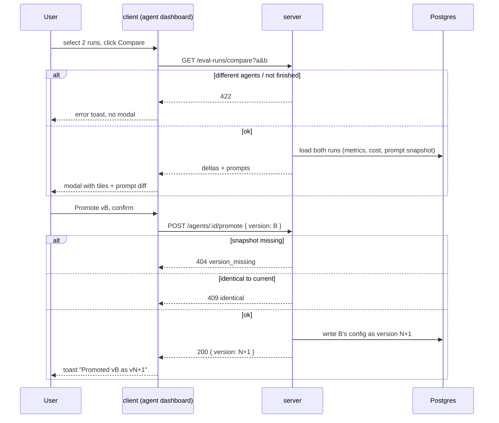
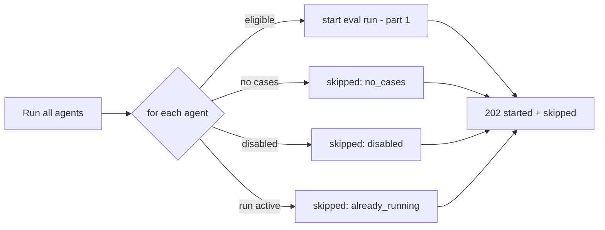

# Spec: Eval Pipeline (part 2 of 2): Eval Dashboard, compare, promote
Spec ID: SPEC-2026-10-14-eval-dashboard
Status: draft
Supersedes: none

Part 1 (eval cases, agent-level eval runs, metric definitions, API):
[SPEC-2026-10-14-eval-pipeline](2026-10-14-eval-pipeline.md). This part reads
the eval runs that part 1 produces. Metric values, `null` ("no data") rules,
run statuses and the run snapshot (agent version, provider, model, strategy,
system prompt) are defined there and are not redefined here. Both parts span
`server` and `client`.

## Problem and user

Part 1 records an eval run each time an agent runs on its case set. One run
alone does not answer the real question: "did my last prompt change make the
agent better or worse, and should I keep it?" To answer it, the user needs to:
- see the trend across runs;
- spot a regression without reading numbers;
- put two runs side by side (old prompt vs new prompt) with metric deltas and
  the prompt diff;
- keep the better configuration.

**User:** the DevDigest studio user who owns and tunes review agents.

### Current state (as of 2026-10-14, for context only)

- The sidebar has WORKSPACE (Pull Requests, Onboarding Tour, Project Context)
  and SKILLS LAB (Agents, Skills, Conventions). There is no Eval Dashboard
  item.
  - The sidebar definition is vendored UI. It has already been edited locally
    once, to add Project Context.
  - The shell already maps paths starting with `/eval` to an "eval" nav key,
    and the shell messages already contain "Eval Dashboard".
- No eval page or route exists in the client. Eval dashboard strings
  (metrics, legend, table columns, "No runs yet…") exist in the client
  messages but are unused.
- The shared contracts define `EvalDashboard` (current metrics, delta, trend,
  recent runs, alert) and `EvalTrendPoint`, with non-null metric numbers. No
  compare contract exists.
- Agents keep an immutable config snapshot for every version. Two read-only
  endpoints list versions and get one version. There is no restore or
  promote for agents.
  - Skills have a roll-forward "Restore", which writes an old version's body
    as a new latest version. That is the pattern this spec follows.

## Goals / Non-goals

### Goals

- An "Eval Dashboard" item in the SKILLS LAB sidebar group opens the
  all-agents dashboard (screenshot 3).
- A per-agent eval dashboard (screenshot 4) with:
  - agent switcher;
  - date filter;
  - "Run eval";
  - regression banner;
  - metric cards with deltas and sparklines;
  - metric trend chart;
  - recent runs table with selection and "Compare".
- A Compare modal for exactly two runs of one agent (screenshot 5), with:
  - before→after values and deltas for recall, precision, citation and cost;
  - the system prompt diff between the two runs;
  - "Promote vN".
- Promote is roll-forward: the selected version's config is written as a new
  agent version.
- "Run all agents" starts an eval run for every eligible agent.

### Non-goals

- No compare of more than two runs, and no compare across different agents.
- No compare of skill links, model pricing, or per-case output diff in the
  modal. Only metrics, cost and the system prompt are compared, as in the
  design.
- No rollback that rewrites or deletes versions. Promote always appends a
  version.
- No dashboard for skill-owned evals.
- No notifications or alerts outside the page (the bell icon is unchanged).
- No export of eval history.

## User stories

- **US-1:** As an agent owner, I want an Eval Dashboard in the sidebar that
  shows every agent's latest eval metrics and the latest runs across agents,
  so that I can see at a glance which agent regressed.
- **US-2:** As an agent owner, I want to start eval runs for all agents with
  one button, so that I can refresh the whole picture after a change.
- **US-3:** As an agent owner, I want a per-agent dashboard with metric cards,
  a trend chart and a run history filtered by date, so that I can follow how
  the agent evolves across versions.
- **US-4:** As an agent owner, I want a clear banner when the latest run is
  worse than the previous one, so that I notice regressions without reading
  every number.
- **US-5:** As an agent owner, I want to compare two runs side by side (metric
  deltas and the system prompt diff), so that I can see what the prompt
  change did.
- **US-6:** As an agent owner, I want to promote the configuration of a
  compared run, so that I can keep the better version without retyping it.

## Acceptance criteria (EARS)

### Navigation and all-agents dashboard

- **AC-1:** The sidebar (shall) show an "Eval Dashboard" item (gauge icon)
  as the last entry of the SKILLS LAB group, linking to the all-agents
  dashboard. The item is highlighted as active on that page and on every
  per-agent dashboard page. The breadcrumb reads "Skills Lab › Eval
  Dashboard", plus "› <agent name>" on a per-agent page.
  Traces: US-1. Verify: unit - nav item present and active for both paths;
  e2e - click navigates.
- **AC-2:** The all-agents dashboard (shall) show the title "Eval Dashboard",
  the subtitle "Regression harness across all reviewer agents · pick an agent
  to see its runs", and an AGENTS list with one card for each agent of the
  workspace that has at least one eval case (screenshot 3). Each card shows:
  - agent name and model chip;
  - "Last run vN · <date time> · x/y pass", or "Never run";
  - a recall sparkline of up to the last 10 finished runs;
  - RECALL, PREC and CITE values of the latest finished run, or "—" for
    `null`;
  - a chevron.

  Clicking the card opens that agent's dashboard.
  Traces: US-1. Verify: unit - cards from mocked data incl. never-run and
  null values.
- **AC-3:** The all-agents dashboard (shall) show "RECENT EVAL RUNS · ALL
  AGENTS": the 20 most recent finished runs across agents, newest first.
  Each row shows:
  - agent name;
  - run time;
  - agent version as "vN";
  - recall, precision and citation as a bar plus a percentage ("—" for
    `null`);
  - pass count "x/y".
  Traces: US-1. Verify: unit - row rendering and ordering.
- **AC-4:** WHEN the user clicks "Run all agents", the system (shall) start
  one eval run, as in part 1, for each enabled agent that has at least one
  case and no active run. The response (shall) list the started runs and the
  skipped agents with a reason (`no_cases`, `already_running`, `disabled`).
  The client (shall) show a toast summary "Started N · skipped M". The
  button (shall) stay disabled with "Running…" while any run it started is
  running.
  Traces: US-2. Verify: integration - mixed eligibility gives correct
  started/skipped lists; unit - toast and button state.

### Per-agent dashboard

- **AC-5:** The per-agent dashboard (shall) show (screenshot 4):
  - an "All agents" back link;
  - agent name and model chip;
  - the subtitle "Regression harness · N runs on the M-case set", where N is
    the number of runs in the selected date range and M the current case
    count;
  - an agent switcher listing the agents of AC-2;
  - a date filter;
  - a "Run eval" button that starts an eval run as in part 1, with the same
    `409` / `422` handling shown as toasts.
  Traces: US-3. Verify: unit - header and controls; switcher navigates to the
  chosen agent's dashboard.
- **AC-6:** WHERE a date range is selected (options "7 days", "30 days", "90
  days" and "All time", default "30 days"), the metric cards, trend chart and
  recent runs table (shall) include only runs whose start time falls in that
  range. The selection (shall) persist in the page URL.
  Traces: US-3. Verify: unit - filtering of mocked runs by range; URL reload
  keeps the range.
- **AC-7:** The per-agent dashboard (shall) show RECALL, PRECISION and
  CITATION ACCURACY cards with:
  - the latest finished run's value in the range;
  - a delta in points against the previous finished run in the range, ▲
    green for up and ▼ red for down;
  - a sparkline of the metric over the runs in the range.

  A `null` value shows "—", with no delta, and is left out of the sparkline.
  Traces: US-3. Verify: unit - values, delta sign and color, null handling.
- **AC-8:** The per-agent dashboard (shall) show a "METRIC TREND" line chart
  with Recall, Precision and Citation series over the finished runs in the
  range, in chronological order, with a legend and a 0.6–1.0 default y-axis
  that widens when a value falls outside it. `null` points (shall) be omitted
  without breaking the series into a zero value.
  Traces: US-3. Verify: unit - series data built from mocked runs incl. a
  null and a value below 0.6.
- **AC-9:** The per-agent dashboard (shall) show "RECENT RUNS" with every run
  in the range, newest first. Each row has:
  - a selection checkbox;
  - ran at;
  - version "vN";
  - recall, precision and citation bar plus percentage;
  - pass "x/y";
  - cost "$0.00", or "—" when unknown.

  Runs with status `running` show "Running… k/N" and cannot be selected.
  `failed` runs show "failed" with the reason in a tooltip and cannot be
  selected. `partial` runs show a "partial" tag.
  Traces: US-3. Verify: unit - row variants per status.
- **AC-10:** WHILE fewer or more than two runs are selected, the "Compare"
  button (shall) be disabled. The header (shall) show "<k> selected".
  Selecting a third run (shall) be prevented, with the hint "Compare takes
  exactly two runs".
  Traces: US-5. Verify: unit - button state for 0/1/2 selections, third
  checkbox blocked.

### Regression banner

- **AC-11:** IF any metric of the latest finished run in the range is lower
  than the same metric of the previous finished run by at least 1 point (0.01),
  THEN the per-agent dashboard (shall) show a warning banner with
  `role="status"`. The text is built by code from a template, for example:
  "**Precision dipped 2pts** on v7 — a new false positive slipped in. Recall
  and citation both up."
  - It names every metric that dropped, with the drop rounded to whole
    points.
  - It names the latest version.
  - It ends with a sentence on the metrics that rose or held.
  - Metrics with `null` on either side are left out.
  - Fewer than two finished runs means no banner.
  Traces: US-4. Verify: unit - template output for one drop, two drops, no
  drop, null side.

### Compare modal

- **AC-12:** WHEN the user clicks "Compare" with two runs selected, the client
  (shall) open the modal "Compare runs · vA → vB" (screenshot 5):
  - the older run (by start time) is on the left (A) and the newer on the
    right (B);
  - the subtitle reads "Old prompt vs new — metric deltas and prompt diff on
    the M-case set";
  - RECALL, PRECISION, CITATION and COST tiles show "A → B" with a delta
    (points for metrics, dollars for cost) and ▲ or ▼;
  - `null` on either side shows "—" and no delta.
  Traces: US-5. Verify: unit - tiles from a mocked compare payload incl. null.
- **AC-13:** The Compare modal (shall) show "SYSTEM PROMPT DIFF" with a "vA
  (old)" and "vB (new)" legend and a line-level diff of the two runs' recorded
  system prompts. Removed lines are marked as old, added lines as new, and
  unchanged lines are plain. Each change is marked by color and by a
  text-equivalent prefix for screen readers. IF both prompts are identical,
  THEN the block (shall) show "System prompts are identical" instead.
  Traces: US-5. Verify: unit - diff rendering for changed and identical
  prompts.
- **AC-14:** IF the two selected runs belong to different agents, or either
  run is not finished, THEN the compare endpoint (shall) respond `422` and the
  client (shall) not open the modal.
  Traces: US-5. Verify: integration - `422` for a cross-agent pair.

### Promote

- **AC-15:** WHEN the user clicks "Promote vB" in the Compare modal and
  confirms, the system (shall) write the stored config snapshot of version B
  as a new agent version N+1: provider, model, system prompt, output schema,
  strategy, CI gate and repo-intel flag. Skill links are unchanged. The
  agent's current version becomes N+1. The modal (shall) close with the
  toast "Promoted v<B> as v<N+1>", and later eval runs and reviews use the
  new version.
  Traces: US-6. Verify: integration - agent version increases by 1 and its
  config equals version B's snapshot; unit - confirm dialog and toast.
- **AC-16:** IF version B's config is identical to the agent's current config,
  THEN "Promote vB" (shall) be disabled with the hint "v<B> is already the
  current configuration". IF the version B snapshot no longer exists, THEN
  the server (shall) respond `404 version_missing` and the agent (shall) stay
  unchanged.
  Traces: US-6. Verify: unit - disabled state; integration - `404` leaves the
  agent untouched.

### Empty and error states

- **AC-17:** IF there are no data to show, THEN each dashboard (shall) show
  an empty state and keep the layout without charts or tables:
  - no agent has eval cases: "No eval cases yet", with a link to Agents;
  - an agent has no runs in the range: "No runs in this range", plus "Run
    eval";
  - an agent has runs but none finished: the cards show "—".

  IF loading fails, THEN the page (shall) show an error state with a
  retry action.
  Traces: US-1, US-3. Verify: unit - each empty and error state.

## Edge cases

- **E-1, single finished run (AC-7, AC-11):** values shown, no deltas, no
  banner, sparkline with one point.
- **E-2, two runs with the same version (AC-12, AC-13):** allowed. The title
  reads "vN → vN". The prompt block shows "identical". Deltas reflect model
  non-determinism.
- **E-3, compare where B is older in version but newer in time (AC-12):**
  for example after a promote of v6 as v8, then compare v8 and a v7 run.
  Order is by run start time, not version number.
- **E-4, promote creates a version equal to an older one (AC-15):** allowed.
  Versions are append-only, and the new version number is shown.
- **E-5, agent deleted while its dashboard is open (AC-5):** the next request
  returns `404`. The page shows "Agent not found" with a link to all agents.
- **E-6, Run all agents with no eligible agent (AC-4):** nothing starts and
  the toast reads "Nothing to run · skipped M".
- **E-7, date range with only failed runs (AC-7, AC-8):** the cards show "—"
  and the chart is empty. The table still lists the failed rows.
- **E-8, very long system prompts (AC-13):** the diff block scrolls within
  the modal (max height 50% of the viewport). The modal does not grow past
  the viewport.
- **E-9, many runs (AC-9):** the table shows up to 50 runs in the range, newest
  first, with "Show more" for the rest.
- **E-10, long agent names (AC-2, AC-5):** truncated with an ellipsis and a
  full-text tooltip.
- **E-11, metric exactly 1 point lower (AC-11):** the banner shows (the
  threshold is inclusive). A drop of 0.9 points does not show it.

## Non-functional requirements

- **NFR-1, performance:** the all-agents dashboard and a per-agent dashboard
  with up to 200 runs in range each load in a single API request that responds
  within 500 ms on the local stack. The compare request responds within
  300 ms.
- **NFR-2, determinism:** the banner text, deltas and prompt diff are computed
  by code. The dashboards and compare make zero LLM calls.
- **NFR-3, security:** every dashboard, compare and promote request is
  scoped to the caller's workspace. A run or agent from another workspace
  returns `404`. Promote changes only the target agent.
- **NFR-4, accessibility:**
  - run checkboxes have the accessible name "Select run vN <date>";
  - deltas carry ▲ or ▼ and the word "up" or "down" for screen readers, not
    color only;
  - charts have a text summary (latest values) for screen readers;
  - the modal traps focus, closes on Esc and returns focus to "Compare";
  - the banner uses `role="status"`.
- **NFR-5, observability:** promote writes one log line with agent id, source
  version and new version. "Run all agents" writes one line with the started
  and skipped counts. No prompt text is logged.
- **NFR-6, i18n:** all labels come from the client message files. The
  existing eval dashboard strings are reused where they match.

## Inputs and provenance

### Data and contracts

- **Source data:** the agent-level eval runs of part 1, with status,
  metrics, pass counts, cost, duration, agent version and the snapshot of
  provider, model, strategy and system prompt. Also agent rows (name, model,
  current version, enabled) and agent version snapshots (for promote).
- **Nullable metrics:** the vendored `EvalDashboard` and `EvalTrendPoint`
  contracts declare non-null metric numbers. Dashboard responses need
  nullable metrics and run status, so the API shapes are module-local
  extensions, as in part 1 (D-10 there).

### API (contract level)

| Method and path | Purpose | Success | Errors |
|---|---|---|---|
| `GET /eval/dashboard` | all-agents cards + 20 recent runs | `200 { agents[], recent_runs[] }` | none |
| `GET /agents/:id/eval-dashboard?range=7d\|30d\|90d\|all` | per-agent page | `200 { agent, cases_total, current, delta, trend[], runs[], alert }` | `404` |
| `GET /eval-runs/compare?a=&b=` | compare payload | `200 { a, b, deltas, prompt_a, prompt_b }` | `404`, `422` |
| `POST /agents/:id/promote` `{ version }` | roll-forward promote | `200 { agent, version }` | `404 version_missing`, `409 identical` |
| `POST /eval-runs/all` | run all agents | `202 { started[], skipped[{agent_id, reason}] }` | none |

### Flows

### Failure at each boundary

- **client → server, dashboard load:** error state with retry (AC-17).
- **compare:** `422` (AC-14).
- **promote:** `404` or `409` (AC-16). The agent stays unchanged on any
  error.
- **Run all agents:** a failure starting one agent's run is reported as
  skipped with reason `error`. Other agents continue.

### Sources

- Design: screenshot 3 (all-agents dashboard), screenshot 4 (per-agent
  dashboard), screenshot 5 (Compare modal).
- Current state: verified by reading the agents schema and config-change
  rule, the sidebar navigation definition and the client eval and shell
  messages, plus repository research reports (2026-10-14) on agent
  versioning and the existing eval code.

## Untrusted inputs

- **System prompt text** shown in the prompt diff is user-authored config
  but may contain pasted content. It is rendered as plain text, never as HTML
  or markdown.
- **Agent names and case names** are rendered as text.
- **Query parameters** (`range`, run ids `a`/`b`, version) are validated as an
  enum or ids. Any other value returns `422` and is never interpolated into
  queries.
- **Banner text** is built from a code template with numeric values only. No
  free text from runs or the model is inserted.
- Run data originally derived from PR diffs and LLM output (part 1) reaches
  this part only as numbers and statuses.

## Open questions

- **Q-1:** [NEEDS CLARIFICATION] Promote direction. The design shows one
  "Promote vB" button for the newer run. When the newer run is the worse one
  (for example after the deliberately broken prompt), the user wants to
  promote the *older* run. Proposed: show "Promote vX" for whichever of the
  two runs is not the current configuration. If both differ, offer both.
- **Q-2:** [NEEDS CLARIFICATION] Should "Run all agents" include disabled
  agents? Proposed: no. Disabled agents are skipped with reason `disabled`.
- **Q-3:** [NEEDS CLARIFICATION] Date filter options are not visible in the
  design (only "30 days"). Proposed: 7 days / 30 days / 90 days / All time,
  default 30 days.
- **Q-4:** [NEEDS CLARIFICATION] The regression threshold and banner wording
  are not specified beyond the example. Proposed: drop ≥ 1 point on any
  metric, with template wording as in AC-11.
- **Q-5:** [NEEDS CLARIFICATION] Should the all-agents dashboard list agents
  without eval cases (as "No eval cases")? Proposed: no, only agents with at
  least one case. AC-17 covers the empty state.
- **Q-6:** [NEEDS CLARIFICATION, architecture] The Eval Dashboard nav item
  needs a local edit of the vendored sidebar definition (do-not-touch), like
  the earlier Project Context item. Proposed: allowed (assumed default), and
  recorded so that it is ported to the sync source. Flag for `docs/`.

### Assumed defaults (confirm in review)

These were not asked of the user and follow the spec author's recommendation.
They are reflected in the ACs above.

- **D-1:** Local edit of the vendored sidebar definition for the nav item
  (AC-1, Q-6).
- **D-2:** Compare takes exactly two runs of one agent, ordered by start time
  (AC-10, AC-12, AC-14).
- **D-3:** Promote is roll-forward from the newer run's version snapshot,
  skill links unchanged, disabled when identical (AC-15, AC-16).
- **D-4:**
  - recent runs list sizes are 20 on the all-agents page and 50 + "Show
    more" per agent (AC-3, E-9);
  - sparkline of up to 10 runs (AC-2).
- **D-5:** Nullable dashboard and compare shapes are module-local extensions,
  and the vendored contracts are not edited in place.
