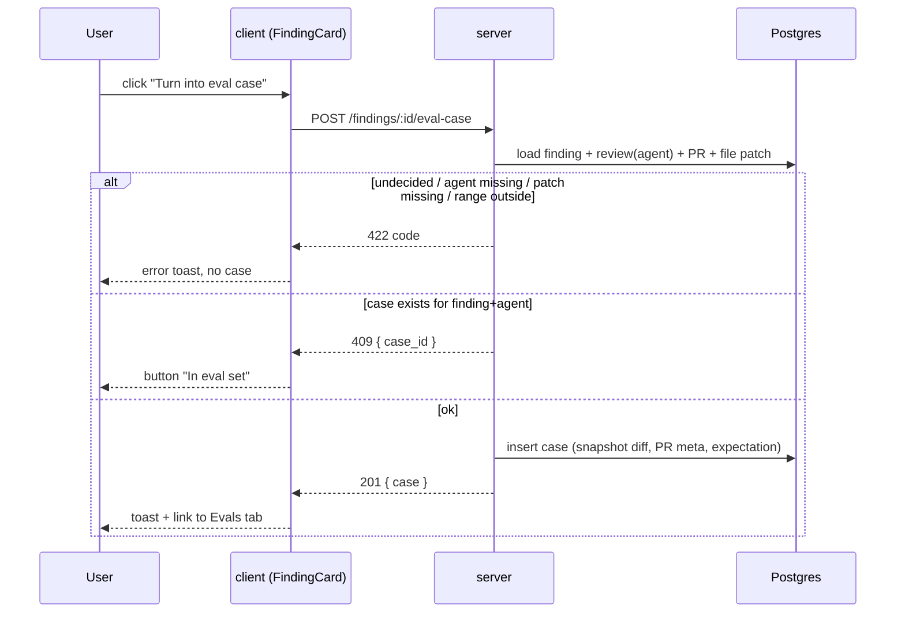
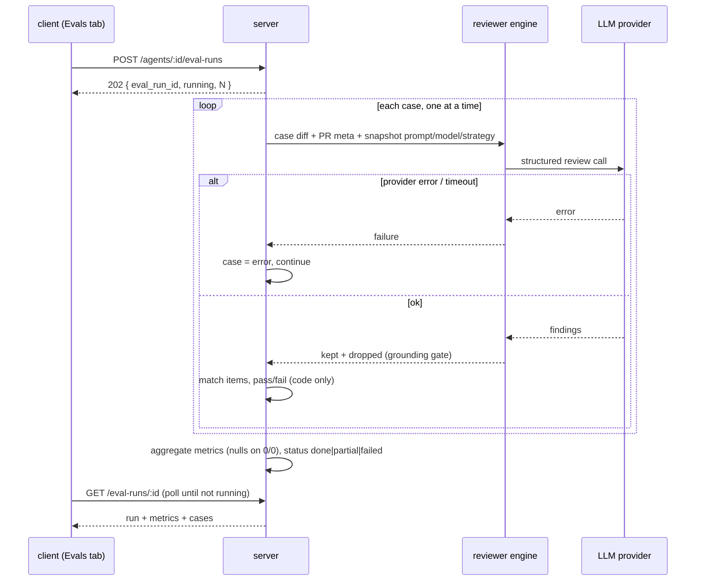
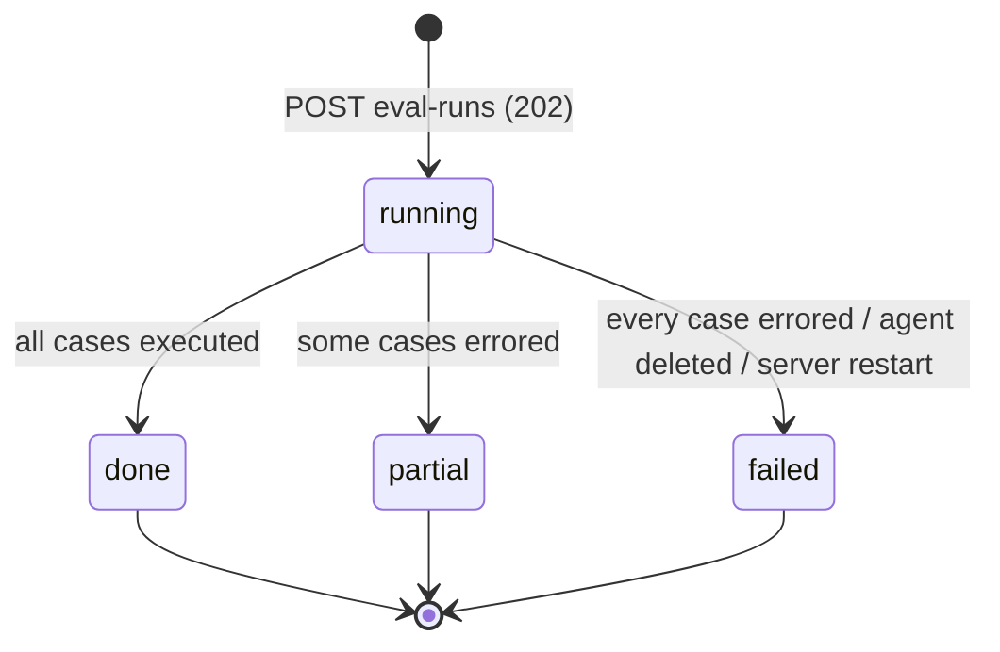

# Spec: Eval Pipeline (part 1 of 2): eval cases, eval runs, metrics
Spec ID: SPEC-2026-10-14-eval-pipeline
Status: draft
Supersedes: none

Part 2 (Eval Dashboard, run compare, promote, regression banner):
[SPEC-2026-10-14-eval-dashboard](2026-10-14-eval-dashboard.md). Part 2 uses the
eval run records, metric definitions and API contracts defined here. Both
parts span `server` and `client`.

## Problem and user

Review agents change all the time: someone edits a system prompt, switches the
model or changes the strategy. Today nothing tells the user whether the change
made the agent better or worse. A prompt edit can silently stop the agent from
finding something it used to find, or make it comment on code the user has
already marked as noise.

The user already has the ground truth. On earlier PRs they accepted findings
(real problems) and dismissed findings (noise). Those decisions are the
dataset. No invented scenarios are needed to start.

**User:** the DevDigest studio user who owns and tunes review agents.

**Want:**
- turn a decided finding into a regression case in one click (accepted:
  "must find X at file:line"; dismissed: "must NOT comment on Y");
- see all cases of an agent, and create or edit cases by hand when needed;
- run the agent on all its cases with fixed inputs, so runs of different agent
  versions can be compared;
- see recall, precision and citation accuracy. They are computed in code, with
  no model judging the output.

### Current state (as of 2026-10-14, for context only)

- **Pre-staged, unused storage:**
  - An eval-case store exists with: owner kind (`skill` | `agent`), owner id,
    name, input diff, input files, input meta, expected output (JSON) and notes.
    It has no expectation type, no link to a source finding or PR, and no
    timestamps.
  - An eval-run store exists with one row per *case* execution: actual output,
    pass, recall, precision, citation accuracy, duration and cost. It has no
    grouping into an agent-level run, no agent version and no config snapshot.
  - Nothing reads or writes either store. There is no eval API.
- **Shared contracts (both vendored copies, identical eval blocks):**
  - `EvalRun` has `recall`, `precision`, `citation_accuracy` (each required,
    0..1), `traces_passed`, `traces_total`, `duration_ms`, `cost_usd`
    (nullable) and `per_trace[]`.
  - `EvalCase`, `EvalCaseInput`, `EvalRunRecord` (metrics nullable),
    `EvalRunResult`, `EvalTrendPoint` and `EvalDashboard` also exist.
  - There is no contract for creating a case from a finding, for an
    agent-level run, or for compare.
- **Findings and decisions:**
  - A finding stores file, start/end line, severity, category, title,
    rationale, suggestion, confidence, kind, `accepted_at` and `dismissed_at`.
  - Accept and dismiss (`POST /findings/:id/accept|dismiss`) are mutually
    exclusive. Each overwrites the other, and there is no undo.
  - A finding has no agent id. The agent is known only through its review's
    `agent_id`, a soft link with no FK.
  - Deleting a review, a run or a PR deletes its findings.
- **Diff availability:**
  - The PR's per-file patches are stored per PR and are replaced with the
    current head each time the PR detail is fetched from GitHub.
  - No snapshot of the exact diff a past run saw is stored, apart from text
    embedded in the run trace.
- **Agents:**
  - `agents.version` increases on every config change: name, description,
    provider, model, system prompt, output schema, strategy, CI gate or
    repo-intel flag. Each version's config is kept as an immutable snapshot.
  - Changing skill links does NOT create a version.
  - No restore or promote exists for agents.
  - A review run records the agent version only inside its trace.
- **Review engine:**
  - A review run can be driven with only a system prompt, a model, a parsed
    diff and an LLM provider. Task line, PR description, skills, repo-intel,
    intent and project context are optional.
  - The grounding gate keeps a finding only when its file is in the diff and
    its line range overlaps a new-side hunk line. Full-file kinds (secret
    leak, lethal trifecta, phantom, hook) need only the file to be in the diff.
  - The engine returns kept and dropped findings. Today only the "x/y passed"
    summary is persisted.
- **Client:**
  - The AgentEditor has an "Evals" tab that renders a "coming soon"
    placeholder.
  - A full set of eval UI strings (dashboard, case editor, evals tab,
    breadcrumbs) exists in the client messages but is unused.
  - FindingCard shows Accept, Dismiss and Translate. Learn and "Reply to
    author" (visible in the design screenshot) are not rendered.

## Goals / Non-goals

### Goals

- A "Turn into eval case" action on FindingCard creates a case from a decided
  finding in one click (screenshot 2).
- The AgentEditor "Evals" tab replaces the placeholder with eval metrics, the
  case list and the case actions (screenshot 6).
- A full eval case modal (screenshot 7) supports: manual "New eval case",
  edit, "Run case", "Run on save", Diff / Files / PR meta input tabs, the
  "Finding skeleton" helper and an expected-output JSON editor with a validity
  badge.
- `POST /agents/:id/eval-runs` runs the agent's current version on all of its
  cases with fixed inputs, asynchronously. The result is recorded as one
  agent-level eval run.
- Scoring is deterministic code: recall, precision, citation accuracy and the
  per-case pass/fail.
- Metrics with no data are `null` ("no data"), never a made-up 0 or 1.

### Non-goals

- **No seed or test-data migrations.** The dataset is the user's real
  decisions plus cases the user creates by hand.
- **No automatic case creation**, and no mass import of all decided findings
  (see Q-1).
- **No skill-owned evals.** Only `owner_kind = agent` is in scope. The Skills
  "Evals" tab stays a placeholder.
- **No LLM-as-judge** and no fuzzy or semantic matching of findings.
- **No repeated sampling** (N runs per case) and no variance estimate.
- **No cancel** of a running eval run. It is not in the design.
- **No MCP tool and no CI integration** for evals.
- **No change to review runs:** normal PR reviews, their findings, scores and
  traces are unchanged.
- Dashboards, compare, promote and the regression banner are in
  [part 2](2026-10-14-eval-dashboard.md), not here.

## User stories

- **US-1:** As an agent owner, I want to turn an accepted or dismissed finding
  into an eval case with one click, so that my real decisions become
  regression checks.
- **US-2:** As an agent owner, I want to see all eval cases of an agent with
  their latest result, so that I know what the set covers and what fails.
- **US-3:** As an agent owner, I want to create, edit, run and delete a single
  case in a modal, so that I can fix or extend the set without leaving the
  agent.
- **US-4:** As an agent owner, I want to run the agent on all its cases with
  fixed inputs and see progress, so that runs of different versions are
  comparable.
- **US-5:** As an agent owner, I want recall, precision and citation accuracy
  computed by code with clear rules, so that I can trust that a metric move
  reflects the agent and not the scorer.
- **US-6:** As an agent owner, I want a deliberately broken prompt to show up
  as a metric drop, so that I know the harness is sensitive enough to catch
  regressions.

## Acceptance criteria (EARS)

### Case from a finding (FindingCard)

- **AC-1:** The FindingCard (shall) show a "Turn into eval case" button
  (flask icon) in the expanded card's action row, after Accept and Dismiss,
  as in screenshot 2, for every finding.
  Traces: US-1. Verify: unit - button rendered on an expanded card.
- **AC-2:** IF the finding has neither `accepted_at` nor `dismissed_at`, THEN
  the "Turn into eval case" button (shall) be disabled and expose the hint
  "Accept or dismiss this finding first" as its accessible description and
  tooltip.
  Traces: US-1. Verify: unit - undecided finding renders a disabled button
  with the hint.
- **AC-3:** WHEN the user clicks "Turn into eval case" on a decided finding,
  the system (shall) create one eval case owned by the agent of the finding's
  review, containing:
  - an expectation of `must_find` for an accepted finding and `must_not_flag`
    for a dismissed one, holding the finding's file, start line and end line,
    plus severity, category and title as labels;
  - the full stored patch of the finding's file, taken at click time, as the
    case diff;
  - the PR title and body, taken at click time, as PR meta;
  - links to the source finding and source PR;
  - a name that is the kebab-case slug of the finding title (max 60
    characters).

  The server responds `201` with the case.
  Traces: US-1. Verify: integration - accepted finding gives a `must_find`
  case, dismissed gives `must_not_flag`, with diff and PR meta stored.
- **AC-4:** WHEN a case is created from a finding, the client (shall) show a
  success toast with a link to the owning agent's "Evals" tab. The button
  (shall) switch to a disabled "In eval set" state.
  Traces: US-1. Verify: unit - toast text and link, button state after
  success.
- **AC-5:** IF an eval case already exists for the same source finding and
  owning agent, THEN the server (shall) respond `409` with the existing case
  id and create nothing. The client (shall) show the button in the disabled
  "In eval set" state for that finding.
  Traces: US-1. Verify: integration - second create returns `409` and the
  case count is unchanged.
- **AC-6:** IF the stored patch of the finding's file is missing, or the
  finding's line range no longer overlaps any new-side hunk line of that patch
  (the PR moved since the review), THEN the server (shall) respond `422` with
  code `diff_unavailable` or `range_outside_diff` and create nothing. The
  client (shall) show the reason in an error toast. Full-file finding kinds
  need only the file's patch to be present.
  Traces: US-1. Verify: integration - finding on a file whose patch no
  longer covers its lines returns `422 range_outside_diff`.
- **AC-7:** IF the finding's review has no agent, or that agent no longer
  exists, THEN the server (shall) respond `422` with code `agent_missing` and
  create nothing.
  Traces: US-1. Verify: integration - finding whose review agent was
  deleted returns `422 agent_missing`.

### Case list and case modal (AgentEditor "Evals" tab)

- **AC-8:** The "Evals" tab (shall) list every eval case of the agent, newest
  first, as in screenshot 6. Each row shows:
  - a status icon: passed, failed, error or never run;
  - the name;
  - "expected N finding(s), got M", or "never run";
  - a label: "SEVERITY · category" of the first `must_find` item,
    "must not flag" for a case with only `must_not_flag` items, or "empty []";
  - Run, Edit and Delete icon buttons.

  The heading shows "Eval cases" with an "x / y passing" badge, where x is
  the number of cases whose latest result passed and y is the total number of
  cases.
  Traces: US-2. Verify: unit - rows, labels, status icons and the badge from
  a mocked list.
- **AC-9:** WHEN the user clicks "New eval case" or a row's Edit button, the
  client (shall) open the eval case modal (screenshot 7) with:
  - a Name field (required);
  - an Input section with Diff (editable unified diff), Files (read-only list
    of the files in the diff with additions/deletions) and PR meta (editable
    title and body) tabs;
  - an Expected output JSON editor with a "valid JSON" / "invalid JSON" badge;
  - a "Finding skeleton" button that inserts a `must_find` item template;
  - a "Run on save" toggle (default on);
  - Cancel, "Run case" and Save buttons.

  The modal is empty for a new case and pre-filled when editing.
  Traces: US-3. Verify: unit - modal fields, tabs and buttons for both modes.
- **AC-10:** IF the name is empty, the expected output is not valid JSON or
  does not match the expected-output contract, or the diff does not parse into
  at least one file, THEN the client (shall) keep Save and "Run case"
  disabled and show the reason next to the field. The server (shall) reject
  the same input with `422`.
  Traces: US-3. Verify: unit - invalid JSON badge and disabled Save;
  integration - `422` for an unparsable diff.
- **AC-11:** IF a `must_find` item's file is not in the case diff, or its line
  range overlaps no new-side hunk line of that file, THEN the server (shall)
  reject the save with `422 expectation_outside_diff`, because such an item
  can never be matched by a grounded finding.
  Traces: US-3. Verify: integration - save with an out-of-diff item returns
  `422`.
- **AC-12:** WHEN the user saves a valid case, the system (shall) persist it.
  An edited case keeps its source finding and PR links. WHERE "Run on save"
  is on, the system (shall) then start a single-case run of that case.
  Traces: US-3. Verify: integration - create/update persist; unit - "Run on
  save" on triggers the case run after save.
- **AC-13:** WHEN the user clicks "Run case" or a row's Run button, the system
  (shall) run the agent's current version on that one case with the fixed
  inputs of AC-16, score it with the rules of AC-21..AC-23, and show the
  outcome in the modal's result panel (or on the row): "Last run passed" or
  "Last run failed", "expected N finding(s), got M", duration in seconds and
  cost. A single-case run (shall) update the case's latest result, and it
  (shall not) create an agent-level eval run.
  Traces: US-3. Verify: integration - single-case run stores a case result
  and no agent-level run; unit - result panel text.
- **AC-14:** WHEN the user confirms deletion of a case, the system (shall)
  delete the case and its per-case results. Aggregate metrics of
  agent-level runs that already finished (shall) stay unchanged.
  Traces: US-3. Verify: integration - delete removes the case; an earlier
  run's metrics are identical before and after.

### Agent-level eval run

- **AC-15:** WHEN the client sends `POST /agents/:id/eval-runs` for an agent
  with at least one case and no active eval run, the server (shall) respond
  `202` with `{ eval_run_id, status: "running", cases_total }` and execute
  every case of the agent in the background. At start, the run records:
  - agent id;
  - agent version;
  - provider, model, strategy and system prompt in use;
  - enabled skill ids (for provenance only);
  - start time.
  Traces: US-4. Verify: integration - `202` body and the recorded snapshot.
- **AC-16:** The system (shall) run every case (agent-level or single-case)
  with only these inputs, so that runs of different versions are comparable:
  - the case diff;
  - the case PR title (as the task line) and PR body (as the PR
    description);
  - the system prompt, provider, model and strategy of the run's snapshot.

  Repo-intel context, derived intent, project-context documents, skills and
  memory (shall not) be included.
  Traces: US-4. Verify: integration - with a stub LLM, the captured prompt
  contains the case diff and PR meta and no repo-map, intent, project-context
  or skill sections.
- **AC-17:** IF an eval run of the same agent is already running, THEN
  `POST /agents/:id/eval-runs` (shall) respond `409` with the active run's id.
  IF the agent has no cases, THEN it (shall) respond `422` with code
  `no_cases`. IF the agent does not exist, THEN it (shall) respond `404`.
  Traces: US-4. Verify: integration - each status code.
- **AC-18:** WHILE an eval run of the agent is running, the "Evals" tab (shall)
  show a "Running… k/N" progress state on "Run all evals", keep that button
  disabled, and refresh the case rows and metric cards within 5 s of the run
  finishing.
  Traces: US-4. Verify: unit - progress state from a mocked running run;
  e2e - progress then final metrics.
- **AC-19:** IF a case fails to execute (provider error, timeout, unparsable
  model output after retries, or a missing provider API key), THEN the system
  (shall) record that case as `error` with a short reason, exclude it from
  metrics and pass counts, and continue with the next case. When the run ends
  its status (shall) be:
  - `done` if no case errored;
  - `partial` if some cases errored;
  - `failed` with all metrics `null` if every case errored.
  Traces: US-4. Verify: integration - stub LLM failing on one of three cases
  gives `partial` with metrics over two cases.
- **AC-20:** IF the server restarts while an eval run is `running`, THEN on
  boot that run (shall) be marked `failed` with reason `interrupted`, so that a
  new run for the agent is not blocked by `409`.
  Traces: US-4. Verify: integration - stale running run is failed on boot.

### Scoring (deterministic, no model)

- **AC-21:** The system (shall) score each executed case only against its
  grounded findings, i.e. those kept by the grounding gate. A grounded finding
  **matches** an expectation item when its file path equals the item's file
  exactly and the inclusive line ranges overlap: `f.start ≤ i.end` and
  `i.start ≤ f.end`, with no tolerance. An item's missing `end_line` equals
  its `start_line`.
  Traces: US-5. Verify: unit - overlap table: touching edges match, off by
  one does not match, different path does not match.
- **AC-22:** The system (shall) mark a case **passed** when:
  - every `must_find` item is matched by at least one grounded finding; and
  - no grounded finding matches any `must_not_flag` item; and
  - if the expected output is an empty array, the case produced zero
    grounded findings.

  Otherwise the case is **failed**. The run's pass count is passed cases out
  of executed (non-error) cases.
  Traces: US-5. Verify: unit - pass/fail table per case type.
- **AC-23:** The system (shall) compute the agent-level run metrics over all
  executed cases as defined in the table below. A metric whose denominator is
  0 (shall) be `null`. Cost is the sum of case costs, or `null` if any case
  cost is unknown. Duration is the wall time from run start to run end.

  | Metric | Numerator | Denominator |
  |---|---|---|
  | recall | `must_find` items matched by ≥ 1 grounded finding | all `must_find` items |
  | precision | grounded findings matching ≥ 1 `must_find` item | that numerator + grounded findings that matched a `must_not_flag` item, or any grounded finding in an empty-array case |
  | citation_accuracy | findings kept by grounding | findings kept + findings dropped by grounding |

  Grounded findings that match no item are **unlabelled**. They are excluded
  from precision's denominator.
  Traces: US-5. Verify: unit - fixture set with known counts gives exact
  values, including a `null` case.
- **AC-24:** WHERE a metric is `null`, the client (shall) show "—" with the
  accessible label "no data" in place of the value. A `null` value (shall
  not) produce a delta or a trend point.
  Traces: US-5. Verify: unit - metric card and row render "—" for null.
- **AC-25:** The "Evals" tab metric cards (shall) show RECALL, PRECISION,
  CITATION ACCURACY and TRACES PASSED from the latest finished agent-level run
  (`done` or `partial`), as in screenshot 6. Each metric shows a delta in
  points against the previous finished run, with ▲ for up and ▼ for down.
  There is a "View full dashboard →" link to the agent's eval dashboard
  ([part 2](2026-10-14-eval-dashboard.md)). With no finished run, the cards
  show "—" and the hint "Run all evals to get metrics".
  Traces: US-2, US-5. Verify: unit - values, delta sign and color, empty
  state.
- **AC-26:** WHEN the experiment is performed, the metrics (shall) move:
  1. run evals on an agent with at least 3 `must_find` and 3
     `must_not_flag` cases from real decisions;
  2. change the system prompt (new version) and run again: at least one
     metric differs between the two runs;
  3. replace the prompt with one that asks to flag every changed line and run
     again: precision is lower than in run 2.
  Traces: US-6. Verify: manual - three runs recorded with versions and the
  observed precision drop noted in the PR description.

## Edge cases

- **E-1, no decided findings (AC-2, AC-17):** every button is disabled and the
  agent's "Evals" tab is empty: "No eval cases yet. Create one to assert this
  agent's expected findings on a sample diff." "Run all evals" is disabled.
- **E-2, decision flipped after case creation (AC-3, AC-5):** the case is a
  frozen snapshot. It is not changed or deleted. The button still shows "In
  eval set". The user can edit or delete the case.
- **E-3, source finding, review or PR deleted (AC-3, AC-14):** the case
  survives. Its source links become empty and it runs normally.
- **E-4, PR moved since the review (AC-6):** the stored patch is the current
  head. If the finding's lines are still in a hunk, the case uses the current
  patch. Otherwise it is rejected with `range_outside_diff`.
- **E-5, binary or huge file (AC-6, AC-10):** a missing patch gives
  `diff_unavailable`. A case diff over 1,000,000 characters is rejected with
  `422 diff_too_large`.
- **E-6, only `must_not_flag` cases (AC-23, AC-24):**
  - recall is `null`;
  - precision is `null` unless some finding hits a `must_not_flag` item, in
    which case it is 0;
  - citation_accuracy is computed normally.
- **E-7, the agent returns zero findings on every case (AC-23):** precision
  and citation_accuracy are `null`, recall is 0 if `must_find` items exist,
  and `must_not_flag` and empty-array cases pass.
- **E-8, one finding overlaps two `must_find` items (AC-21, AC-23):** both
  items count as matched for recall. The finding counts once in precision's
  numerator.
- **E-9, two findings overlap the same `must_find` item (AC-23):** both count
  in precision's numerator. The item counts once for recall.
- **E-10, full-file kind findings (AC-21):** they still match by their stated
  line range. Grounding keeps them if the file is in the diff.
- **E-11, agent edited during a run (AC-15, AC-16):** the run uses the
  snapshot taken at start. The edit applies to the next run.
- **E-12, agent deleted (AC-7, AC-17):** its cases and eval runs are deleted
  with it. A run in progress ends `failed` with reason `agent_deleted`.
- **E-13, missing provider API key (AC-19):** every case errors, so the run
  is `failed`. The tab shows "No API key for <provider>".
- **E-14, file renamed in the PR (AC-21):** matching uses the new path as it
  appears in the case diff.
- **E-15, long names and paths (AC-8):** a case name or path that does not fit
  is truncated with an ellipsis, and the full text is shown in the tooltip.
- **E-16, many cases (AC-8, AC-18):** the list scrolls. Runs of 100 cases
  report progress and keep within the NFR budget.

## Non-functional requirements

- **NFR-1, performance:** `POST /agents/:id/eval-runs` responds `202` within
  500 ms for an agent with up to 200 cases. Cases run one at a time (at most
  one LLM call in flight per eval run). Each case is bounded by the provider
  timeout already used for reviews.
- **NFR-2, determinism of scoring:** given the same stored findings, scoring
  produces bit-identical metrics. Scoring makes zero LLM calls; the only LLM
  calls of a run are the review calls, at most `1 + retries` per case for
  single-pass.
- **NFR-3, rate limit:** the eval-run, single-case-run and create-from-finding
  endpoints allow at most 10 requests per minute each, matching the review
  endpoint.
- **NFR-4, security and authorization:** every eval endpoint is scoped to the
  caller's workspace. A case, finding or agent from another workspace returns
  `404`.
- **NFR-5, observability:** each eval run writes one log line at start and one
  at end with: run id, agent id, version, cases total, executed, errored,
  status, duration and cost. Logs (shall not) contain diff text, PR body,
  prompt text or finding text.
- **NFR-6, accessibility:**
  - all icon-only buttons (Run, Edit, Delete) have accessible names that
    include the case name;
  - the modal traps focus, closes on Esc and returns focus to the trigger;
  - pass/fail/error status is conveyed by icon and text, not color alone;
  - deltas carry ▲ or ▼ in addition to color.
- **NFR-7, i18n:** every label comes from the client message files. The
  existing eval strings are reused where they match.

## Inputs and provenance

### Data and contracts

- **Eval case (stored):**
  - owner (agent);
  - name;
  - case diff (unified diff text);
  - PR meta `{ title, body }`;
  - expected output;
  - source finding id (nullable);
  - source PR id (nullable);
  - created/updated times;
  - notes.

  The existing case store is extended with: expectation data, source finding
  link, source PR link and timestamps. The source links do not cascade-delete
  the case.
- **Expected-output contract:** a JSON array of items
  `{ expect?: "must_find" | "must_not_flag" (default "must_find"), file,
  start_line, end_line?, severity?, category?, title? }`.
  - An empty array means "no findings expected".
  - A case created from a finding has exactly one item.
  - "Finding skeleton" inserts `{ severity, category, title, file, start_line }`
    as in screenshot 7.
- **Agent-level eval run (new, stored):**
  - id, agent id, agent version;
  - provider, model, strategy, system prompt, enabled skill ids;
  - status `running | done | partial | failed`, reason;
  - started/finished times;
  - cases total, executed, errored, passed;
  - recall, precision, citation_accuracy (nullable);
  - cost (nullable), duration.
- **Per-case result (existing per-case store, extended):**
  - link to the agent-level run (empty for single-case runs);
  - status `passed | failed | error`;
  - grounded findings (actual output);
  - kept and dropped counts;
  - matched counts;
  - duration, cost, error reason.
- **Contract nullability:** the vendored `EvalRun` contract declares the
  metrics non-null. This feature needs nullable metrics. The vendored copies
  are do-not-touch, so the nullable API shapes are module-local extensions,
  following the existing pattern for module-local contract extensions.
  Architecture note: flag a re-vendor of the shared contract in `docs/`.

### API (contract level)

| Method and path | Purpose | Success | Errors |
|---|---|---|---|
| `POST /findings/:id/eval-case` | create a case from a finding | `201 { case }` | `404`, `409 { case_id }`, `422 undecided \| diff_unavailable \| range_outside_diff \| agent_missing` |
| `GET /pulls/:id/reviews` (existing) | each finding carries `eval_case_id` (nullable) for the "In eval set" state | `200` | unchanged |
| `GET /agents/:id/eval-cases` | list with latest result | `200 [case + latest_result]` | `404` |
| `POST /agents/:id/eval-cases` | manual create | `201` | `422` |
| `GET /eval-cases/:id` | open modal | `200` | `404` |
| `PUT /eval-cases/:id` | edit | `200` | `404`, `422` |
| `DELETE /eval-cases/:id` | delete | `200 { ok }` | `404` |
| `POST /eval-cases/:id/run` | single-case run | `202 { result_id }`, then `GET` for the result | `404`, `409` (case already running) |
| `POST /agents/:id/eval-runs` | run all cases | `202 { eval_run_id, status, cases_total }` | `404`, `409 { eval_run_id }`, `422 no_cases` |
| `GET /eval-runs/:id` | progress and result | `200 { run, progress { done, total }, cases[] }` | `404` |
| `GET /agents/:id/eval-runs?since=` | history (used by part 2) | `200 [run]` | `404` |

### Flows

### Failure at each boundary

- **client → server:** network error leaves the button or run state
  unchanged and shows an error toast. The client never assumes success.
- **server → stored patch:** `diff_unavailable` or `range_outside_diff`
  (AC-6).
- **server → engine/LLM:** the case is marked `error` (AC-19).
- **server restart:** the run is marked failed (AC-20).

### Provenance of the current-state claims

Verified by reading the server schema for eval, reviews and agents, the
grounding gate in the review engine, the agents config-change rule, the
sidebar navigation definition and the client eval messages. The rest is
from three repository research reports (2026-10-14): findings and the
accept/dismiss flow, agent versioning and the run executor, and the existing
eval code inventory.

Design sources: screenshot 2 (FindingCard), screenshot 6 (Evals tab) and
screenshot 7 (case modal). Gaps were checked against the eval strings that
exist in the client messages.

## Untrusted inputs

- **Case diff** (from a PR patch or typed by the user) and **PR title/body**:
  untrusted data. They reach the model only inside the engine's untrusted
  fences with the injection guard, exactly like a normal review. The client
  renders them as plain text, never as HTML. Diffs may contain secrets (for
  example a committed key). They are stored only in the local database, like
  PR patches today, and are never written to logs (NFR-5).
- **Finding title, rationale and labels** copied into a case: untrusted data,
  rendered as text.
- **Expected-output JSON** (user-typed):
  - parsed only as data and validated against the expected-output contract
    (AC-10);
  - unknown keys are rejected;
  - paths must be relative, with no `..` segments and no absolute path;
  - line numbers are positive integers.
- **LLM output:** parsed and validated against the findings contract and
  passed through the grounding gate before scoring. A model's claims about
  its own accuracy are never used. Scoring ignores any self-reported score.
- **Case name and notes:** user text, rendered as text, max 120 and 2,000
  characters.

## Open questions

- **Q-1:** [NEEDS CLARIFICATION] Should a mass import of all decided findings
  of an agent exist? Proposed: no in this feature (one-click per finding
  only); revisit after the per-finding flow is in use.
- **Q-2:** [NEEDS CLARIFICATION] Run history inside the Evals tab: the task
  text says the tab shows run history, but screenshot 6 shows none. Proposed:
  no new visual. History is reached through "View full dashboard →" (part 2).
  Confirm or provide a screenshot.
- **Q-3:** [NEEDS CLARIFICATION] Manual cases are allowed (user decision)
  although the task text says "no invented scenarios". Proposed: mark
  manual cases with a "manual" tag in the row label so that the dataset
  origin stays visible.
- **Q-4:** [NEEDS CLARIFICATION] The Files tab shows no editable content in
  the design. Proposed: a read-only list derived from the case diff. Files
  are not fed to the agent, because review inputs carry no file contents.
- **Q-5:** [NEEDS CLARIFICATION] Enabled skill ids are recorded on a run but
  skills are not fed (fixed inputs). Proposed: keep it that way, because skill
  link changes do not create agent versions and would make same-version runs
  incomparable.
- **Q-6:** [NEEDS CLARIFICATION] Model non-determinism: reasoning models run
  without temperature 0, so two runs of the same version can differ.
  Proposed: accept it for now, with no repeats (non-goal), and document it in
  the dashboard subtitle in a later iteration.

### Assumed defaults (confirm in review)

These were not asked of the user and follow the spec author's recommendation.
They are reflected in the ACs above.

- **D-1:** The case diff is the full stored patch of the finding's file at
  click time. If the range no longer overlaps, the case is rejected (AC-3,
  AC-6).
- **D-2:** The case store gains expectation data, source finding, source PR
  and timestamps. The owning agent is the existing owner field (AC-3,
  provenance). The schema change goes through the generated-migration flow
  only.
- **D-3:** A new agent-level eval run entity records agent version, config
  snapshot and enabled skill ids (AC-15).
- **D-4:** Fixed inputs are the case diff, PR title/body and the snapshot
  prompt/model/provider/strategy (AC-16).
- **D-5:** Matching is exact path and inclusive overlap with no tolerance
  (AC-21).
- **D-6:** The button is always visible, with disabled and "In eval set"
  states (AC-1, AC-2, AC-4).
- **D-7:** Runs are async, one active run per agent (`409`), and an agent
  without cases gets `422` (AC-15, AC-17).
- **D-8:** One case per (finding, agent). Cases are frozen snapshots (AC-5,
  E-2).
- **D-9:** Mass import is out of scope (Q-1).
- **D-10:** Nullable metric shapes are module-local extensions, and the
  vendored contract is not edited in place (provenance).
- **D-11:** The sensitivity experiment is a manual AC (AC-26).
- **D-12:**
  - case errors are excluded from metrics (AC-19);
  - single-case runs do not create agent-level runs (AC-13);
  - deleting an agent deletes its cases and runs (E-12);
  - the case diff is capped at 1,000,000 characters (E-5).
