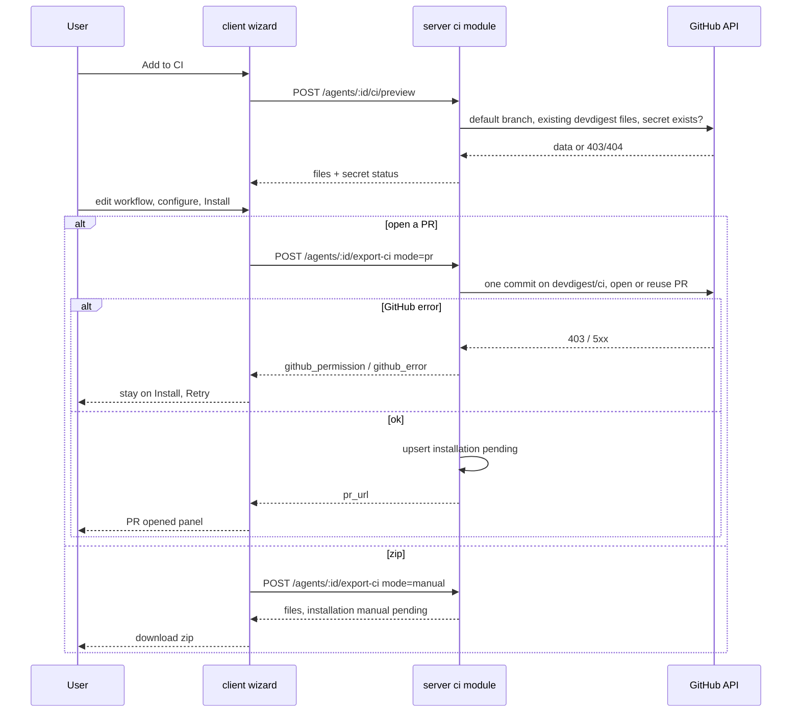
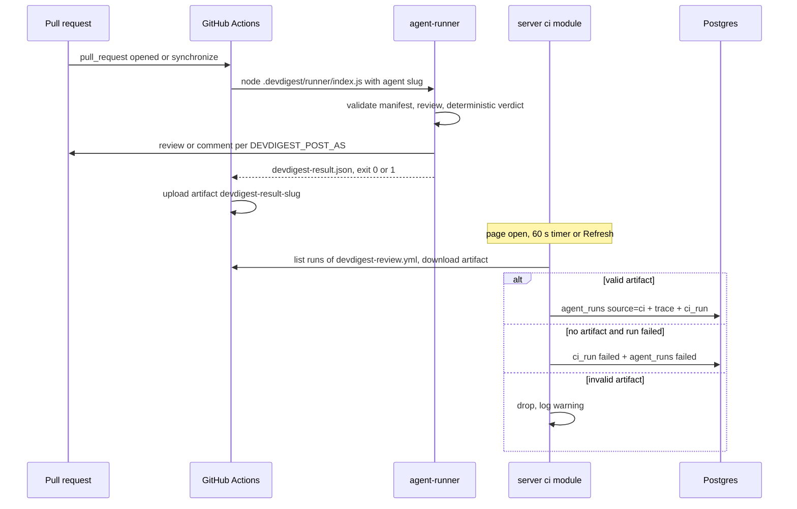
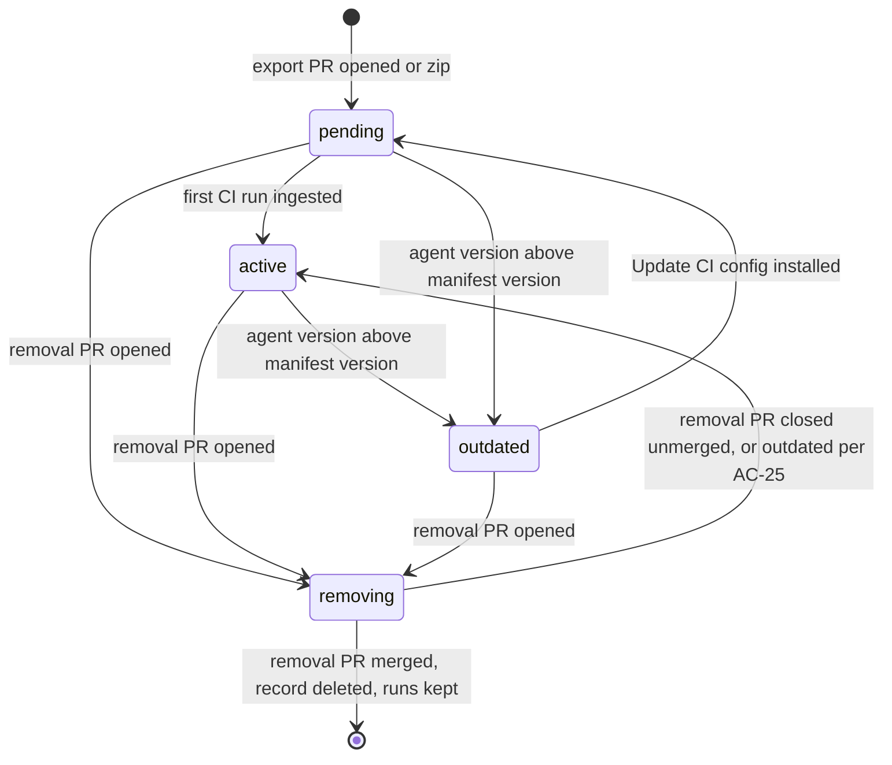

# Spec: Export to CI
Spec ID: SPEC-2026-10-16-export-to-ci
Status: draft
Supersedes: none

Modules: `server` (ci module, its routes, ingest), `client` (Export wizard,
agent CI tab, CI Runs page), `agent-runner` (manifest/memory/result contract),
shared contracts (vendored into server and client). Has an external
dependency on multi-manifest support in agent-runner, which the user builds in
a separate worktree (see "External dependency: multi-manifest runner" under
Inputs and provenance).

## Problem and user

An agent tuned in the studio runs only on the user's machine, so a team
cannot rely on it for every PR. Export to CI moves the agent's configuration
into the target repository and runs the review through GitHub Actions on each
pull request.

A tuned agent is a versioned configuration: model, system prompt, linked
skills and parameters. Export serializes it to `.devdigest/agents/<slug>.yaml`.
The studio and the agent-runner validate that manifest with the same schema.
The same manifest guarantees the same configuration, not a byte-identical
result: model answers vary and CI tool versions differ. Each CI run therefore
records the manifest version, model, dependencies and commit SHA.

**User:** the DevDigest studio user who owns review agents and maintains the
team's repositories on GitHub.

### Current state (as of 2026-10-16, for context only)

- **agent-runner** (commit bb16a35) is a self-contained bundle run as
  `node .devdigest/runner/index.js`. Today it:
  - reads exactly one `.devdigest/agents/*.yaml` (more than one is a hard
    failure), validates it with the shared `AgentManifest` schema, and reads
    `.devdigest/skills/<slug>.md`;
  - calls the model only through OpenRouter (`OPENROUTER_API_KEY`) and runs
    the same reviewer-core pipeline as the studio (untrusted wrapping,
    mandatory grounding);
  - computes the verdict deterministically from grounded findings and
    `ci_fail_on`: no findings is approve, gate tripped is request_changes,
    otherwise comment;
  - writes `devdigest-result.json`, posts per `DEVDIGEST_POST_AS` env var
    (`github_review` default, `pr_comment`, `none`), and exits 1 when the gate
    trips or on any hard failure (no artifact, no post on hard failure);
  - reads no memory and does not upload the result anywhere.
- **Shared contracts:**
  - `AgentManifest`, `CiExportInput`, `CiInstallation`, `CiExport`, `CiRun`,
    `CiRunStatus`, `CiResultArtifact` and `CiTarget` exist in the server copy.
    The client copy lacks `AgentManifest`.
  - The manifest has no manifest version, agent id or `post_as`.
  - The result artifact has counts, cost, duration, agent name, runner
    version and PR number. It has no verdict, model, commit SHA, repo or job
    link.
  - The run trace config has agent, version, provider, model, PR and source
    (`local` | `ci`). It has no commit SHA, runner version or dependencies.
- **Server:**
  - Tables `ci_installations` (agent, repo, target, installed at) and
    `ci_runs` (installation, PR number, ran at, status, findings count, cost,
    GitHub URL, source) exist. No module reads or writes them, and there are
    no CI routes.
  - `agent_runs.source` (`local` | `ci`) exists. Every writer sets `local`.
  - The GitHub adapter can make a multi-file commit to a branch, open a PR
    and find an open PR by head branch. It cannot read the default branch,
    read a file, list workflow runs, download artifacts or check secrets.
  - The API has no authentication and is not reachable from CI in a local
    setup.
  - Agents and skills have no slug. Agents have a version that increases on
    every config change, including `ci_fail_on`.
  - Memory is a stored table (workspace, optional repo, scope, kind,
    content). Nothing feeds it into reviews.
- **Client:**
  - The agent editor has Config, Skills, Context, Evals and Stats tabs. There
    is no CI tab.
  - `ci_fail_on` is edited as "CI gate" on the Config tab.
  - There is no `/ci-runs` page. Its nav label and a full `ci` message set
    (wizard, CI Runs, CI tab) exist but are unused. An `ExportWizardSteps`
    stepper exists in the vendored UI.

## Goals / Non-goals

### Goals

- The "Add to CI" button on the agent's CI tab opens a four-step Export
  wizard: Target, Preview, Configure, Install (screenshots 1, 3, 4, 5).
- GitHub Actions is the only implemented target. CircleCI, Jenkins and
  Generic CLI are shown as disabled "Coming soon" cards.
- Preview shows the manifest, the skills, `.devdigest/memory.jsonl`, the
  runner bundle and an editable `.github/workflows/devdigest-review.yml`.
- Configure sets the `pull_request` triggers (opened, synchronize, optional
  reopened), shows the expected secrets with their status, and sets how
  results are posted: GitHub review, PR comment, or exit code only.
- Install opens a PR from a dedicated `devdigest/ci` branch (never writes to
  the default branch), or downloads the files as a zip.
- The workflow runs the bundled agent-runner. `devdigest/review-action@v1`
  from the mock stays a placeholder and is not used.
- Several agents can be exported to the same repository. Exporting one never
  removes or replaces another. Until the runner supports several manifests,
  Install into a repo that already has another agent is blocked.
- A "Remove" action on each installation opens a PR that deletes only that
  agent's CI files. Ingested CI runs are kept.
- The studio ingests each CI result through a verified channel (the user's
  authenticated GitHub API access to the installed workflow's artifacts) and
  writes it to `agent_runs` with `source = 'ci'`, plus a CI run record.
- The CI Runs page lists CI runs across repos with repository, PR, agent,
  verdict, findings, cost, duration and a link to the job.
- The agent's CI tab shows installations, manifest version, recent CI history
  and the "Fail CI on" setting.
- Each CI run's trace records manifest version, provider, model, runner and
  dependency versions, and the PR head commit SHA.

### Non-goals

- **No CircleCI, Jenkins or Generic CLI generators.** Their cards are stubs.
- **No published GitHub Action.** `uses: devdigest/review-action@v1` is not
  generated.
- **No multi-manifest runner work.** Supporting several manifests in one
  `.devdigest/agents/` is built by the user in a separate worktree, outside
  this spec. This spec defines the contract that work implements (D-MA-1..4).
  It is not the studio multi-agent review feature
  (`emdash/multi-agent-review-01x94`), whose spec excludes agent-runner.
- **No change to the multi-agent run service or the PR feed/timeline code.**
  CI `agent_runs` rows keep their PR link. How the feed presents them is the
  feed owner's decision.
- **No push ingest endpoint** reachable from CI. Ingest is pull-only.
- **No warning in Preview** that the exported files become repository
  content (as in the design).
- **No GitHub App, no branch-protection automation.** Blocking merges stays a
  manual "required status check" step, as the Configure note says.
- **No writing or reading of secret values.** The studio only checks whether
  a secret exists.

## User stories

- **US-1:** As an agent owner, I want to install my agent into a repository's
  CI through a reviewed PR (or a zip I add by hand), so that the team gets the
  review on every PR without anything being pushed to the default branch.
- **US-2:** As an agent owner, I want to preview every file before it is
  committed and adjust the workflow, so that I know exactly what lands in the
  repository.
- **US-3:** As an agent owner, I want to choose the triggering events and how
  results are posted, and see which secrets the workflow needs, so that the
  first CI run works.
- **US-4:** As a team lead, I want one CI Runs list across repositories with
  repo, PR, agent, verdict, findings, cost, duration and a job link, so that I
  can see what CI reviews did.
- **US-5:** As an agent owner, I want the agent's CI tab to show where it is
  installed, which manifest version each repo runs, recent CI history and the
  "Fail CI on" policy, and let me update an outdated installation.
- **US-6:** As an agent owner, I want the studio and the runner to accept the
  same manifest and every CI run to record manifest version, model,
  dependencies and commit SHA, so that I can explain differences between a
  local and a CI result.
- **US-7:** As a team with several agents, I want exporting one agent to a
  repo to leave the other agents installed there intact, so that agents can be
  added one by one.
- **US-8:** As an agent owner, I want to remove an agent from a repository's
  CI through a reviewed PR, without touching other agents and without losing
  past CI runs, so that I can retire an installation safely.

## Acceptance criteria (EARS)

### Agent CI tab and wizard entry

- **AC-1:** The agent page (shall) show a "CI" tab after Stats, as in
  screenshot 2. With at least one installation it shows:
  - the heading "CI deployment" and an "Active in N repos" badge, where N is
    the number of installations in status `active` or `outdated`;
  - the "Update CI config" and "Add to CI" buttons;
  - one row per installation (see AC-26);
  - a dashed "Add repository" row.

  With no installation it shows the design's empty state: "Not exported to
  CI", "Run this agent automatically on pull requests in CI." and an "Export
  to CI" button that opens the wizard.
  Traces: US-5. Verify: unit - tab content for 0 and 2 installations.
- **AC-2:** WHEN the user clicks "Add to CI" (or "Export to CI"), the client
  (shall) open the wizard titled "Export to CI" with the subtitle "Run
  <agent name> automatically on pull requests". The target repository is the
  active repository. The stepper shows Target, Preview, Configure and Install
  as done (check), current (accent, `aria-current="step"`) or pending.
  Back and Continue move between steps, and the last step's primary button is
  "Install".
  WHEN the user clicks "Add repository", the wizard (shall) instead show a
  "Target repository" select on the Target step. The select lists the
  connected repositories where this agent has no installation yet, and
  Continue stays disabled until one is chosen.
  Traces: US-1. Verify: unit - wizard opens with the active repo; the "Add
  repository" variant shows the select and filters installed repos.
- **AC-3:** The Target step (shall) show four cards as in screenshot 1, as a
  keyboard-operable radio group:
  - GitHub Actions ("Runs on pull_request events"), selected by default, with
    a "recommended" badge;
  - CircleCI, Jenkins and Generic CLI, each rendered disabled with
    `aria-disabled="true"` and a "Coming soon" badge. They cannot be selected
    by mouse or keyboard.

  IF an export or preview request names a target other than GitHub Actions,
  THEN the server (shall) respond `422 target_not_supported`.
  Traces: US-1. Verify: unit - stub cards are not selectable; integration -
  `422` for target `circle`.

### Preview and the generated files

- **AC-4:** The Preview step (shall) list under "FILES TO CREATE", as in
  screenshot 3:
  - `.devdigest/agents/<agent-slug>.yaml`;
  - one `.devdigest/skills/<skill-slug>.md` per skill enabled for the agent,
    in link order;
  - `.devdigest/memory.jsonl`;
  - `.devdigest/runner/index.js`, marked "generated, not editable";
  - `.github/workflows/devdigest-review.yml`, selected by default and marked
    "editable".

  Selecting a file shows its full contents in the right pane. Only the
  workflow file is editable. The workflow pane shows the whole file as it
  will be committed, including the jobs of other agents already installed in
  the repository.
  Traces: US-2, US-7. Verify: unit - file list, default selection, read-only
  versus editable panes; integration - preview for a repo with agent A
  installed shows A's job unchanged next to the new job.
- **AC-5:** The system (shall) generate the agent manifest so that it passes
  the shared `AgentManifest` schema, the same schema the runner uses. The
  manifest contains: name, provider `openrouter`, model, system prompt, skill
  slugs (in link order), strategy, `ci_fail_on`, `manifest_version` (= the
  agent's current version) and `agent_id`. IF the generated manifest fails
  the schema, THEN the server (shall) respond `422 manifest_invalid` with the
  failing fields and commit nothing.
  Traces: US-2, US-6. Verify: unit - a generated manifest round-trips through
  the schema; integration - the runner's manifest loader accepts the exported
  file.
- **AC-6:** WHERE the agent's provider is `openai` or `anthropic`, the
  manifest model (shall) be the OpenRouter id `<provider>/<model>` (for
  example `openai/gpt-4.1`). The Preview shows the note "Runs via OpenRouter
  as <id>" above the manifest.
  Traces: US-2. Verify: unit - mapping per provider and the Preview note.
- **AC-7:** The system (shall) generate `.devdigest/memory.jsonl` with one JSON
  object per line for each memory item of the workspace whose scope is
  `global`, or `repo` for the target repository. Each object has only
  `kind`, `scope` and `content`; no embedding, id or source data is exported.
  With no such items the file is empty.
  Traces: US-2. Verify: integration - items of another repo are excluded and
  embeddings never appear.
- **AC-8:** The generated workflow `.github/workflows/devdigest-review.yml`
  (shall) satisfy this contract:
  - name "DevDigest Review", triggered by `pull_request` with the types
    chosen on Configure;
  - one job per installed agent, whose job id is the agent slug; export adds
    or replaces only its own job;
  - the agent's job is skipped for PRs whose head repository is a fork;
  - job permissions limited to `contents: read` and `pull-requests: write`;
  - checks out the PR's merge commit (the `actions/checkout` default): it has
    the default branch's `.devdigest/` even for a PR branch cut before the CI
    files were merged, plus the PR's own files, so DevDigest's install PR runs
    the agent it adds. A same-repo PR can change the runner or manifests that
    review it (accepted trade-off; fork PRs never run). It runs the bundled
    runner `node .devdigest/runner/index.js` on Node 22 or newer;
  - passes `OPENROUTER_API_KEY` from repository secrets, the workflow's
    `GITHUB_TOKEN`, the repository, the PR number, `DEVDIGEST_POST_AS` and
    `DEVDIGEST_AGENT=<agent-slug>` (D-MA-2);
  - uploads `devdigest-result-<agent-slug>.json` as a workflow artifact named
    `devdigest-result-<agent-slug>`, also when the runner exits non-zero;
  - contains no reference to `devdigest/review-action`.
  Traces: US-2, US-3, US-7. Verify: unit - parse the generated YAML and assert
  each item.
- **AC-9:** WHEN the user edits the workflow, the client (shall) parse it as
  YAML on every change. IF parsing fails, THEN Continue is disabled and the
  parse error with its line number is shown under the editor. The server
  (shall) reject an unparsable workflow with `422 workflow_invalid`.
  IF the user has edited the workflow and then changes triggers or "Post
  results as" on Configure, THEN the workflow (shall not) be regenerated, and
  Configure shows "Workflow edited manually — trigger changes not applied".
  Otherwise, trigger and post-as changes regenerate the workflow.
  Traces: US-2. Verify: unit - invalid YAML disables Continue; an edited
  workflow is kept after a trigger change, with the warning.

### Configure

- **AC-10:** The Configure step (shall) show trigger chips
  `pull_request:opened` and `pull_request:synchronize` (on by default) and
  `pull_request:reopened` (off by default), as in screenshot 5. IF no chip is
  selected, THEN Continue is disabled with the hint "Select at least one
  trigger".
  Traces: US-3. Verify: unit - defaults and the empty-selection rule.
- **AC-11:** The Configure step (shall) show "Secrets expected" with two rows:
  - `OPENROUTER_API_KEY` with the status `ready` when the secret exists in the
    target repository, `not set` when GitHub reports it missing, or `unknown`
    with the hint "Can't check secrets with this GitHub token" when the check
    is not permitted or fails;
  - `GITHUB_TOKEN`, "Auto-provided by Actions", always `ready`.

  It also shows the note "Add these to your repo's Actions secrets before the
  workflow runs." The same secret name is used in the workflow. A `not set`
  or `unknown` status does not block Continue.
  Traces: US-3. Verify: integration - existing, missing and forbidden secret
  give `ready`, `not set`, `unknown`; unit - badges.
- **AC-12:** The Configure step (shall) offer "Post results as" radios:
  "GitHub review" (default, "recommended"), "PR comment" and "None (exit code
  only)". The choice is written to the workflow as `DEVDIGEST_POST_AS`
  (`github_review` | `pr_comment` | `none`). The step shows the info note from
  screenshot 5 about setting "Fail CI on" (CI tab) and adding a required
  status check.
  Traces: US-3. Verify: unit - each radio sets the env value in the
  generated YAML.

### Install

- **AC-13:** The Install step (shall) offer two options, as in screenshot 6:
  - "Open a PR with these files" (default, "recommended"), with the text
    "DevDigest opens a PR in <repo> titled “Add DevDigest CI review” with the
    <N> generated files", where N is the real file count;
  - "Copy files as a zip" ("add them manually").

  Below them is the "GitHub Action setup docs" link.
  Traces: US-1. Verify: unit - N equals the Preview file count.
- **AC-14:** WHEN the user clicks Install with "Open a PR" selected, the system
  (shall):
  1. commit all previewed files, including the edited workflow, in one commit
     to branch `devdigest/ci` (never to the default branch). The branch is
     created from the repository's default branch, or the commit is added on
     top of `devdigest/ci` if that branch exists;
  2. open a PR from `devdigest/ci` to the default branch titled "Add DevDigest
     CI review", or reuse the PR that is already open from `devdigest/ci`;
  3. create or update the installation for (agent, repo) with target GitHub
     Actions, mode `pr`, status `pending`, manifest version, triggers,
     post-as and PR URL.

  While this runs, the button reads "Installing…" and is disabled. On success
  the wizard shows a "PR opened" panel with a link to the PR (new tab) and a
  Close button.
  Traces: US-1. Verify: integration - with a mock GitHub client: the default
  branch is untouched, one commit is on `devdigest/ci`, the PR is opened or
  reused, the installation is recorded; unit - success panel.
- **AC-15:** WHEN an agent is exported to a repository where other agents are
  already installed (on the default branch or on an open `devdigest/ci`), the
  commit (shall) add or update only:
  - this agent's manifest;
  - the skill files it references;
  - `memory.jsonl`;
  - the runner bundle;
  - this agent's review in the workflow.

  It (shall not) delete, rename or change any other agent's manifest or that
  agent's review in the workflow. The other agents' installations stay
  unchanged.
  Traces: US-7. Verify: integration - export agent B into a repo that holds
  agent A's files; A's manifest and workflow job are byte-identical
  afterwards. Applies end to end once D-MA-1..4 land; until then AC-31 blocks
  this case.
- **AC-16:** IF installing fails, THEN the server (shall) record no
  installation change and respond with a typed error, and the wizard (shall)
  stay on Install with all edits kept and show the reason with a Retry
  action. The errors are:
  - `422 github_token_missing`: "Add a GitHub token in Settings";
  - `403 github_permission`, naming the missing token permission (Contents,
    Pull requests or Workflows: write);
  - `502 github_error` for any other GitHub or network failure.
  Traces: US-1. Verify: integration - each error from a mock GitHub client;
  unit - message and Retry.
- **AC-17:** WHEN the user clicks Install with "Copy files as a zip" selected,
  the client (shall) download `devdigest-ci-<agent-slug>.zip` containing exactly
  the previewed files, with the edited workflow, at their repository paths.
  The system creates no branch or PR and records the installation with mode
  `manual` and status `pending`.
  Traces: US-1. Verify: unit - zip entries and paths; integration - manual
  installation recorded.

### Runner contract

- **AC-18:** WHEN the workflow runs, the runner (shall) load only the manifest
  `.devdigest/agents/<slug>.yaml` named by `DEVDIGEST_AGENT`, validate it with the
  shared `AgentManifest` schema, and review with it. Other agents' manifests
  in `.devdigest/agents/` do not cause a failure. IF the selected manifest is
  missing or invalid, THEN the run (shall) fail with exit code 1, post
  nothing and write no result.
  Traces: US-6, US-7. Verify: unit - two manifests present, the selected one
  is used (needs the external dependency D-MA-1).
- **AC-19:** WHERE `.devdigest/memory.jsonl` holds items, the runner (shall)
  pass their `content` to the review as memory context, inside the same
  untrusted wrapping as other repository data. A missing or empty file means
  no memory and is not an error. IF a line is not a valid memory object, THEN
  the run (shall) fail with exit code 1 and an error naming the line number.
  Traces: US-2, US-6. Verify: unit - with a stub LLM the prompt contains the
  wrapped memory; a malformed line fails the run.
- **AC-20:** WHEN a review completes, the runner (shall) write
  `devdigest-result-<agent-slug>.json` that passes the shared result schema
  and contains:
  - counts per severity and in total;
  - the deterministic verdict and the blocker count;
  - cost and duration;
  - agent name, slug and id, and the manifest version;
  - provider and model;
  - runner version and dependency versions (reviewer-core, Node);
  - the PR head commit SHA, the PR number and the repository.
  Traces: US-6. Verify: unit - result fixture validated against the schema
  with every field set.

### Ingest

- **AC-21:** WHEN the CI Runs page or an agent's CI tab is opened, every 60 s
  while it stays open, and when the user clicks Refresh, the server (shall)
  fetch, for each GitHub Actions installation, the runs of
  `devdigest-review.yml` in that repository since the last ingested run
  (looking back at most 30 days). For each completed run it downloads the
  artifact `devdigest-result-<agent-slug>`, authenticated with the user's
  GitHub token. While a refresh is in progress for an installation, a new
  trigger joins it instead of starting a second one.
  Traces: US-4. Verify: integration - mock GitHub with three runs gives three
  fetches; concurrent refreshes make one set of calls.
- **AC-22:** WHEN an artifact validates against the result schema and its repo
  and agent match the installation, the system (shall) write:
  - one `agent_runs` row with `source = 'ci'`, holding the agent, the PR when
    it exists locally, provider, model, duration, cost, findings count,
    blockers and status `done`;
  - its trace, with `config.source = 'ci'`, `config.version` = the manifest
    version, the model, the runner and dependency versions, the commit SHA
    and the job URL;
  - one CI run record linked to the installation.

  Re-ingesting the same (GitHub run, agent slug) (shall not) create
  duplicates.
  Traces: US-4, US-6. Verify: integration - ingest twice gives one row each;
  trace fields present.
- **AC-23:** IF a downloaded artifact fails the schema, names another repo or
  agent than the installation, or is larger than 5 MB, THEN the system (shall)
  store nothing for it and log a warning with the GitHub run id.
  IF a run concluded `failure` or `cancelled` without an artifact, THEN the
  system (shall) record a CI run with status `failed` and the job URL, and an
  `agent_runs` row with `source = 'ci'`, status `failed` and the error "CI run
  produced no result".
  IF a run is still in progress, THEN it is listed with status `running` and
  completed on a later refresh. An expired artifact (410) is skipped.
  Traces: US-4. Verify: integration - each case with a mock GitHub client.
- **AC-24:** IF GitHub is unreachable, rate-limited or rejects the token during
  a refresh, THEN the system (shall) keep the stored runs, and the client
  (shall) show the non-blocking banner "Couldn't refresh CI runs" with a Retry
  action.
  Traces: US-4. Verify: integration - stored rows unchanged on `502`; unit -
  banner.
- **AC-25:** The installation status (shall) be:
  - `pending` until the first CI run is ingested for it;
  - `active` once a run is ingested;
  - `outdated` while the agent's current version is greater than the
    installation's manifest version;
  - `removing` while a removal PR for it is open (AC-35).

  `removing` takes precedence over `outdated`, and `outdated` over `active`.
  Traces: US-5, US-8. Verify: unit - status from (runs, versions, removal
  PR) table.

### CI tab details

- **AC-26:** Each installation row on the CI tab (shall) show, as in
  screenshot 2:
  - the repository name;
  - a "GitHub Actions" badge;
  - "manifest vN";
  - a status badge (the last run's status, or `pending` / `manual pending`);
  - the relative time of the last run;
  - an "outdated" badge when AC-25 applies, or a "removing" badge with a link
    to the removal PR when AC-35 applies;
  - a "Remove" action (AC-33).
  Traces: US-5, US-8. Verify: unit - row content for pending, active,
  outdated and removing installations.
- **AC-27:** The CI tab (shall) show a "Fail CI on" select with the existing
  options and labels:
  - "Never block — comment only";
  - "Block on critical (recommended)";
  - "Block on warning or critical";
  - "Block on any finding".

  It is bound to the agent's `ci_fail_on`, the same value as "CI gate" on the
  Config tab. WHEN the user changes it, the system (shall) save the agent
  (creating a new version), so its installations become `outdated` until
  updated.
  Traces: US-5. Verify: unit - change saves and Config shows the same value;
  integration - installation reports `outdated` after the change.
- **AC-28:** WHEN the user clicks "Update CI config", the client (shall) open
  the wizard at the Preview step for an installation, preselecting the first
  `outdated` one, with a repository select when there are several. The
  installation's triggers and post-as are prefilled. Install (shall) commit to
  `devdigest/ci` and update the open PR from that branch, or open a new PR
  titled "Update DevDigest CI review" if none is open.
  Traces: US-5. Verify: integration - update reuses the open PR; unit -
  wizard opens at Preview with prefilled values.
- **AC-29:** The CI tab (shall) show "Recent CI runs" with the last 10 CI runs
  of this agent, in the CI Runs row format, and a "View all" link to CI Runs
  filtered by this agent.
  Traces: US-5. Verify: unit - at most 10 rows and the link's filter.

### CI Runs page

- **AC-30:** The "CI Runs" sidebar item (GLOBAL group) (shall) open the CI Runs
  page with:
  - the title "CI Runs", the subtitle "Agent reviews executed inside CI · not
    local runs", the "auto-refresh on" indicator and a Refresh button;
  - filters Last 7 days, All agents, All repos, All statuses and All sources;
  - columns Timestamp, Repository, Pull request (`#N` and title), Agent,
    Source, Dur., Findings (per-severity icon and count), Verdict, Cost,
    Status and Job.

  Rows are newest first. Status is one of Succeeded, No findings, Failed and
  Running. Unknown values show "—". The Job link opens the GitHub run in a new
  tab with `rel="noopener noreferrer"`.
  WHILE loading, the page shows skeleton rows. IF loading fails, THEN it shows
  an error state with Retry. With no runs it shows the design's empty state
  ("No CI runs yet", "Once you export an agent to CI, every automated review
  shows up here.", "Set up CI for an agent" linking to Agents). Long titles
  and names are truncated with the full text in a tooltip.
  Traces: US-4. Verify: unit - columns, filters, the four states; e2e -
  ingested run visible with a working Job link.

### Several agents in one repository

- **AC-31 (retired 2026-10-18, D-MA-1..4 delivered — Install into a repository
  with other agents is allowed; kept for history):** WHILE the external dependency D-MA-1..4 has not landed, IF the
  target repository already has an installation of a different agent, THEN
  Install (both "Open a PR" and zip) (shall) be blocked: the server responds
  `409 multi_agent_unsupported`, and the wizard shows "Multi-agent CI support
  is not available yet" on the Install step with Install disabled.
  This AC is a temporary gate. Once the dependency lands, it is retired by a
  spec update that marks D-MA-1..4 as delivered; no other AC depends on it.
  Traces: US-7. Verify: integration - export of agent B into a repo with
  agent A installed returns `409 multi_agent_unsupported`; unit - message and
  disabled Install.
- **AC-32:** The system (shall) derive slugs as follows:
  - the agent slug and each skill slug are the kebab-case ASCII form of the
    name, at most 60 characters;
  - when two different skills of one export give the same slug, the second
    and later get `-2`, `-3`… in link order, and the manifest references the
    suffixed slugs;
  - IF another agent (different id) with the same slug is already installed
    in the target repository, THEN export responds `409 agent_slug_conflict`
    and the wizard asks the user to rename the agent.
  Traces: US-2, US-7. Verify: unit - slug table incl. suffixes; integration -
  `409 agent_slug_conflict`.

### Remove an installation

- **AC-33:** WHEN the user activates "Remove" on an installation row, the
  client (shall) open a confirmation dialog titled "Remove <agent> from
  <repo>?" with the text "DevDigest opens a PR in <repo> titled “Remove
  DevDigest CI review” that deletes this agent's CI files. Past CI runs stay
  in DevDigest." and the buttons Cancel and Remove. Nothing is sent until the
  user confirms. The action and the dialog use the existing button and
  confirmation styles; no other visual element is added. The action's
  accessible name is "Remove <agent> from <repo>".
  Traces: US-8. Verify: unit - dialog text, Cancel sends nothing, focus
  returns to the action on close.
- **AC-34:** WHEN the user confirms removal, the system (shall) commit to
  `devdigest/ci` (created from the default branch, or on top of it if it
  exists) and open a PR to the default branch titled "Remove DevDigest CI
  review", or reuse the PR already open from `devdigest/ci`. The commit
  deletes:
  - this agent's manifest and this agent's job in the workflow;
  - each of its skill files that no other agent remaining in the repository
    references;
  - `memory.jsonl`, the runner bundle and the workflow file, only when no
    other agent remains in the repository.

  It (shall not) change any other agent's manifest, job or referenced skill
  files.
  Traces: US-8, US-7. Verify: integration - with agents A and B installed,
  removing A deletes A's manifest, A's job and A-only skills, and leaves B's
  files byte-identical; removing the last agent deletes all DevDigest CI
  files.
- **AC-35:** WHEN the removal PR is opened, the installation (shall) get
  status `removing` with the removal PR link, and ingest continues for it.
  WHEN a later refresh finds the removal PR merged, the installation record
  (shall) be deleted. IF the removal PR is closed without merge, THEN the
  installation returns to the status AC-25 gives without `removing`.
  CI runs and `agent_runs` rows already ingested (shall) be kept in every case;
  after deletion they show the agent and repo stored on the run.
  IF the agent's manifest is on neither the default branch nor
  `devdigest/ci` (for example a zip install never committed), THEN removal
  (shall) still go through a removal PR: the commit on `devdigest/ci` is
  empty when there is nothing to delete, and the installation follows the
  same `removing` path as above.
  Traces: US-8. Verify: integration - merged, closed-unmerged and
  never-committed cases; runs count unchanged after deletion.
- **AC-36:** IF removal fails, THEN the server (shall) respond with the same
  typed errors as AC-16 (`422 github_token_missing`, `403 github_permission`,
  `502 github_error`) and leave the installation unchanged, and the dialog
  (shall) stay open showing the reason with a Retry action.
  Traces: US-8. Verify: integration - each error with a mock GitHub client;
  unit - message and Retry in the dialog.

## Edge cases

- **E-1, fork PR (AC-8, AC-23):** the job is skipped, so no run and no
  artifact exist and nothing is recorded.
- **E-2, workflow added by the export PR itself (AC-8, AC-14):** GitHub runs
  the PR's own workflow, so the export PR is reviewed. The runner already
  strips `.devdigest/**` and `.github/workflows/**` from the diff. The run is
  ingested like any other.
- **E-3, secret not set when the first run starts (AC-11, AC-23):** the
  runner hard-fails without an artifact. The run is recorded as `failed` with
  its job link.
- **E-4, `devdigest/ci` exists but has no open PR (AC-14):** the commit goes
  on top of the branch and a new PR is opened.
- **E-5, branch protection or a required review on the default branch
  (AC-14):** it does not matter; the export never writes there.
- **E-6, gate tripped (AC-20, AC-23):** the runner exits 1 and the run
  concludes `failure` but with an artifact. It is ingested as a normal run
  with verdict request_changes and status Succeeded, not as Failed.
- **E-7, agent edited after export (AC-25, AC-27):** the installation shows
  `outdated`. CI keeps running the committed manifest until it is updated and
  merged.
- **E-8, export PR not merged yet (AC-25):** the installation stays
  `pending`. Runs on other PRs do not exist yet, because the workflow is not
  on the default branch.
- **E-9, two agents with the same slug in one repo (AC-32):** `409
  agent_slug_conflict`; the user renames one agent.
- **E-10, two agents share a skill (AC-15, AC-34):** the skill file is
  written with the current body, which both agents already use. Removing one
  agent keeps the file. Different skills with the same slug get suffixes
  (AC-32).
- **E-11, agent deleted (AC-22):** its installations are deleted. CI runs and
  `agent_runs` rows already ingested stay, with the agent link empty and the
  agent name from the artifact.
- **E-12, PR not in the local database (AC-22):** the `agent_runs` row has no
  PR link. The CI run still shows `#N` and the title from GitHub.
- **E-13, artifact expired (AC-23):** it is skipped, and a run already stored
  is kept.
- **E-14, many installations and runs (AC-21, AC-30):** ingest is bounded by
  NFR-2, and the CI Runs list scrolls.
- **E-15, very long workflow, prompt or memory files (AC-4):** the Preview
  pane scrolls. Files above 5 MB block Install with `422 file_too_large`.
- **E-16, runner hard failure (AC-18, AC-19, AC-23):** recorded as `failed`
  with the job link, never as a synthetic review.
- **E-17, removal while the export PR is still open (AC-34, AC-35):** the
  removal commit goes on the same `devdigest/ci` branch and the open PR is
  reused. The agent's files leave the PR. If no other agent's files remain
  in it, the PR changes nothing on the default branch and the user can close
  it.
- **E-18, removing the last agent (AC-34):** the commit deletes every
  DevDigest CI file, including the workflow.
- **E-19, removal PR closed without merge (AC-35):** CI keeps running the
  agent, and the installation returns to `active` or `outdated`.
- **E-20, export of a second agent before the multi-manifest runner (AC-31):**
  Install is blocked. Remove and Update for the existing agent still work.

## Non-functional requirements

- **NFR-1, performance:** the preview endpoint responds within 3 s at p95,
  excluding GitHub latency, for an agent with up to 20 skills. Install and
  Remove each make at most 8 GitHub API calls, independent of the file count
  (one commit for all files).
- **NFR-2, ingest budget:** a refresh fetches at most 50 runs per installation.
  At most one ingest per installation runs at a time (AC-21). Auto-refresh
  stops when the page or tab is not visible.
- **NFR-3, rate limit:** the preview, install, remove and refresh endpoints
  each allow at most 10 requests per minute.
- **NFR-4, security, secrets:**
  - No secret value is ever read, stored, logged, returned to the client or
    written into an exported file.
  - The studio checks secret existence only.
  - The exported manifest, workflow, skills and memory contain no API key or
    token. Install refuses with `422 secret_in_export` if a file matches the
    repo's secret patterns (for example `gh[ps]_…` or `sk-…`).
- **NFR-5, security, token permissions:** the user's GitHub token needs:
  - Contents, Pull requests and Workflows write, for Install;
  - Actions read, for ingest;
  - Secrets read, optional, for AC-11.

  Missing permissions surface as AC-16 or AC-24 errors, never as a silent
  success.
- **NFR-6, observability:** one log line per install and per removal (agent
  id, repo, mode, files written or deleted, outcome, PR URL) and one per
  refresh (installation id, runs
  seen, ingested, rejected, failed, duration). Logs (shall not) contain
  prompt, skill, memory, diff or workflow text.
- **NFR-7, accessibility:**
  - the wizard and the removal confirmation trap focus, close on Esc and
    return focus to the control that opened them;
  - the current step carries `aria-current="step"`;
  - target cards and post-as options are radio groups operable with arrow
    keys;
  - status, verdict and secret badges carry text, not color alone.
- **NFR-8, i18n:** every label comes from the client message files. The
  existing `ci` messages are reused where they match.
- **NFR-9, portability:** the shipped runner bundle stays a single file with
  no runtime package imports. The exported files run on a stock
  `ubuntu-latest` runner with no extra setup beyond the secret.

## Inputs and provenance

### Data and contracts

- **Agent manifest** (shared schema `AgentManifest`, extended): name,
  provider, model, system_prompt, skills (slugs), strategy, ci_fail_on, plus
  new `manifest_version` (integer, = agent version) and `agent_id`. The
  studio writes it and the runner reads it. The new fields are optional in
  the schema so a manifest without them still validates.
- **Memory file** `.devdigest/memory.jsonl`: one object per line,
  `{ kind, scope, content }`.
- **CI result** (shared schema `CiResultArtifact`, extended), written by the
  runner to `devdigest-result-<agent-slug>.json` and uploaded as the artifact
  `devdigest-result-<agent-slug>`: the existing
  counts, cost, duration, agent, version and pr_number, plus `verdict`
  (`approve` | `comment` | `request_changes`), `blockers`, `agent_slug`,
  `agent_id`, `manifest_version`, `provider`, `model`, `runner_version`,
  `dependencies { reviewer_core, node }`, `commit_sha` and `repo`.
- **Installation** (extends `CiInstallation`): plus `mode` (`pr` | `manual`),
  `status` (`pending` | `active` | `outdated` | `removing`),
  `manifest_version`, `post_as`, `triggers`, `pr_url`, `removal_pr_url`,
  `last_run_at`, `last_run_status` and `agent_slug`. One installation per
  (agent, repo). Deleting it keeps its CI runs (their installation link
  becomes empty).
- **CI run** also stores the agent name and repo itself, so that it stays
  readable after its installation or agent is deleted.
- **CI run** (extends `CiRun`): plus `repo`, `pr_title`, `verdict`, per-severity
  counts, `job_url`, `agent_id` and `github_run_id`.
- **Trace of a CI run** (extends the run trace config, module-local if the
  vendored contract cannot change): `source = 'ci'`, `version` = manifest
  version, provider, model, `runner_version`, `dependencies`, `commit_sha`
  and `job_url`.
- **Architecture note (flag for `docs/`):** the manifest and result schema
  changes are edits to the vendored shared contracts. They must be made at
  the sync source and applied to both copies. The client copy currently
  lacks `AgentManifest` (drift recorded in the root INSIGHTS, 2026-09-18).
  The new pull-based ingest channel is a new inter-system boundary (studio to
  GitHub Actions artifacts) and belongs in the root README architecture.

### API (contract level)

| Method and path | Purpose | Success | Errors |
|---|---|---|---|
| `POST /agents/:id/ci/preview` | body `{ repo, target, triggers, post_as }` → generated files and secret status | `200 { files[{path, contents, editable}], secrets[{name, status}], notes[] }` | `404`, `422 target_not_supported \| manifest_invalid` |
| `POST /agents/:id/export-ci` | body = `CiExportInput` + `{ workflow?: string, mode: "pr" \| "manual" }` | `200 CiExport { installation, files, pr_url }` | `404`, `409 agent_slug_conflict \| multi_agent_unsupported`, `422 target_not_supported \| workflow_invalid \| manifest_invalid \| file_too_large \| secret_in_export \| github_token_missing`, `403 github_permission`, `502 github_error` |
| `GET /agents/:id/ci/installations` | CI tab rows | `200 [installation]` | `404` |
| `POST /ci/installations/:id/remove` | removal PR (AC-34, AC-35) | `200 { installation \| null, pr_url \| null }` | `404`, `422 github_token_missing`, `403 github_permission`, `502 github_error` |
| `GET /ci-runs?agent=&repo=&status=&source=&since=&limit=` | CI Runs list and CI tab history | `200 [ci_run]` | `422` bad filter |
| `POST /ci-runs/refresh` | body `{ agent_id? }` → ingest now | `200 { ingested, rejected, failed, errors[] }` | `502 github_error`, `429` |
| `PUT /agents/:id` (existing) | "Fail CI on" | unchanged | unchanged |

### Flows

### Failure at each boundary

- **client → server:** a network error keeps the wizard state and shows
  Retry. The client never assumes success.
- **server → GitHub (install):** AC-16. No partial installation is recorded.
  A commit that lands without a PR is recovered by E-4 on retry.
- **server → GitHub (remove):** AC-36. The installation is unchanged on
  failure, and a retry reuses the branch and any open PR.
- **workflow → runner:** a manifest, memory, secret or LLM failure is a hard
  failure (exit 1, no artifact), recorded per AC-23.
- **server → GitHub (ingest):** AC-23 and AC-24. Stored data is never
  removed by a failed refresh.

### External dependency: multi-manifest runner (separate user worktree)

**Status (2026-10-18): delivered.** agent-runner (`RUNNER_VERSION` 3) loads only
`.devdigest/agents/<DEVDIGEST_AGENT>.yaml` (D-MA-1); D-MA-2..4 were already
produced by the generator and the runner. AC-31 is retired; AC-15 and AC-18
apply end to end.

Export to CI does not assume one agent per repository (US-7, AC-15, AC-18).
The runner at bb16a35 fails when `.devdigest/agents/` holds more than one
manifest. The user adds multi-manifest support to agent-runner in a separate
worktree of their own. That work is outside this spec and is not the studio
multi-agent review feature (`emdash/multi-agent-review-01x94`, whose spec
excludes agent-runner). The names below are the contract that work
implements:

- **D-MA-1:** the runner accepts any number of manifests in
  `.devdigest/agents/` and reviews only the agent the workflow selects.
- **D-MA-2:** the workflow selects the agent with the env var
  `DEVDIGEST_AGENT=<agent-slug>`, matching `.devdigest/agents/<agent-slug>.yaml`.
- **D-MA-3:** the runner writes the result to
  `devdigest-result-<agent-slug>.json`, and the workflow uploads it as the
  artifact `devdigest-result-<agent-slug>`.
- **D-MA-4:** `.devdigest/skills/`, `memory.jsonl` and `runner/index.js` are
  shared by all agents in the repository.

The integration point is the generated workflow: one job per agent that sets
`DEVDIGEST_AGENT` and uploads the slug-named artifact. Export to CI ships
independently. Until D-MA-1..4 land, AC-31 blocks Install into a repository
that already has another agent. AC-31 is the only place that depends on the
dependency's status and is retired when it lands. The end-to-end checks of
AC-15 and AC-18 need the dependency.

### Provenance of the current-state claims

- Read directly:
  - agent-runner `README.md`, `CLAUDE.md`, `insights/INSIGHTS.md` and its
    source (manifest loading, run orchestration, artifact, diff filter,
    context, skills);
  - the vendored contracts `eval-ci.ts`, `trace.ts` (run config),
    `findings.ts` (`Verdict`) and `knowledge.ts` (`CiFailOn`, `Provider`);
  - reviewer-core `to-review.ts` (deterministic event rule);
  - server schema `ci.ts`, `runs.ts` and `agents.ts`.
- Repository research reports (2026-10-16):
  - server: GitHub adapter capabilities, missing API auth, unused CI tables,
    agent versioning, no slugs, memory not wired;
  - client: no CI tab or `/ci-runs` page, unused `ci` messages,
    `ExportWizardSteps`, "CI gate" on Config, contract drift.
- External research (docs.github.com, 2026-10-16):
  - `workflow` scope or "Workflows: write" is needed to write
    `.github/workflows/`;
  - fork PRs get a read-only token and no secrets;
  - workflow runs and artifacts endpoints, with download links that expire
    and artifacts that return 410 once expired (90-day default retention);
  - secret existence check (name and timestamps only).
  - Not confirmed in the docs: that a workflow added by a PR runs on that PR
    (E-2).
- Design sources, in priority order:
  - screenshots: 1 (Target), 2 (CI tab), 3 (Preview), 5 (Configure), 6
    (Install);
  - the `design/` HTML for CI Runs columns, empty state, filters and the CI
    tab empty state. No screenshot covers these.
  - Conflicts resolved in favour of the screenshots: `OPENROUTER_API_KEY`
    instead of the mock's `OPENAI_API_KEY`, and the Configure info note
    instead of the mock's disabled "Block merge on findings" toggle.
  - The mock's `uses: devdigest/review-action@v1` is replaced by the bundled
    runner, per the requirements.
  - The Remove action (AC-33..AC-36) has no design. It uses the `design/`
    fallback and the existing button and confirmation styles, with no new
    visual elements beyond the action and the confirmation.
- User decisions (2026-10-16): Q1 to Q16 of the clarification batch took
  options A, except Q13, which became the external multi-manifest dependency
  above. Q4: the stub cards are disabled with "Coming soon". Q16: the bundle
  of states is approved.
- User decisions (2026-10-17), closing the spec's open questions and assumed
  defaults:
  - Q-1: CI `agent_runs` keep the PR link; feed presentation is the feed
    owner's decision (Non-goals).
  - Q-2: `DEVDIGEST_AGENT=<slug>`, `devdigest-result-<slug>.json` and the
    artifact `devdigest-result-<slug>` are the contract the user's separate
    runner worktree implements (D-MA-2, D-MA-3, AC-8, AC-18, AC-20).
  - Q-3: suffixes `-2`, `-3` in link order, referenced by the manifest
    (AC-32).
  - Q-4: removal is in scope now (AC-26, AC-33..AC-36, US-8).
  - Q-5: Export to CI ships independently with the removable gate AC-31.
  - Q-6: no Preview warning, as in the design (Non-goals).
  - Q-7: one workflow file with one job per agent (AC-4, AC-8).
  - D-1, D-2, D-3 and D-4 confirmed (AC-32, AC-19, AC-21, NFR-2).
  - D-5 changed: the artifact cap and the exported-file cap are 5 MB (AC-23,
    E-15).
  - D-6: PR titles "Add DevDigest CI review", "Update DevDigest CI review"
    and "Remove DevDigest CI review" (AC-14, AC-28, AC-34).
  - Correction: the parallel worktree `emdash/multi-agent-review-01x94` is
    the studio multi-agent review feature and excludes agent-runner. The
    multi-manifest runner is the user's own separate worktree.

## Untrusted inputs

- **PR title, body and diff** (in CI): untrusted data. The runner keeps the
  reviewer-core untrusted wrapping and the injection guard, and the grounding
  gate stays mandatory.
- **Exported files read back in CI** (manifest, skills, memory): the repo's
  writers or a PR author can change them. The runner validates the manifest
  with the schema before use (AC-18) and validates each memory line (AC-19).
  Memory and skill text reach the model as data, never as instructions to
  the runner.
- **CI result artifacts** (ingest): untrusted. A same-repo PR author can
  change the workflow in their PR and upload a fake result. The artifact is
  therefore treated as claims:
  - schema-validated, with a 5 MB size cap, and checked to match the
    installation's repo and agent (AC-23);
  - counts must be non-negative integers and cost non-negative;
  - rendered as text only;
  - never used to change agent configuration, gates or anything beyond
    display and statistics.
- **GitHub API responses** (run names, PR titles, URLs): rendered as text.
  Only `https://github.com/` job URLs are rendered as links; any other URL is
  shown as plain text.
- **User-edited workflow YAML:** parsed only to validate it (AC-9), never
  executed or interpolated by the studio, and committed as written.
- **Memory content and system prompt:** these become repository content, so
  anyone with read access to the repository can see them. By user decision
  the Preview shows no warning about it (as in the design). NFR-4 still
  keeps secrets out of the exported files.
- **Repository names, branch names and file paths:** repository must match
  `owner/name` from the connected repositories. Paths are fixed by the
  generator, never taken from user input.

## Open questions

No open questions remain. Q-1..Q-7 and D-1..D-6 were resolved by the user on
2026-10-17; the decisions are recorded under "Inputs and provenance" and in
the ACs they changed.

### Resolved (2026-10-17)

- **Q-1:** CI `agent_runs` keep the PR link; feed presentation belongs to the
  feed owner.
- **Q-2:** `DEVDIGEST_AGENT=<slug>`, `devdigest-result-<slug>.json`,
  artifact `devdigest-result-<slug>` (D-MA-2, D-MA-3).
- **Q-3:** suffixes `-2`, `-3` in link order (AC-32).
- **Q-4:** removal in scope (AC-33..AC-36).
- **Q-5:** ships independently with the removable gate AC-31.
- **Q-6:** no Preview warning.
- **Q-7:** one workflow file, one job per agent (AC-4, AC-8).
- **D-1..D-4:** confirmed. **D-5:** 5 MB caps. **D-6:** Add / Update /
  Remove PR titles.

- **D-7 (confirmed):** an open removal PR puts the installation in status
  `removing`. The record is deleted only when a refresh finds that PR
  merged. A PR closed without merge restores the previous status (AC-35).
- **D-8 (changed):** removal always goes through a PR, also when the agent's
  files were never committed (for example a zip install); the commit is then
  empty (AC-35).

### Size note

This spec has 36 ACs. Proposed split if the planner prefers, with the
inter-module contracts defined once in part 1:

- part 1, export (wizard, generated files, install, runner contract,
  several agents; AC-1..AC-20, AC-31, AC-32);
- part 2, ingest, visibility and removal (AC-21..AC-30, AC-33..AC-36).
