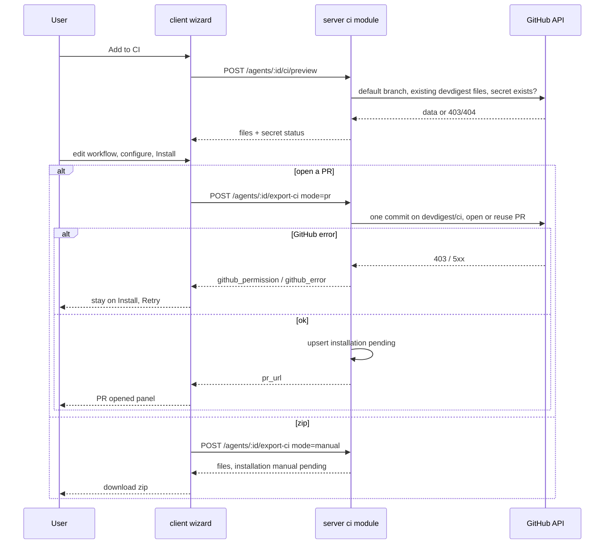
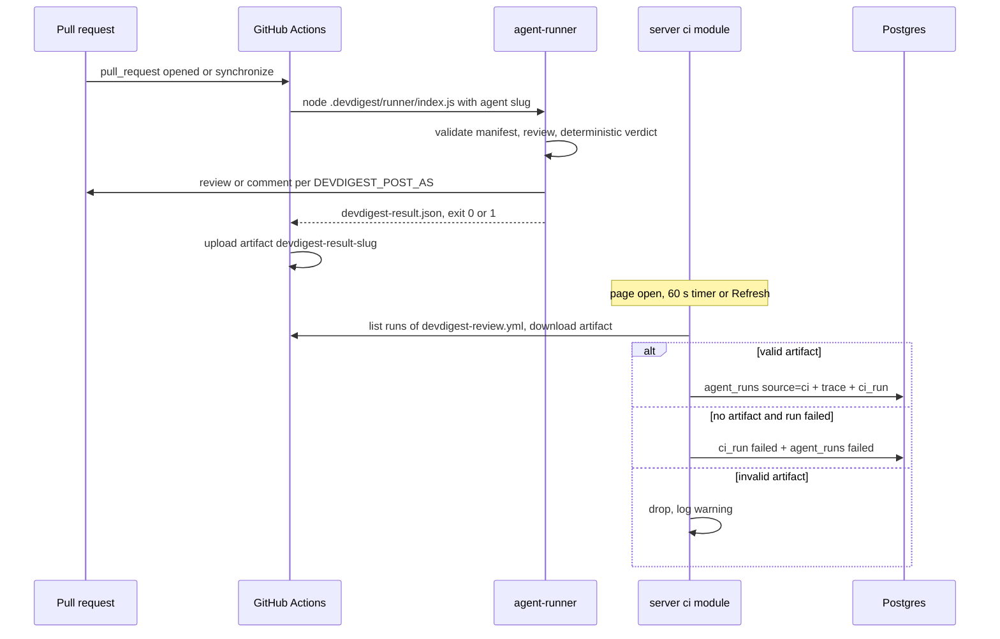
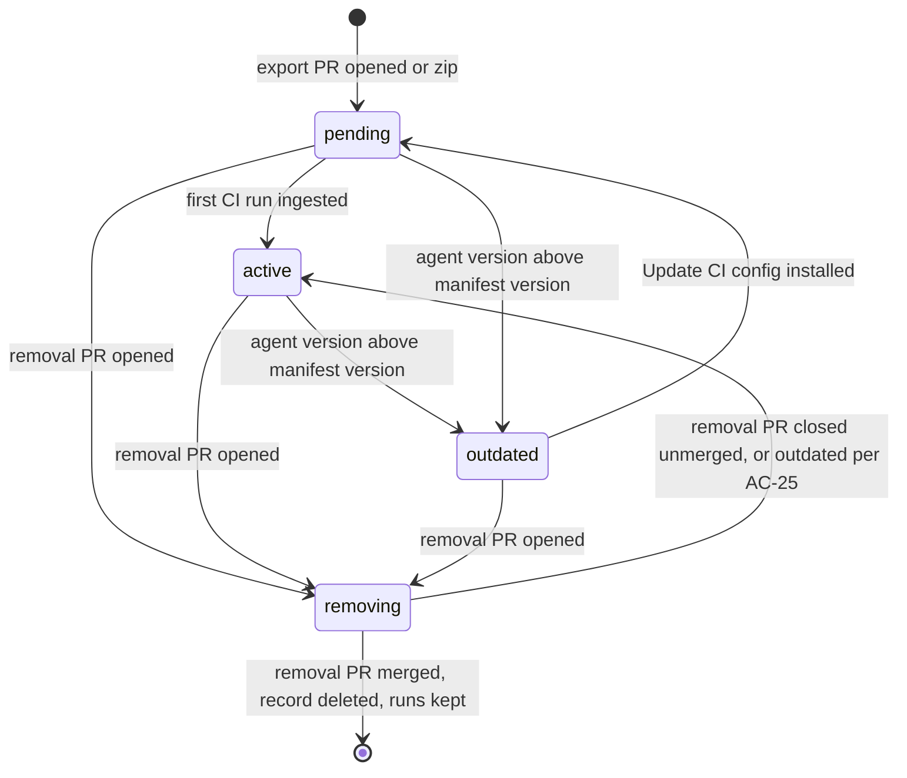

# Специфікація: Export to CI
Spec ID: SPEC-2026-10-16-export-to-ci
Status: draft
Supersedes: none

> Український переклад `specs/2026-10-16-export-to-ci.md`. Джерело істини —
> англійська версія; у разі розбіжностей діє вона. Ключові слова EARS
> (WHEN, IF … THEN, WHILE, WHERE, shall), ідентифікатори, шляхи, коди помилок
> і тексти інтерфейсу залишено англійською.

Модулі: `server` (модуль ci, його роути, ingest), `client` (Export wizard,
вкладка CI агента, сторінка CI Runs), `agent-runner` (контракт
manifest/memory/result), спільні контракти (vendored у server і client). Має
зовнішню залежність від підтримки кількох manifest в agent-runner, яку
користувач робить в окремому worktree (див. «Зовнішня залежність:
multi-manifest runner» у розділі «Вхідні дані та походження»).

## Проблема і користувач

Агент, налаштований у студії, працює лише на машині користувача, тож команда
не може покладатися на нього в кожному PR. Export to CI переносить
конфігурацію агента в цільовий репозиторій і запускає рев'ю через GitHub
Actions на кожному pull request.

Налаштований агент — це версіонована конфігурація: модель, system prompt,
підключені skills і параметри. Експорт серіалізує її в
`.devdigest/agents/<slug>.yaml`. Студія та agent-runner валідують цей manifest
однією й тією самою схемою. Однаковий manifest гарантує однакову
конфігурацію, а не байт-у-байт однаковий результат: відповіді моделі
відрізняються, а версії інструментів у CI інші. Тому кожен CI-запуск записує
версію manifest, модель, залежності та commit SHA.

**Користувач:** користувач студії DevDigest, який володіє агентами рев'ю та
підтримує репозиторії команди на GitHub.

### Поточний стан (на 2026-10-16, лише для контексту)

- **agent-runner** (коміт bb16a35) — самодостатній бандл, що запускається як
  `node .devdigest/runner/index.js`. Наразі він:
  - читає рівно один `.devdigest/agents/*.yaml` (більше одного — жорстка
    помилка), валідує його спільною схемою `AgentManifest` і читає
    `.devdigest/skills/<slug>.md`;
  - викликає модель лише через OpenRouter (`OPENROUTER_API_KEY`) і запускає
    той самий pipeline reviewer-core, що й студія (untrusted wrapping,
    обов'язковий grounding);
  - детерміновано обчислює verdict з grounded знахідок і `ci_fail_on`: немає
    знахідок — approve, gate спрацював — request_changes, інакше — comment;
  - пише `devdigest-result.json`, публікує згідно зі змінною середовища
    `DEVDIGEST_POST_AS` (`github_review` за замовчуванням, `pr_comment`,
    `none`) і завершується з кодом 1, коли спрацьовує gate або при будь-якій
    жорсткій помилці (при жорсткій помилці немає ні артефакту, ні публікації);
  - не читає memory і нікуди не завантажує результат.
- **Спільні контракти:**
  - `AgentManifest`, `CiExportInput`, `CiInstallation`, `CiExport`, `CiRun`,
    `CiRunStatus`, `CiResultArtifact` і `CiTarget` є в копії server. У копії
    client бракує `AgentManifest`.
  - Manifest не має версії manifest, id агента чи `post_as`.
  - Артефакт результату має лічильники, вартість, тривалість, ім'я агента,
    версію runner і номер PR. У ньому немає verdict, моделі, commit SHA, repo
    чи посилання на job.
  - Config trace запуску має agent, version, provider, model, PR і source
    (`local` | `ci`). У ньому немає commit SHA, версії runner чи залежностей.
- **Server:**
  - Таблиці `ci_installations` (agent, repo, target, installed at) і `ci_runs`
    (installation, PR number, ran at, status, findings count, cost, GitHub
    URL, source) існують. Жоден модуль їх не читає і не пише, CI-роутів немає.
  - `agent_runs.source` (`local` | `ci`) існує. Усі, хто пише, ставлять `local`.
  - GitHub-адаптер уміє зробити багатофайловий коміт у гілку, відкрити PR і
    знайти відкритий PR за head-гілкою. Він не вміє читати default branch,
    читати файл, отримувати список workflow runs, завантажувати артефакти чи
    перевіряти секрети.
  - API не має автентифікації і в локальному сетапі недосяжний з CI.
  - Агенти та skills не мають slug. Агенти мають версію, що зростає з кожною
    зміною конфігурації, зокрема `ci_fail_on`.
  - Memory — збережена таблиця (workspace, необов'язковий repo, scope, kind,
    content). Ніщо не передає її в рев'ю.
- **Client:**
  - Редактор агента має вкладки Config, Skills, Context, Evals і Stats.
    Вкладки CI немає.
  - `ci_fail_on` редагується як «CI gate» на вкладці Config.
  - Сторінки `/ci-runs` немає. Її підпис у навігації та повний набір
    повідомлень `ci` (wizard, CI Runs, вкладка CI) існують, але не
    використовуються. У vendored UI є степер `ExportWizardSteps`.

## Цілі / Не-цілі

### Цілі

- Кнопка «Add to CI» на вкладці CI агента відкриває чотирикроковий Export
  wizard: Target, Preview, Configure, Install (скриншоти 1, 3, 4, 5).
- GitHub Actions — єдина реалізована ціль. CircleCI, Jenkins і Generic CLI
  показуються як неактивні картки «Coming soon».
- Preview показує manifest, skills, `.devdigest/memory.jsonl`, бандл runner і
  редагований `.github/workflows/devdigest-review.yml`.
- Configure задає тригери `pull_request` (opened, synchronize, опційно
  reopened), показує очікувані секрети з їхнім статусом і задає спосіб
  публікації результатів: GitHub review, PR comment або лише exit code.
- Install відкриває PR з окремої гілки `devdigest/ci` (ніколи не пише в default
  branch) або завантажує файли як zip.
- Workflow запускає збандлений agent-runner. `devdigest/review-action@v1` з
  макета лишається плейсхолдером і не використовується.
- Кілька агентів можна експортувати в один репозиторій. Експорт одного ніколи
  не видаляє і не замінює іншого. Доки runner не підтримує кілька manifest,
  Install у репозиторій, де вже є інший агент, заблоковано.
- Дія «Remove» на кожній інсталяції відкриває PR, що видаляє лише CI-файли
  цього агента. Уже отримані CI-запуски зберігаються.
- Студія отримує (ingest) кожен результат CI через перевірений канал
  (автентифікований доступ користувача через GitHub API до артефактів
  встановленого workflow) і пише його в `agent_runs` з `source = 'ci'`, а
  також запис CI run.
- Сторінка CI Runs показує CI-запуски по всіх репозиторіях: репозиторій, PR,
  агент, verdict, знахідки, вартість, тривалість і посилання на job.
- Вкладка CI агента показує інсталяції, версію manifest, недавню історію CI і
  налаштування «Fail CI on».
- Trace кожного CI-запуску записує версію manifest, provider, модель, версії
  runner і залежностей та commit SHA head-коміту PR.

### Не-цілі

- **Немає генераторів CircleCI, Jenkins чи Generic CLI.** Їхні картки —
  заглушки.
- **Немає опублікованого GitHub Action.** `uses: devdigest/review-action@v1`
  не генерується.
- **Немає роботи над multi-manifest runner.** Підтримку кількох manifest в
  одному `.devdigest/agents/` користувач робить в окремому worktree, поза цією
  специфікацією. Ця специфікація визначає контракт, який та робота реалізує
  (D-MA-1..4). Це не фіча мультиагентного рев'ю в студії
  (`emdash/multi-agent-review-01x94`), специфікація якої виключає
  agent-runner.
- **Немає змін у сервісі мультипрогонів чи коді PR-стрічки/таймлайну.**
  CI-рядки `agent_runs` зберігають посилання на PR. Як стрічка їх показує —
  рішення власника стрічки.
- **Немає push-ендпоінта ingest**, досяжного з CI. Ingest — лише pull.
- **Немає попередження в Preview**, що експортовані файли стануть вмістом
  репозиторію (як у дизайні).
- **Немає GitHub App і автоматизації branch protection.** Блокування merge
  лишається ручним кроком «required status check», як сказано в примітці
  Configure.
- **Немає запису чи читання значень секретів.** Студія лише перевіряє, чи
  секрет існує.

## User stories

- **US-1:** Як власник агента, я хочу встановити агента в CI репозиторію через
  PR, який можна переглянути (або zip, який я додам вручну), щоб команда
  отримувала рев'ю на кожному PR і нічого не пушилося в default branch.
- **US-2:** Як власник агента, я хочу переглянути кожен файл перед комітом і
  підправити workflow, щоб точно знати, що потрапить у репозиторій.
- **US-3:** Як власник агента, я хочу вибрати події-тригери і спосіб публікації
  результатів та бачити, які секрети потрібні workflow, щоб перший CI-запуск
  спрацював.
- **US-4:** Як тімлід, я хочу єдиний список CI Runs по всіх репозиторіях з
  repo, PR, агентом, verdict, знахідками, вартістю, тривалістю і посиланням на
  job, щоб бачити, що зробили CI-рев'ю.
- **US-5:** Як власник агента, я хочу, щоб вкладка CI агента показувала, де
  його встановлено, яку версію manifest запускає кожен репозиторій, недавню
  історію CI і політику «Fail CI on», і дозволяла оновити застарілу
  інсталяцію.
- **US-6:** Як власник агента, я хочу, щоб студія і runner приймали той самий
  manifest, а кожен CI-запуск записував версію manifest, модель, залежності і
  commit SHA, щоб я міг пояснити різницю між локальним і CI-результатом.
- **US-7:** Як команда з кількома агентами, ми хочемо, щоб експорт одного
  агента в репозиторій не чіпав інших агентів, уже встановлених там, щоб
  агентів можна було додавати по одному.
- **US-8:** Як власник агента, я хочу прибрати агента з CI репозиторію через
  PR, який можна переглянути, не чіпаючи інших агентів і не втрачаючи минулих
  CI-запусків, щоб безпечно виводити інсталяцію з ужитку.

## Критерії приймання (EARS)

### Вкладка CI агента та вхід у wizard

- **AC-1:** Сторінка агента (shall) показувати вкладку «CI» після Stats, як на
  скриншоті 2. Якщо є хоча б одна інсталяція, вона показує:
  - заголовок «CI deployment» і бейдж «Active in N repos», де N — кількість
    інсталяцій у статусі `active` або `outdated`;
  - кнопки «Update CI config» і «Add to CI»;
  - по одному рядку на інсталяцію (див. AC-26);
  - пунктирний рядок «Add repository».

  Якщо інсталяцій немає, показується порожній стан із дизайну: «Not exported
  to CI», «Run this agent automatically on pull requests in CI.» і кнопка
  «Export to CI», що відкриває wizard.
  Traces: US-5. Verify: unit — вміст вкладки для 0 і 2 інсталяцій.
- **AC-2:** WHEN користувач натискає «Add to CI» (або «Export to CI»), client
  (shall) відкривати wizard із заголовком «Export to CI» і підзаголовком «Run
  <agent name> automatically on pull requests». Цільовий репозиторій —
  активний репозиторій. Степер показує Target, Preview, Configure і Install як
  виконані (галочка), поточний (accent, `aria-current="step"`) або очікувані.
  Back і Continue переходять між кроками, а основна кнопка останнього кроку —
  «Install».
  WHEN користувач натискає «Add repository», wizard (shall) натомість
  показувати на кроці Target select «Target repository». Select містить
  підключені репозиторії, де цей агент ще не встановлений, і Continue
  лишається неактивним, доки репозиторій не вибрано.
  Traces: US-1. Verify: unit — wizard відкривається з активним repo; варіант
  «Add repository» показує select і відфільтровує вже встановлені repo.
- **AC-3:** Крок Target (shall) показувати чотири картки, як на скриншоті 1, у
  вигляді radio group, керованої з клавіатури:
  - GitHub Actions («Runs on pull_request events»), вибрана за
    замовчуванням, з бейджем «recommended»;
  - CircleCI, Jenkins і Generic CLI — кожна неактивна, з
    `aria-disabled="true"` і бейджем «Coming soon». Їх не можна вибрати ні
    мишею, ні клавіатурою.

  IF запит export чи preview вказує ціль, відмінну від GitHub Actions, THEN
  server (shall) відповідати `422 target_not_supported`.
  Traces: US-1. Verify: unit — картки-заглушки не вибираються; integration —
  `422` для target `circle`.

### Preview і згенеровані файли

- **AC-4:** Крок Preview (shall) показувати під «FILES TO CREATE», як на
  скриншоті 3:
  - `.devdigest/agents/<agent-slug>.yaml`;
  - по одному `.devdigest/skills/<skill-slug>.md` на кожен skill, увімкнений
    для агента, у порядку підключення;
  - `.devdigest/memory.jsonl`;
  - `.devdigest/runner/index.js` з позначкою «generated, not editable»;
  - `.github/workflows/devdigest-review.yml`, вибраний за замовчуванням і з
    позначкою «editable».

  Вибір файлу показує його повний вміст у правій панелі. Редагувати можна
  лише файл workflow. Панель workflow показує весь файл так, як його буде
  закомічено, включно з jobs інших агентів, уже встановлених у репозиторії.
  Traces: US-2, US-7. Verify: unit — список файлів, вибір за замовчуванням,
  панелі read-only та editable; integration — preview для repo з
  встановленим агентом A показує job A без змін поруч із новим job.
- **AC-5:** Система (shall) генерувати manifest агента так, щоб він проходив
  спільну схему `AgentManifest` — ту саму, що використовує runner. Manifest
  містить: name, provider `openrouter`, model, system prompt, slug-и skills (у
  порядку підключення), strategy, `ci_fail_on`, `manifest_version` (= поточна
  версія агента) і `agent_id`. IF згенерований manifest не проходить схему,
  THEN server (shall) відповідати `422 manifest_invalid` з полями, що не
  пройшли, і нічого не комітити.
  Traces: US-2, US-6. Verify: unit — згенерований manifest проходить схему
  туди й назад; integration — завантажувач manifest у runner приймає
  експортований файл.
- **AC-6:** WHERE provider агента — `openai` або `anthropic`, модель у manifest
  (shall) бути OpenRouter id `<provider>/<model>` (наприклад,
  `openai/gpt-4.1`). Preview показує над manifest примітку «Runs via
  OpenRouter as <id>».
  Traces: US-2. Verify: unit — мапінг для кожного provider і примітка в
  Preview.
- **AC-7:** Система (shall) генерувати `.devdigest/memory.jsonl` з одним
  JSON-об'єктом на рядок для кожного запису memory workspace, у якого scope
  `global` або `repo` для цільового репозиторію. Кожен об'єкт має лише `kind`,
  `scope` і `content`; embedding, id чи дані про джерело не експортуються.
  Якщо таких записів немає, файл порожній.
  Traces: US-2. Verify: integration — записи іншого repo виключено, embedding
  ніколи не з'являються.
- **AC-8:** Згенерований workflow `.github/workflows/devdigest-review.yml`
  (shall) відповідати контракту:
  - назва «DevDigest Review», тригер `pull_request` з типами, вибраними на
    Configure;
  - по одному job на кожного встановленого агента, id job — slug агента;
    експорт додає або замінює лише свій job;
  - job агента пропускається для PR, у яких head-репозиторій — форк;
  - дозволи job обмежено `contents: read` і `pull-requests: write`;
  - робить checkout PR і запускає збандлений runner `node
    .devdigest/runner/index.js` на Node 22 або новішому;
  - передає `OPENROUTER_API_KEY` із секретів репозиторію, `GITHUB_TOKEN`
    workflow, репозиторій, номер PR, `DEVDIGEST_POST_AS` і
    `DEVDIGEST_AGENT=<agent-slug>` (D-MA-2);
  - завантажує `devdigest-result-<agent-slug>.json` як артефакт workflow з
    назвою `devdigest-result-<agent-slug>`, навіть коли runner завершується з
    ненульовим кодом;
  - не містить посилань на `devdigest/review-action`.
  Traces: US-2, US-3, US-7. Verify: unit — розпарсити згенерований YAML і
  перевірити кожен пункт.
- **AC-9:** WHEN користувач редагує workflow, client (shall) парсити його як
  YAML при кожній зміні. IF парсинг не вдається, THEN Continue неактивна, а під
  редактором показується помилка парсингу з номером рядка. Server (shall)
  відхиляти workflow, що не парситься, з `422 workflow_invalid`.
  IF користувач відредагував workflow, а потім змінює тригери чи «Post results
  as» на Configure, THEN workflow (shall not) перегенеровуватися, а Configure
  показує «Workflow edited manually — trigger changes not applied». Інакше
  зміни тригерів і post-as перегенеровують workflow.
  Traces: US-2. Verify: unit — невалідний YAML вимикає Continue; відредагований
  workflow зберігається після зміни тригера, з попередженням.

### Configure

- **AC-10:** Крок Configure (shall) показувати чипи тригерів
  `pull_request:opened` і `pull_request:synchronize` (увімкнені за
  замовчуванням) та `pull_request:reopened` (вимкнений за замовчуванням), як на
  скриншоті 5. IF не вибрано жодного чипа, THEN Continue неактивна з підказкою
  «Select at least one trigger».
  Traces: US-3. Verify: unit — значення за замовчуванням і правило порожнього
  вибору.
- **AC-11:** Крок Configure (shall) показувати «Secrets expected» з двома
  рядками:
  - `OPENROUTER_API_KEY` зі статусом `ready`, коли секрет існує в цільовому
    репозиторії, `not set`, коли GitHub повідомляє, що його немає, або
    `unknown` з підказкою «Can't check secrets with this GitHub token», коли
    перевірка не дозволена або не вдалася;
  - `GITHUB_TOKEN`, «Auto-provided by Actions», завжди `ready`.

  Також показується примітка «Add these to your repo's Actions secrets before
  the workflow runs.» Та сама назва секрету використовується у workflow.
  Статус `not set` чи `unknown` не блокує Continue.
  Traces: US-3. Verify: integration — наявний, відсутній і заборонений секрет
  дають `ready`, `not set`, `unknown`; unit — бейджі.
- **AC-12:** Крок Configure (shall) пропонувати radio «Post results as»:
  «GitHub review» (за замовчуванням, «recommended»), «PR comment» і «None
  (exit code only)». Вибір записується у workflow як `DEVDIGEST_POST_AS`
  (`github_review` | `pr_comment` | `none`). Крок показує інформаційну примітку
  зі скриншоту 5 про налаштування «Fail CI on» (вкладка CI) і додавання
  required status check.
  Traces: US-3. Verify: unit — кожен radio задає значення env у згенерованому
  YAML.

### Install

- **AC-13:** Крок Install (shall) пропонувати два варіанти, як на скриншоті 6:
  - «Open a PR with these files» (за замовчуванням, «recommended») з текстом
    «DevDigest opens a PR in <repo> titled “Add DevDigest CI review” with the
    <N> generated files», де N — реальна кількість файлів;
  - «Copy files as a zip» («add them manually»).

  Під ними — посилання «GitHub Action setup docs».
  Traces: US-1. Verify: unit — N дорівнює кількості файлів у Preview.
- **AC-14:** WHEN користувач натискає Install з вибраним «Open a PR», система
  (shall):
  1. закомітити всі файли з Preview, включно з відредагованим workflow, одним
     комітом у гілку `devdigest/ci` (ніколи не в default branch). Гілка
     створюється від default branch репозиторію, або коміт додається поверх
     `devdigest/ci`, якщо така гілка вже існує;
  2. відкрити PR з `devdigest/ci` у default branch із заголовком «Add
     DevDigest CI review» або використати PR, уже відкритий з `devdigest/ci`;
  3. створити або оновити інсталяцію для (agent, repo) з target GitHub
     Actions, mode `pr`, status `pending`, версією manifest, тригерами,
     post-as і URL PR.

  Під час виконання кнопка показує «Installing…» і неактивна. Після успіху
  wizard показує панель «PR opened» з посиланням на PR (нова вкладка) і
  кнопкою Close.
  Traces: US-1. Verify: integration — з mock GitHub client: default branch не
  змінено, один коміт у `devdigest/ci`, PR відкрито або перевикористано,
  інсталяцію записано; unit — панель успіху.
- **AC-15:** WHEN агента експортують у репозиторій, де вже встановлено інших
  агентів (у default branch або у відкритій `devdigest/ci`), коміт (shall)
  додавати або оновлювати лише:
  - manifest цього агента;
  - файли skills, на які він посилається;
  - `memory.jsonl`;
  - бандл runner;
  - рев'ю цього агента у workflow.

  Він (shall not) видаляти, перейменовувати чи змінювати manifest будь-якого
  іншого агента чи рев'ю того агента у workflow. Інсталяції інших агентів
  лишаються без змін.
  Traces: US-7. Verify: integration — експорт агента B у repo з файлами агента
  A; manifest A і його job у workflow після цього байт-у-байт ідентичні.
  Наскрізно застосовується, щойно з'являться D-MA-1..4; до того цей випадок
  блокує AC-31.
- **AC-16:** IF встановлення не вдається, THEN server (shall) не записувати
  жодних змін інсталяції і відповідати типізованою помилкою, а wizard (shall)
  лишатися на кроці Install зі збереженням усіх правок і показувати причину з
  дією Retry. Помилки:
  - `422 github_token_missing`: «Add a GitHub token in Settings»;
  - `403 github_permission` з назвою відсутнього дозволу токена (Contents,
    Pull requests або Workflows: write);
  - `502 github_error` для будь-якої іншої помилки GitHub чи мережі.
  Traces: US-1. Verify: integration — кожна помилка з mock GitHub client;
  unit — повідомлення і Retry.
- **AC-17:** WHEN користувач натискає Install з вибраним «Copy files as a
  zip», client (shall) завантажувати `devdigest-ci-<agent-slug>.zip`, що
  містить рівно файли з Preview, з відредагованим workflow, за їхніми шляхами
  в репозиторії. Система не створює гілки чи PR і записує інсталяцію з mode
  `manual` і status `pending`.
  Traces: US-1. Verify: unit — записи і шляхи в zip; integration — записано
  інсталяцію `manual`.

### Контракт runner

- **AC-18:** WHEN workflow запускається, runner (shall) завантажувати лише
  manifest `.devdigest/agents/<slug>.yaml`, названий у `DEVDIGEST_AGENT`,
  валідувати його спільною схемою `AgentManifest` і робити рев'ю з ним.
  Manifest інших агентів у `.devdigest/agents/` не спричиняють помилки. IF
  вибраний manifest відсутній або невалідний, THEN запуск (shall)
  завершуватися з кодом 1, нічого не публікувати і не писати результату.
  Traces: US-6, US-7. Verify: unit — є два manifest, використовується
  вибраний (потребує зовнішньої залежності D-MA-1).
- **AC-19:** WHERE `.devdigest/memory.jsonl` містить записи, runner (shall)
  передавати їхній `content` у рев'ю як контекст memory, у тому самому
  untrusted wrapping, що й інші дані репозиторію. Відсутній чи порожній файл
  означає відсутність memory і не є помилкою. IF рядок не є валідним об'єктом
  memory, THEN запуск (shall) завершуватися з кодом 1 і помилкою з номером
  рядка.
  Traces: US-2, US-6. Verify: unit — зі stub LLM prompt містить обгорнуту
  memory; некоректний рядок валить запуск.
- **AC-20:** WHEN рев'ю завершується, runner (shall) писати
  `devdigest-result-<agent-slug>.json`, що проходить спільну схему результату
  і містить:
  - лічильники за severity і загальний;
  - детермінований verdict і кількість blockers;
  - вартість і тривалість;
  - ім'я, slug та id агента і версію manifest;
  - provider і модель;
  - версію runner і версії залежностей (reviewer-core, Node);
  - commit SHA head-коміту PR, номер PR і репозиторій.
  Traces: US-6. Verify: unit — fixture результату валідується схемою з усіма
  заповненими полями.

### Ingest

- **AC-21:** WHEN відкривається сторінка CI Runs чи вкладка CI агента, кожні
  60 с, поки вона відкрита, і коли користувач натискає Refresh, server (shall)
  для кожної інсталяції GitHub Actions отримувати запуски
  `devdigest-review.yml` у тому репозиторії з моменту останнього отриманого
  запуску (не далі ніж на 30 днів назад). Для кожного завершеного запуску він
  завантажує артефакт `devdigest-result-<agent-slug>`, автентифікуючись
  GitHub-токеном користувача. Поки для інсталяції триває оновлення, новий
  тригер приєднується до нього, а не запускає друге.
  Traces: US-4. Verify: integration — mock GitHub з трьома запусками дає три
  завантаження; паралельні оновлення роблять один набір викликів.
- **AC-22:** WHEN артефакт проходить схему результату, а його repo і агент
  відповідають інсталяції, система (shall) записувати:
  - один рядок `agent_runs` з `source = 'ci'`, що містить агента, PR (якщо він
    є локально), provider, модель, тривалість, вартість, кількість знахідок,
    blockers і status `done`;
  - його trace з `config.source = 'ci'`, `config.version` = версія manifest,
    моделлю, версіями runner і залежностей, commit SHA і URL job;
  - один запис CI run, пов'язаний з інсталяцією.

  Повторний ingest тієї самої пари (GitHub run, agent slug) (shall not)
  створювати дублікати.
  Traces: US-4, US-6. Verify: integration — подвійний ingest дає по одному
  рядку; поля trace присутні.
- **AC-23:** IF завантажений артефакт не проходить схему, вказує інший repo чи
  агента, ніж інсталяція, або більший за 5 MB, THEN система (shall) нічого для
  нього не зберігати і логувати попередження з id GitHub run.
  IF запуск завершився `failure` чи `cancelled` без артефакту, THEN система
  (shall) записувати CI run зі статусом `failed` і URL job, а також рядок
  `agent_runs` з `source = 'ci'`, status `failed` і помилкою «CI run produced
  no result».
  IF запуск ще триває, THEN він показується зі статусом `running` і
  завершується при наступному оновленні. Прострочений артефакт (410)
  пропускається.
  Traces: US-4. Verify: integration — кожен випадок з mock GitHub client.
- **AC-24:** IF під час оновлення GitHub недосяжний, обмежує за rate limit або
  відхиляє токен, THEN система (shall) зберігати вже збережені запуски, а
  client (shall) показувати неблокуючий банер «Couldn't refresh CI runs» з
  дією Retry.
  Traces: US-4. Verify: integration — збережені рядки не змінюються при `502`;
  unit — банер.
- **AC-25:** Статус інсталяції (shall) бути:
  - `pending`, доки для неї не отримано перший CI-запуск;
  - `active`, щойно отримано запуск;
  - `outdated`, поки поточна версія агента більша за версію manifest
    інсталяції;
  - `removing`, поки для неї відкритий PR видалення (AC-35).

  `removing` має пріоритет над `outdated`, а `outdated` — над `active`.
  Traces: US-5, US-8. Verify: unit — статус за таблицею (runs, versions,
  removal PR).

### Деталі вкладки CI

- **AC-26:** Кожен рядок інсталяції на вкладці CI (shall) показувати, як на
  скриншоті 2:
  - назву репозиторію;
  - бейдж «GitHub Actions»;
  - «manifest vN»;
  - бейдж статусу (статус останнього запуску або `pending` / `manual
    pending`);
  - відносний час останнього запуску;
  - бейдж «outdated», коли застосовується AC-25, або бейдж «removing» з
    посиланням на PR видалення, коли застосовується AC-35;
  - дію «Remove» (AC-33).
  Traces: US-5, US-8. Verify: unit — вміст рядка для інсталяцій pending,
  active, outdated і removing.
- **AC-27:** Вкладка CI (shall) показувати select «Fail CI on» з наявними
  опціями і підписами:
  - «Never block — comment only»;
  - «Block on critical (recommended)»;
  - «Block on warning or critical»;
  - «Block on any finding».

  Він прив'язаний до `ci_fail_on` агента — того самого значення, що й «CI
  gate» на вкладці Config. WHEN користувач змінює його, система (shall)
  зберігати агента (створюючи нову версію), тож його інсталяції стають
  `outdated`, доки їх не оновлять.
  Traces: US-5. Verify: unit — зміна зберігається, і Config показує те саме
  значення; integration — після зміни інсталяція має статус `outdated`.
- **AC-28:** WHEN користувач натискає «Update CI config», client (shall)
  відкривати wizard на кроці Preview для інсталяції, попередньо вибираючи
  першу `outdated`, із select репозиторію, якщо їх кілька. Тригери і post-as
  інсталяції заповнено заздалегідь. Install (shall) комітити в `devdigest/ci`
  і оновлювати відкритий PR з цієї гілки, або відкривати новий PR із
  заголовком «Update DevDigest CI review», якщо відкритого немає.
  Traces: US-5. Verify: integration — оновлення перевикористовує відкритий PR;
  unit — wizard відкривається на Preview із заповненими значеннями.
- **AC-29:** Вкладка CI (shall) показувати «Recent CI runs» з останніми 10
  CI-запусками цього агента у форматі рядка CI Runs і посилання «View all» на
  CI Runs, відфільтровані за цим агентом.
  Traces: US-5. Verify: unit — не більше 10 рядків і фільтр у посиланні.

### Сторінка CI Runs

- **AC-30:** Пункт бічного меню «CI Runs» (група GLOBAL) (shall) відкривати
  сторінку CI Runs з:
  - заголовком «CI Runs», підзаголовком «Agent reviews executed inside CI ·
    not local runs», індикатором «auto-refresh on» і кнопкою Refresh;
  - фільтрами Last 7 days, All agents, All repos, All statuses і All sources;
  - колонками Timestamp, Repository, Pull request (`#N` і заголовок), Agent,
    Source, Dur., Findings (іконка і кількість за severity), Verdict, Cost,
    Status і Job.

  Рядки від найновіших. Status — один із Succeeded, No findings, Failed і
  Running. Невідомі значення показуються як «—». Посилання Job відкриває
  GitHub run у новій вкладці з `rel="noopener noreferrer"`.
  WHILE триває завантаження, сторінка показує skeleton-рядки. IF завантаження
  не вдається, THEN показується стан помилки з Retry. Якщо запусків немає,
  показується порожній стан із дизайну («No CI runs yet», «Once you export an
  agent to CI, every automated review shows up here.», «Set up CI for an
  agent» з посиланням на Agents). Довгі заголовки й назви обрізаються, а
  повний текст показується в tooltip.
  Traces: US-4. Verify: unit — колонки, фільтри, чотири стани; e2e —
  отриманий запуск видно, посилання Job працює.

### Кілька агентів в одному репозиторії

- **AC-31 (виведено з ужитку 2026-10-18, D-MA-1..4 виконано — Install у
  репозиторій з іншими агентами дозволено; лишено для історії):** WHILE зовнішня залежність D-MA-1..4 ще не з'явилася, IF у
  цільовому репозиторії вже є інсталяція іншого агента, THEN Install (і «Open
  a PR», і zip) (shall) блокуватися: server відповідає
  `409 multi_agent_unsupported`, а wizard показує на кроці Install «Multi-agent
  CI support is not available yet» з неактивною кнопкою Install.
  Цей AC — тимчасовий gate. Щойно залежність з'явиться, його виводять з ужитку
  оновленням специфікації, що позначає D-MA-1..4 як виконані; інші AC від
  нього не залежать.
  Traces: US-7. Verify: integration — експорт агента B у repo зі встановленим
  агентом A повертає `409 multi_agent_unsupported`; unit — повідомлення і
  неактивний Install.
- **AC-32:** Система (shall) формувати slug-и так:
  - slug агента і slug кожного skill — kebab-case ASCII-форма назви, не довше
    60 символів;
  - коли два різні skills одного експорту дають однаковий slug, другий і
    наступні отримують `-2`, `-3`… у порядку підключення, а manifest
    посилається на slug-и із суфіксами;
  - IF інший агент (з іншим id) з тим самим slug уже встановлений у цільовому
    репозиторії, THEN export відповідає `409 agent_slug_conflict`, а wizard
    просить користувача перейменувати агента.
  Traces: US-2, US-7. Verify: unit — таблиця slug-ів, зокрема суфікси;
  integration — `409 agent_slug_conflict`.

### Видалення інсталяції

- **AC-33:** WHEN користувач активує «Remove» у рядку інсталяції, client
  (shall) відкривати діалог підтвердження із заголовком «Remove <agent> from
  <repo>?», текстом «DevDigest opens a PR in <repo> titled “Remove DevDigest
  CI review” that deletes this agent's CI files. Past CI runs stay in
  DevDigest.» і кнопками Cancel і Remove. Нічого не надсилається, доки
  користувач не підтвердить. Дія і діалог використовують наявні стилі кнопок і
  підтвердження; інших візуальних елементів не додається. Доступна назва дії —
  «Remove <agent> from <repo>».
  Traces: US-8. Verify: unit — текст діалогу, Cancel нічого не надсилає, при
  закритті фокус повертається на дію.
- **AC-34:** WHEN користувач підтверджує видалення, система (shall) комітити в
  `devdigest/ci` (створену від default branch, або поверх неї, якщо вона
  існує) і відкривати PR у default branch із заголовком «Remove DevDigest CI
  review», або використовувати PR, уже відкритий з `devdigest/ci`. Коміт
  видаляє:
  - manifest цього агента і job цього агента у workflow;
  - кожен його файл skill, на який не посилається жоден інший агент, що
    лишається в репозиторії;
  - `memory.jsonl`, бандл runner і файл workflow — лише коли в репозиторії не
    лишається жодного іншого агента.

  Він (shall not) змінювати manifest, job чи файли skills, на які посилається
  будь-який інший агент.
  Traces: US-8, US-7. Verify: integration — зі встановленими агентами A і B
  видалення A видаляє manifest A, job A і skills лише A, а файли B лишаються
  байт-у-байт ідентичними; видалення останнього агента видаляє всі CI-файли
  DevDigest.
- **AC-35:** WHEN PR видалення відкрито, інсталяція (shall) отримувати статус
  `removing` з посиланням на PR видалення, а ingest для неї триває.
  WHEN наступне оновлення виявляє, що PR видалення змержено, запис інсталяції
  (shall) видалятися. IF PR видалення закрито без merge, THEN інсталяція
  повертається до статусу, який дає AC-25 без `removing`.
  Уже отримані CI runs і рядки `agent_runs` (shall) зберігатися в усіх
  випадках; після видалення вони показують агента і repo, збережені в запуску.
  IF manifest агента немає ні в default branch, ні в `devdigest/ci`
  (наприклад, zip-інсталяцію так і не закомітили), THEN видалення (shall)
  однаково йти через PR видалення: коміт у `devdigest/ci` порожній, якщо
  видаляти нічого, а інсталяція проходить той самий шлях `removing`, що й
  вище.
  Traces: US-8. Verify: integration — випадки «змержено», «закрито без merge»
  і «ніколи не комітилося»; кількість запусків після видалення не змінюється.
- **AC-36:** IF видалення не вдається, THEN server (shall) відповідати тими
  самими типізованими помилками, що й AC-16 (`422 github_token_missing`,
  `403 github_permission`, `502 github_error`), і лишати інсталяцію без змін,
  а діалог (shall) лишатися відкритим і показувати причину з дією Retry.
  Traces: US-8. Verify: integration — кожна помилка з mock GitHub client;
  unit — повідомлення і Retry у діалозі.

## Крайові випадки

- **E-1, PR із форку (AC-8, AC-23):** job пропускається, тож немає ні запуску,
  ні артефакту, і нічого не записується.
- **E-2, workflow, доданий самим PR експорту (AC-8, AC-14):** GitHub запускає
  власний workflow PR, тож PR експорту теж отримує рев'ю. Runner уже вирізає
  `.devdigest/**` і `.github/workflows/**` з diff. Запуск отримується як
  будь-який інший.
- **E-3, секрет не задано на момент першого запуску (AC-11, AC-23):** runner
  жорстко падає без артефакту. Запуск записується як `failed` з посиланням на
  job.
- **E-4, `devdigest/ci` існує, але відкритого PR немає (AC-14):** коміт іде
  поверх гілки, і відкривається новий PR.
- **E-5, branch protection чи обов'язковий review на default branch (AC-14):**
  не має значення; експорт ніколи туди не пише.
- **E-6, gate спрацював (AC-20, AC-23):** runner завершується з кодом 1, і
  запуск завершується `failure`, але з артефактом. Він отримується як
  звичайний запуск з verdict request_changes і статусом Succeeded, а не Failed.
- **E-7, агента змінено після експорту (AC-25, AC-27):** інсталяція показує
  `outdated`. CI продовжує запускати закомічений manifest, доки його не
  оновлять і не змержать.
- **E-8, PR експорту ще не змержено (AC-25):** інсталяція лишається
  `pending`. Запусків на інших PR ще немає, бо workflow ще не в default branch.
- **E-9, два агенти з однаковим slug в одному repo (AC-32):**
  `409 agent_slug_conflict`; користувач перейменовує одного з агентів.
- **E-10, два агенти мають спільний skill (AC-15, AC-34):** файл skill
  пишеться з поточним вмістом, який уже використовують обидва агенти.
  Видалення одного агента зберігає файл. Різні skills з однаковим slug
  отримують суфікси (AC-32).
- **E-11, агента видалено (AC-22):** його інсталяції видаляються. Уже отримані
  CI runs і рядки `agent_runs` лишаються з порожнім посиланням на агента та
  ім'ям агента з артефакту.
- **E-12, PR немає в локальній базі (AC-22):** рядок `agent_runs` не має
  посилання на PR. CI run усе одно показує `#N` і заголовок з GitHub.
- **E-13, артефакт прострочений (AC-23):** його пропущено, а вже збережений
  запуск лишається.
- **E-14, багато інсталяцій і запусків (AC-21, AC-30):** ingest обмежено
  NFR-2, список CI Runs прокручується.
- **E-15, дуже довгі файли workflow, prompt чи memory (AC-4):** панель Preview
  прокручується. Файли понад 5 MB блокують Install з `422 file_too_large`.
- **E-16, жорстка помилка runner (AC-18, AC-19, AC-23):** записується як
  `failed` з посиланням на job, ніколи як синтетичне рев'ю.
- **E-17, видалення, поки PR експорту ще відкритий (AC-34, AC-35):** коміт
  видалення йде в ту саму гілку `devdigest/ci`, і відкритий PR
  перевикористовується. Файли агента зникають з PR. Якщо в ньому не лишилося
  файлів інших агентів, PR нічого не змінює в default branch, і користувач
  може його закрити.
- **E-18, видалення останнього агента (AC-34):** коміт видаляє всі CI-файли
  DevDigest, включно з workflow.
- **E-19, PR видалення закрито без merge (AC-35):** CI продовжує запускати
  агента, а інсталяція повертається до `active` або `outdated`.
- **E-20, експорт другого агента до появи multi-manifest runner (AC-31):**
  Install заблоковано. Remove і Update для наявного агента працюють.

## Нефункціональні вимоги

- **NFR-1, продуктивність:** ендпоінт preview відповідає за 3 с на p95 (без
  урахування затримки GitHub) для агента з до 20 skills. Install і Remove
  кожен роблять не більше 8 викликів GitHub API незалежно від кількості файлів
  (один коміт для всіх файлів).
- **NFR-2, бюджет ingest:** одне оновлення отримує не більше 50 запусків на
  інсталяцію. Для однієї інсталяції одночасно виконується не більше одного
  ingest (AC-21). Автооновлення зупиняється, коли сторінка чи вкладка не
  видима.
- **NFR-3, rate limit:** ендпоінти preview, install, remove і refresh кожен
  дозволяють не більше 10 запитів на хвилину.
- **NFR-4, безпека, секрети:**
  - Жодне значення секрету ніколи не читається, не зберігається, не
    логується, не повертається клієнту і не пишеться в експортований файл.
  - Студія перевіряє лише існування секрету.
  - Експортовані manifest, workflow, skills і memory не містять API-ключів чи
    токенів. Install відмовляє з `422 secret_in_export`, якщо файл відповідає
    шаблонам секретів репозиторію (наприклад, `gh[ps]_…` чи `sk-…`).
- **NFR-5, безпека, дозволи токена:** GitHub-токену користувача потрібні:
  - Contents, Pull requests і Workflows write — для Install;
  - Actions read — для ingest;
  - Secrets read, необов'язково — для AC-11.

  Відсутні дозволи проявляються як помилки AC-16 чи AC-24, а не як тихий
  успіх.
- **NFR-6, спостережуваність:** один рядок логу на кожне встановлення і
  кожне видалення (agent id, repo, mode, записані чи видалені файли,
  результат, URL PR) і один на оновлення (installation id, побачено запусків,
  отримано, відхилено, failed, тривалість). Логи (shall not) містити текст
  prompt, skill, memory, diff чи workflow.
- **NFR-7, доступність:**
  - wizard і підтвердження видалення утримують фокус (focus trap),
    закриваються по Esc і повертають фокус на елемент, що їх відкрив;
  - поточний крок має `aria-current="step"`;
  - картки цілей і опції post-as — radio groups, керовані стрілками;
  - бейджі статусу, verdict і секретів мають текст, а не лише колір.
- **NFR-8, i18n:** кожен підпис береться з файлів повідомлень client. Наявні
  повідомлення `ci` перевикористовуються, де вони підходять.
- **NFR-9, переносимість:** бандл runner лишається одним файлом без імпортів
  пакетів у рантаймі. Експортовані файли працюють на стандартному
  `ubuntu-latest` runner без додаткового налаштування, крім секрету.

## Вхідні дані та походження

### Дані та контракти

- **Manifest агента** (спільна схема `AgentManifest`, розширена): name,
  provider, model, system_prompt, skills (slug-и), strategy, ci_fail_on, а
  також нові `manifest_version` (ціле число, = версія агента) і `agent_id`.
  Студія його пише, runner читає. Нові поля в схемі необов'язкові, тож
  manifest без них теж проходить валідацію.
- **Файл memory** `.devdigest/memory.jsonl`: один об'єкт на рядок,
  `{ kind, scope, content }`.
- **Результат CI** (спільна схема `CiResultArtifact`, розширена), який runner
  пише в `devdigest-result-<agent-slug>.json` і завантажує як артефакт
  `devdigest-result-<agent-slug>`: наявні лічильники, cost, duration, agent,
  version і pr_number, плюс `verdict` (`approve` | `comment` |
  `request_changes`), `blockers`, `agent_slug`, `agent_id`,
  `manifest_version`, `provider`, `model`, `runner_version`,
  `dependencies { reviewer_core, node }`, `commit_sha` і `repo`.
- **Інсталяція** (розширює `CiInstallation`): плюс `mode` (`pr` | `manual`),
  `status` (`pending` | `active` | `outdated` | `removing`),
  `manifest_version`, `post_as`, `triggers`, `pr_url`, `removal_pr_url`,
  `last_run_at`, `last_run_status` і `agent_slug`. Одна інсталяція на пару
  (agent, repo). Її видалення зберігає її CI runs (їхнє посилання на
  інсталяцію стає порожнім).
- **CI run** також сам зберігає ім'я агента і repo, щоб лишатися читабельним
  після видалення інсталяції чи агента.
- **CI run** (розширює `CiRun`): плюс `repo`, `pr_title`, `verdict`, лічильники
  за severity, `job_url`, `agent_id` і `github_run_id`.
- **Trace CI-запуску** (розширює config trace запуску; локально в модулі,
  якщо vendored-контракт не можна змінити): `source = 'ci'`, `version` =
  версія manifest, provider, model, `runner_version`, `dependencies`,
  `commit_sha` і `job_url`.
- **Архітектурна примітка (позначити для `docs/`):** зміни схем manifest і
  результату — це правки vendored спільних контрактів. Їх треба робити в
  джерелі синхронізації й застосовувати до обох копій. У копії client зараз
  бракує `AgentManifest` (розбіжність записана в кореневому INSIGHTS,
  2026-09-18). Новий pull-канал ingest — нова межа між системами (студія →
  артефакти GitHub Actions), і його місце в архітектурі кореневого README.

### API (на рівні контракту)

| Метод і шлях | Призначення | Успіх | Помилки |
|---|---|---|---|
| `POST /agents/:id/ci/preview` | body `{ repo, target, triggers, post_as }` → згенеровані файли і статус секретів | `200 { files[{path, contents, editable}], secrets[{name, status}], notes[] }` | `404`, `422 target_not_supported \| manifest_invalid` |
| `POST /agents/:id/export-ci` | body = `CiExportInput` + `{ workflow?: string, mode: "pr" \| "manual" }` | `200 CiExport { installation, files, pr_url }` | `404`, `409 agent_slug_conflict \| multi_agent_unsupported`, `422 target_not_supported \| workflow_invalid \| manifest_invalid \| file_too_large \| secret_in_export \| github_token_missing`, `403 github_permission`, `502 github_error` |
| `GET /agents/:id/ci/installations` | рядки вкладки CI | `200 [installation]` | `404` |
| `POST /ci/installations/:id/remove` | PR видалення (AC-34, AC-35) | `200 { installation \| null, pr_url \| null }` | `404`, `422 github_token_missing`, `403 github_permission`, `502 github_error` |
| `GET /ci-runs?agent=&repo=&status=&source=&since=&limit=` | список CI Runs та історія у вкладці CI | `200 [ci_run]` | `422` некоректний фільтр |
| `POST /ci-runs/refresh` | body `{ agent_id? }` → ingest зараз | `200 { ingested, rejected, failed, errors[] }` | `502 github_error`, `429` |
| `PUT /agents/:id` (наявний) | «Fail CI on» | без змін | без змін |

### Потоки

### Збої на кожній межі

- **client → server:** мережева помилка зберігає стан wizard і показує Retry.
  Client ніколи не вважає дію успішною наперед.
- **server → GitHub (install):** AC-16. Часткова інсталяція не записується.
  Коміт, що потрапив у гілку без PR, відновлюється за E-4 при повторі.
- **server → GitHub (remove):** AC-36. У разі збою інсталяція не змінюється, а
  повтор перевикористовує гілку і будь-який відкритий PR.
- **workflow → runner:** помилка manifest, memory, секрету чи LLM — жорстка
  помилка (exit 1, без артефакту), записується згідно з AC-23.
- **server → GitHub (ingest):** AC-23 і AC-24. Невдале оновлення ніколи не
  видаляє збережені дані.

### Зовнішня залежність: multi-manifest runner (окремий worktree користувача)

**Статус (2026-10-18): виконано.** agent-runner (`RUNNER_VERSION` 3) читає лише
`.devdigest/agents/<DEVDIGEST_AGENT>.yaml` (D-MA-1); D-MA-2..4 вже робили
генератор і runner. AC-31 виведено з ужитку; AC-15 і AC-18 діють наскрізно.

Export to CI не припускає одного агента на репозиторій (US-7, AC-15, AC-18).
Runner на bb16a35 падає, коли `.devdigest/agents/` містить більше одного
manifest. Користувач додає підтримку кількох manifest в agent-runner у
власному окремому worktree. Ця робота поза межами цієї специфікації і не є
фічею мультиагентного рев'ю в студії (`emdash/multi-agent-review-01x94`,
специфікація якої виключає agent-runner). Назви нижче — контракт, який та
робота реалізує:

- **D-MA-1:** runner приймає будь-яку кількість manifest у
  `.devdigest/agents/` і робить рев'ю лише агентом, якого вибирає workflow.
- **D-MA-2:** workflow вибирає агента змінною середовища
  `DEVDIGEST_AGENT=<agent-slug>`, що відповідає
  `.devdigest/agents/<agent-slug>.yaml`.
- **D-MA-3:** runner пише результат у `devdigest-result-<agent-slug>.json`, а
  workflow завантажує його як артефакт `devdigest-result-<agent-slug>`.
- **D-MA-4:** `.devdigest/skills/`, `memory.jsonl` і `runner/index.js` спільні
  для всіх агентів у репозиторії.

Точка інтеграції — згенерований workflow: по одному job на агента, який
задає `DEVDIGEST_AGENT` і завантажує артефакт з назвою за slug. Export to CI
випускається незалежно. Доки не з'являться D-MA-1..4, AC-31 блокує Install у
репозиторій, де вже є інший агент. AC-31 — єдине місце, що залежить від
стану цієї залежності, і його виводять з ужитку, щойно вона з'явиться.
Наскрізні перевірки AC-15 і AC-18 потребують цієї залежності.

### Походження тверджень про поточний стан

- Прочитано напряму:
  - agent-runner `README.md`, `CLAUDE.md`, `insights/INSIGHTS.md` і його
    вихідний код (завантаження manifest, оркестрація запуску, артефакт,
    фільтр diff, context, skills);
  - vendored-контракти `eval-ci.ts`, `trace.ts` (config запуску),
    `findings.ts` (`Verdict`) і `knowledge.ts` (`CiFailOn`, `Provider`);
  - reviewer-core `to-review.ts` (детерміноване правило event);
  - схема server `ci.ts`, `runs.ts` і `agents.ts`.
- Звіти дослідження репозиторію (2026-10-16):
  - server: можливості GitHub-адаптера, відсутня автентифікація API,
    невикористані CI-таблиці, версіонування агентів, відсутні slug-и, memory
    не підключена;
  - client: немає вкладки CI і сторінки `/ci-runs`, невикористані
    повідомлення `ci`, `ExportWizardSteps`, «CI gate» у Config, розбіжність
    контрактів.
- Зовнішнє дослідження (docs.github.com, 2026-10-16):
  - для запису в `.github/workflows/` потрібен scope `workflow` або
    «Workflows: write»;
  - PR із форків отримують read-only токен і не мають секретів;
  - ендпоінти workflow runs і artifacts, посилання на завантаження
    спливають, а прострочені артефакти повертають 410 (типове зберігання —
    90 днів);
  - перевірка існування секрету (лише назва і часові мітки).
  - Не підтверджено в документації: що workflow, доданий PR, запускається на
    цьому ж PR (E-2).
- Джерела дизайну в порядку пріоритету:
  - скриншоти: 1 (Target), 2 (вкладка CI), 3 (Preview), 5 (Configure), 6
    (Install);
  - HTML з `design/` для колонок CI Runs, порожнього стану, фільтрів і
    порожнього стану вкладки CI. Скриншотів для них немає.
  - Конфлікти вирішено на користь скриншотів: `OPENROUTER_API_KEY` замість
    `OPENAI_API_KEY` з макета, і інформаційна примітка Configure замість
    неактивного перемикача «Block merge on findings» з макета.
  - `uses: devdigest/review-action@v1` з макета замінено збандленим runner,
    згідно з вимогами.
  - Дія Remove (AC-33..AC-36) не має дизайну. Вона використовує fallback з
    `design/` і наявні стилі кнопок і підтвердження, без нових візуальних
    елементів, крім самої дії та підтвердження.
- Рішення користувача (2026-10-16): у питаннях Q1–Q16 пакета уточнень обрано
  варіант A, крім Q13, яке стало зовнішньою залежністю від multi-manifest
  runner вище. Q4: картки-заглушки неактивні з «Coming soon». Q16: пакет
  станів затверджено.
- Рішення користувача (2026-10-17), що закривають відкриті питання і
  припущені значення специфікації:
  - Q-1: CI-рядки `agent_runs` зберігають посилання на PR; як їх показує
    стрічка — рішення власника стрічки (Не-цілі).
  - Q-2: `DEVDIGEST_AGENT=<slug>`, `devdigest-result-<slug>.json` і артефакт
    `devdigest-result-<slug>` — контракт, який реалізує окремий worktree
    користувача з runner (D-MA-2, D-MA-3, AC-8, AC-18, AC-20).
  - Q-3: суфікси `-2`, `-3` у порядку підключення, на них посилається
    manifest (AC-32).
  - Q-4: видалення входить у межі зараз (AC-26, AC-33..AC-36, US-8).
  - Q-5: Export to CI випускається незалежно зі знімним gate AC-31.
  - Q-6: без попередження в Preview, як у дизайні (Не-цілі).
  - Q-7: один файл workflow з одним job на агента (AC-4, AC-8).
  - D-1, D-2, D-3 і D-4 підтверджено (AC-32, AC-19, AC-21, NFR-2).
  - D-5 змінено: ліміт артефакту і ліміт експортованого файлу — 5 MB (AC-23,
    E-15).
  - D-6: заголовки PR «Add DevDigest CI review», «Update DevDigest CI review»
    і «Remove DevDigest CI review» (AC-14, AC-28, AC-34).
  - Виправлення: паралельний worktree `emdash/multi-agent-review-01x94` — це
    фіча мультиагентного рев'ю в студії, і він виключає agent-runner.
    Multi-manifest runner — окремий власний worktree користувача.

## Недовірені вхідні дані

- **Заголовок, опис і diff PR** (у CI): недовірені дані. Runner зберігає
  untrusted wrapping і injection guard з reviewer-core, а grounding gate
  лишається обов'язковим.
- **Експортовані файли, прочитані назад у CI** (manifest, skills, memory): їх
  можуть змінити ті, хто має запис у repo, або автор PR. Runner валідує
  manifest схемою перед використанням (AC-18) і валідує кожен рядок memory
  (AC-19). Текст memory і skills потрапляє до моделі як дані, а не як
  інструкції для runner.
- **Артефакти результатів CI** (ingest): недовірені. Автор PR з того самого
  repo може змінити workflow у своєму PR і завантажити підроблений результат.
  Тому артефакт трактується як твердження:
  - валідується схемою, обмежений 5 MB і перевіряється на відповідність repo
    та агенту інсталяції (AC-23);
  - лічильники мають бути невід'ємними цілими, вартість — невід'ємною;
  - показується лише як текст;
  - ніколи не використовується для зміни конфігурації агента, gate чи будь-
    чого, окрім відображення і статистики.
- **Відповіді GitHub API** (назви запусків, заголовки PR, URL): показуються як
  текст. Посиланнями показуються лише URL job, що починаються з
  `https://github.com/`; будь-який інший URL показується простим текстом.
- **YAML workflow, відредагований користувачем:** парситься лише для
  валідації (AC-9), студія ніколи його не виконує і не інтерполює, комітиться
  як написано.
- **Вміст memory і system prompt:** стають вмістом репозиторію, тож їх бачить
  кожен, хто має доступ на читання до репозиторію. За рішенням користувача
  Preview не попереджає про це (як у дизайні). NFR-4 і далі не пускає секрети
  в експортовані файли.
- **Назви репозиторіїв, гілок і шляхи файлів:** репозиторій має відповідати
  `owner/name` з підключених репозиторіїв. Шляхи задає генератор, вони
  ніколи не беруться з введення користувача.

## Відкриті питання

Відкритих питань не лишилося. Q-1..Q-7 і D-1..D-6 користувач вирішив
2026-10-17; рішення записано в розділі «Вхідні дані та походження» і в AC,
які вони змінили.

### Вирішено (2026-10-17)

- **Q-1:** CI-рядки `agent_runs` зберігають посилання на PR; показ у стрічці —
  справа власника стрічки.
- **Q-2:** `DEVDIGEST_AGENT=<slug>`, `devdigest-result-<slug>.json`, артефакт
  `devdigest-result-<slug>` (D-MA-2, D-MA-3).
- **Q-3:** суфікси `-2`, `-3` у порядку підключення (AC-32).
- **Q-4:** видалення в межах (AC-33..AC-36).
- **Q-5:** випуск незалежно зі знімним gate AC-31.
- **Q-6:** без попередження в Preview.
- **Q-7:** один файл workflow, один job на агента (AC-4, AC-8).
- **D-1..D-4:** підтверджено. **D-5:** ліміти 5 MB. **D-6:** заголовки PR
  Add / Update / Remove.

- **D-7 (підтверджено):** відкритий PR видалення переводить інсталяцію в
  статус `removing`. Запис видаляється лише тоді, коли оновлення виявляє, що
  цей PR змержено. PR, закритий без merge, відновлює попередній статус
  (AC-35).
- **D-8 (змінено):** видалення завжди йде через PR, навіть коли файли агента
  так і не закомітили (наприклад, zip-інсталяція); тоді коміт порожній
  (AC-35).

### Примітка щодо розміру

Ця специфікація має 36 AC. Пропонований поділ, якщо планувальнику так
зручніше, з міжмодульними контрактами, визначеними один раз у частині 1:

- частина 1, експорт (wizard, згенеровані файли, install, контракт runner,
  кілька агентів; AC-1..AC-20, AC-31, AC-32);
- частина 2, ingest, відображення і видалення (AC-21..AC-30, AC-33..AC-36).
